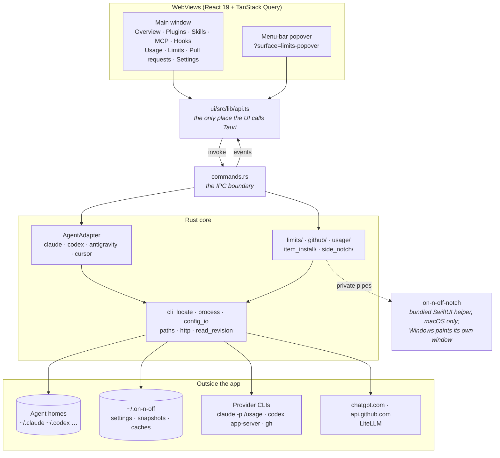
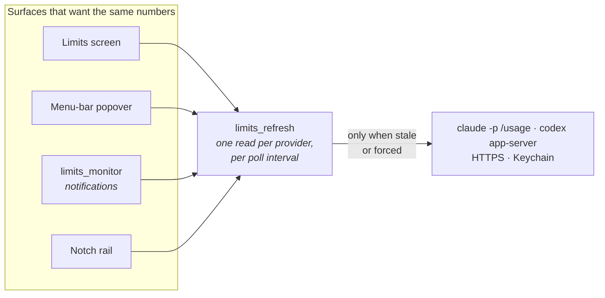
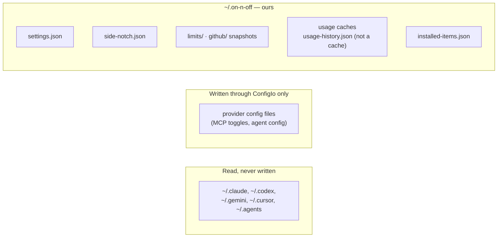

# Architecture

How on-n-off is put together, for orientation.

**This is not a source of truth. The code is.** These notes and diagrams exist so you know where
to look and which pieces talk to which; when they disagree with `src-tauri/` or `ui/`, the code is
right and this file is stale. Fix it in passing or leave it — never "fix" the code to match a
diagram here.

Repository safety and workflow rules live in [AGENTS.md](../../AGENTS.md).
Build commands, testing, visual proof and implementation conventions live in the
[development guide](../development.md).

## What it is

A Tauri 2 desktop app for Windows and macOS (Apple Silicon) that reads what your coding agents —
Claude, Codex, Antigravity, Cursor, Muse — have on disk, and shows it in one place: installed plugins,
skills, MCP servers, the hooks a provider would run (Claude and Codex, listed and never run),
token usage and cost, subscription rate limits, and your GitHub pull requests. It is
overwhelmingly a **reader**; the write boundaries are in [Data safety](../../AGENTS.md#data-safety) and
the [account ownership guide](accounts.md).

## The shape of the process

Two things to hold onto:

- **`commands.rs` is the only door.** The UI reaches Rust through `$lib/api`, which reaches
  `commands.rs`, and nothing else. Feature components never invoke Tauri directly.
- **The notch is not a WebView.** On macOS it is a bundled Swift helper in its own process: Rust
  owns its settings and feeds it snapshots over bounded private pipes, and it draws and reports
  back typed actions. No credentials cross that pipe and it opens no listener. On Windows there is
  no helper — the app paints a layered overlay window itself over in-process channels.

## Reads, and why they are shared

Almost every screen is a view over an expensive read: spawning `claude -p /usage` or
`codex app-server`, unlocking the Keychain, a GraphQL round trip, or a scan of transcript files. Several surfaces want the same read
at the same time, so each such read is cached once per process and shared.

The same pattern holds for pull requests (`github` + `github_monitor` + the notch's PR cell). The
consequence — that a surface holding its own copy has to be told when another one refreshes — is
the subject of [shared-reads.md](shared-reads.md), and it is the part most easily got wrong.

## Feature subsystems

Each is a directory under `src-tauri/src/`. What follows is only enough to know which one you
want; the guides it links and the PROVIDERS.md rows hold the detail, since the source carries no
comments.

| Subsystem | What it does | Notable |
| --- | --- | --- |
| `{claude,codex,antigravity,cursor,muse}.rs` | Provider adapters behind `AgentAdapter` | Every provider difference in behaviour belongs here; each provider's static facts are its row in `provider_catalogue.rs`. Layout per provider is in `PROVIDERS.md`. |
| `scanner.rs`, `plugin_meta.rs`, `mcp.rs` | Plugins, skills and MCP servers for a provider | Feeds Overview, Plugins, Skills, MCP. |
| `usage/` | Token and cost aggregation from transcripts, and the usage kept after they are deleted | Read-only on agent homes. See below. |
| `limits/` + `limits_refresh.rs` | Live subscription rate limits | Provider problems come back as a `status` on the DTO, never an `Err`. See below. |
| `github/` + `github_monitor.rs` | The Pull requests screen and its CI notifications | Not a provider, not behind `AgentAdapter`. See below. |
| `item_install/` | Installing skills/subagents from a GitHub marketplace | The only substantial writer. Atomic placement plus a provenance registry at `~/.on-n-off/installed-items.json`, so upstream changes stay visible after the user edits their copy. |
| `side_notch/` | The notch overlay, macOS and Windows 11 | See [side-notch.md](side-notch.md). |
| `monitor.rs` | Shared polling/notification plumbing | `limits_monitor` and `github_monitor` are both built on it; they poll while the window is hidden. |

### Accounts

The opt-in [account manager](accounts.md) saves protected renewable profiles and explicitly changes
the default native CLI login. Active credentials remain native-owned. Inactive profiles never
refresh in the background. Config, plugins, MCP settings and sessions are preserved.

### Limits

Each provider is read the way that provider intends, and the signed-in login is renewed only by the
provider's own client:

- **Claude** — run Claude Code's own usage report, `claude -p /usage --safe-mode` (with
  `--no-session-persistence --output-format stream-json --verbose`), for the user's own login as
  Claude Code resolves it from `CLAUDE_CONFIG_DIR` and `CLAUDE_SECURESTORAGE_CONFIG_DIR`, but in a
  config dir of on-n-off's own (`~/.on-n-off/claude-usage`), because the report also scans every
  transcript its config dir kept that week (`limits/claude.rs`, `limits/claude_cli.rs`). Claude
  Code reads its own login, renews it when it has to, and asks Anthropic's usage endpoint without a
  model turn; the read opens no Claude credential, and on-n-off sends nothing to Anthropic.
  `--safe-mode` keeps the login but starts none of the user's CLAUDE.md, skills, plugins, hooks,
  MCP servers or custom commands, which every poll would otherwise start; a Claude Code too old to
  know the flag is not run at all, and the card asks for an update. The card is the account the
  user's own `.claude.json` `oauthAccount` names before the read, which must still name it after,
  and its plan comes from that record, not from the copy Claude Code keeps in on-n-off's dir. That
  copy also files Claude Code's usage cache under whichever account first read there, and Claude
  Code answers from that cache for any login, so a read first removes the dir when its copy names
  another account than the user's record, and a read the account changed under removes it after.
  When there is no report, `claude auth status --json`, which reads only what is stored, tells a
  signed-out config dir from a report that could not be had.

  Because the read is Claude Code's, so is the renewal. The access token lives eight hours and
  Claude Code renews it whenever it runs, which each poll does, under its own refresh locks.
  on-n-off holds no Claude token, takes no refresh lock to renew and sends no grant; the one writer
  it keeps in `accounts/claude_store.rs` serves the account switch and the saved accounts' homes.
  Claude Code's report has no saved resets and no subscription status, so a Claude card shows
  neither.
- **Codex** — launch the official `codex app-server` and call `account/read` plus
  `account/rateLimits/read`. Codex owns its own login and refresh; on-n-off reads only
  `account_id` metadata from the app-server's confirmed home. The same read reports banked
  rate-limit resets (`rateLimitResetCredits`). Spending one is the only write Limits makes:
  `account/rateLimitResetCredit/consume`, from an explicit click on the signed-in account's card,
  after checking that the native login is still that account, and never while an account change
  holds the Codex activity lease. The card always asks first, and above 5% of the current limit
  left, or the lower share the account's banked reset alert names (`resetSpendLimit`), or with
  no telling how much is left, it warns before the spend rather than refusing it. An automatic
  spend is held to its alert's share (`ResetSpend::Automatic`, carrying the `SpendShare` only an
  alert gives): it reads the limit again in the same app-server session and refuses above it, or
  when it cannot tell (`SpendShare::allows`). A shared forced read follows every attempt that got
  past that lease, a failed one included, since a request that timed out may still have reached
  Codex; and the card reuses one idempotency key until Codex gives a definite answer, so a retry
  cannot spend a second reset.

  A **banked reset alert** (turned on from a Codex card's menu and listed in Settings) notifies,
  or uses the reset automatically. One module, `reset_alert.rs`, owns the rule end to end and does
  no I/O: the alert as the settings keep it (`ResetAlert`), its defaults and the bounds the
  settings clamp applies (`keep_within_bounds`), how much of the limit is left (the fullest weekly
  or session window), when a reset is worth using, once per weekly cycle, when a waiting spend
  falls due, the share an automatic spend is held to, and the wording of every notification.
  Given a poll's readings, the alerts, the monitor's saved state and the time, `reset_alert::plan`
  returns what to do: the poll's offers, which once the state is saved tell the alerts that only
  notify and schedule the automatic ones (`Offered::commit`), and the waiting spends that fell
  due, each to spend at its alert's share or to keep with the notice that says why.

  It offers the reset when two polls in a row, each a newer reading of the signed-in account in
  the same weekly cycle, find it at the alert's share or below, with its weekly window at least
  the alert's hours from renewing and a banked reset that has not lapsed. It offers once per weekly
  cycle, which a spent reset starts anew. A cycle is the weekly window's reset time, and two within
  two seconds of each other are the same cycle: Codex reports that time to the second, the same
  window's time can differ by a second or two from one response to the next, and a remembered
  window can spell the same instant differently, all of which an exact match took for a new week.
  The tolerance is `ResetInstant::same_cycle_as` (`limits/window.rs`), the one the Codex sessions
  merge matches a window by and the limits monitor compares by, and the saved cycle stays the
  string the reading carried; one that does not read as a time is another cycle. The alert never asks whether usage
  dropped: a cycle is its reset instant alone, since an account can be low again in the next one. An automatic alert's offer is a notification that the reset will be used in ten minutes. When that
  time comes the reset is used only if a fresh read still finds the signed-in account low in the
  same cycle; a read that fails, or could not ask Codex at all (no `codex` found), leaves it
  waiting, while one that finds nobody signed in, or an API-key login, keeps the reset as no longer
  needed. The rule tells them apart by the typed failure of the signed-in read (`ReadFailure`),
  which the shared cache serves with the cards it read (`limits_refresh::read_served`, one `Served`
  per provider) and the monitor hands the rule (`codex_now`), since the card alone reads signed out
  either way; and one found more than fifteen minutes late,
  as after sleep, is kept. A spend that fails is not tried again.

  `limits_monitor` is the loop that does the I/O around the rule (`poll_once`, over a small `Io`
  trait its tests fake). It polls while any alert is on, reading only the providers that bank
  resets (`WITH_BANKED_RESETS`, Codex) when limit notifications are off (`watched_providers`) and
  reading that provider (`BANKED_RESETS_PROVIDER`) afresh when a spend is due. It saves
  its state, in its own file, before it tells anyone or schedules anything, and rolls the state
  back when the save fails, so the offer is made again. It spends through the same
  `limits_refresh::consume_codex_reset_credit` a click uses and says what came of it either way.
  Until then the account's card shows the waiting spend with a Cancel (`pending_reset_spends`,
  `cancel_reset_spend`, announced as the `limits:reset-spends` shared read), and a reset used by
  hand clears it (`spend_reset_by_hand`). A waiting spend lives in memory only, apart from the
  monitor's saved state, so quitting on-n-off cancels it.

  The UI restates the rule's numbers in `ui/src/lib/appSettings.ts`: the 5% cap, a new alert, the
  form's bounds, the ten-minute delay and an alert's share. `ui/src/lib/resetAlertRule.test.ts`
  checks them against `src-tauri/src/reset_alert/fixtures/rule.json`, which a Rust test keeps
  equal to what the rule does. The card's own "how much is left" (`usageLeft`,
  `limitPresentation.ts`) counts a window past its reset as 0% used, as every surface reads a
  window at an instant (below), because a reading ages on screen; the rule judges live readings
  and does not.

Every quota window is built in one place, `limits/window.rs`. A reader maps its provider's answer
to `QuotaWindow` facts (id, scope, length, used percent, reset instant) and nothing else;
`QuotaWindow::into_dto` decides the kind, the label, the meter's range, the reset's spelling and
`windowSeconds` (the rules are in the Common shape of [PROVIDERS.md](../../PROVIDERS.md)), and
`QuotaWindow::idle` is the unused window a provider leaves out while it has not started (Muse's
five-hour window). What a surface does with a window beyond its kind travels on the window, set by
the reader that understands the payload: its `role` (the side notch's inner ring, Claude's Fable
week) and whether it starts with the first message, which the module reports only while the
window is unused and has no reset. The notch and the card read those fields and never a label or
a provider. A reading's plan is the reader's; its label and the capacity the card order weighs
are `plan::describe`'s (`limits/plan.rs`), worked out where the window rules apply and never filed.
Shared Limits code asks a provider's Limits facts (`AgentId::limits_facts`, provider catalogue
below) rather than naming it: a saved profile's legacy reading (`SnapshotStore::remember`), what a
remembered file changes as it loads (`StoredSnapshot::into_dto`), whether a read asked about credits
spent or the subscription term (`limits/reading.rs`), whether session rollouts are merged
(`limits::read_limits_in`) and whose banked resets the monitor and the alert follow
(`BANKED_RESETS_PROVIDER`, the one provider a compile-time check allows). The plan's label and
capacity hold by construction: `keep_remembered` drops whatever either reading carried and works
them out again from the plan it kept.

Every window that leaves `limits/` is within 0–100, since no surface can draw a meter outside it:
each draws such a window as unreadable, a dash, and the macOS helper used to refuse the whole
message for one, which blanked the notch. Three clamps share that job, and each governs its own
path:

- `QuotaWindow::into_dto` clamps every window a reader builds, the one the Codex sessions merge
  advances included, so a fresh window is in range before anything else sees it.
- `window::keep_in_range` in `StoredSnapshot::into_dto` is the only clamp on what was read from
  disk: a remembered reading an older version wrote, or a file edited by hand, is clamped as it
  loads, while the file keeps what was written. Removing it would let one old file blank the notch.
- `window::keep_in_range` in `pipeline::finish` is the outer guard on every read, signed-in or
  saved, and clamps the workspace-credit share a read computes.

What a window reads at an instant is decided once, in `limits/window_at.rs`: `WindowAt` (`of` a
window, `of_share` a workspace-credit share, in its `instant` child, which only the Windows painter
and tests compile) given the window and the time. Its reset cycle is decided once: pending until its
reset instant, renewed from it, and without a reset idle when its reader says the window starts with
the first message, else unknown. The flag is set only through `window::unstarted`, so the surfaces
trust it and never check the usage again. Its used now is 0 once renewed, and none when its used
percent is not a number or lies outside 0–100, which every surface draws as a dash and an empty
meter in the unreadable ink, and a screen reader hears as "Usage unavailable". It is reached only at
100% used. The figure behind the percent text is 100 only then, so 99.5% reads "99%"; a sliver under
1% reads "<1%" and counts as 1; otherwise the percent is rounded, a half up. That figure is what the
card's meters tell a screen reader and what the banked reset's confirmation says is left. The meter's level
is the base ink up to 70%, a blend toward the trip red eased by the square root of how far it is
through 70–90%, and the trip red from 90%. The reset note names the reset instant in the local zone,
a window's as a weekday and a 24-hour clock (`Mon 14:00`), a share's as a date (`Dec 1`); a window
without one says "Reset time unavailable" and an idle one says it starts with the first message,
where a share without one says nothing. The card writes the note in full ("resets in 2d 3h · Mon
14:00", "reset 1h ago · Mon 14:00", "Starts with your first message"); both notches drop the
countdown, which their popover's row has no room for, and shorten the idle note ("Resets Mon
14:00", "Reset Mon 14:00", "Starts with first message"). The limits monitor asks the same
module whether a window is reached and how a notification words a percent, so "reset from 99% to
<1% used" reads as the card does.

The module does no I/O and reads no clock: the Windows painter is given the time by its window, and
the drawers that redraw between reads ask it again. The card restates the rules in
`ui/src/lib/windowAt.ts`, with the meter inks beside the levels, and the macOS helper in `NotchCore`
(`Quota.cycle`, `WorkspaceCredits`, `meterLevel`), since each redraws on its own clock. All three read the cases in
`limits/window_at/fixtures/window-cases.json`, pinned to one instant and one time zone: the Rust
tests assert every field but the card's wording, `windowAt.test.ts` every field but the notch's,
and `NotchCoreChecks` what the helper draws. A row names each surface's wording (`card`, `notch`), so
a rule or a word changed on one side fails until the others follow.

Reset times are compared only as `ResetInstant`s, parsed from a window's `resetsAt` once. The type
itself compares and orders by the exact instant, so equality a struct derives and any sort stay
exact; the tolerance lives only in `same_cycle_as` (two instants within two seconds are one cycle)
and `later_than` (later beyond that), because Codex reports a window's reset to the second and the
same window's can differ by a second or two from one response to the next. Whether a window's
cycle turned over between two observations is `cycle_turned_over`: its reset instant is later than
the saved one, or the saved one has passed by the new observation's time (an idle window reports
none), and in either case its usage dropped by more than half a point. The limits
monitor's reset notice is that rule; the banked reset alert's cycle is the reset instant alone
(above).

Saved profiles are read beside the signed-in account (`accounts/usage.rs`). A saved Claude account
is read in its home ([accounts.md](accounts.md#homes)) by the same Claude Code report, expecting the
profile's identity (`limits/claude_cli.rs`); a Claude login still in the vault, one the last read
could not move into its home, is never sent. A saved Codex account is read by Codex's reader, which
the accounts adapter dispatches (`Adapter::read_usage`): the backend body app-server itself reads,
`wham/usage`, asked over HTTP with the profile's access token (`limits/codex.rs`), since running
app-server for a saved profile would write its credential to disk. Neither renews a login itself:
Claude Code renews a home's login, a Codex login on-n-off owns renews before its read, and one it
does not own is never renewed. A saved read tells a refused login, one that now signs in as another
account and a rate limit apart (its read outcome, below), and the poll backs off accordingly: a
login refused, or now signing in as another account, waits for a new login, in the vault or in its
home alike, and the profile's login state says so, on the account list and on its Limits column entry
([accounts.md](accounts.md#login-state)); any other failure
waits the Limits failure backoff (`limits_refresh::failure_backoff`, [shared-reads.md](shared-reads.md#the-mechanism)),
or a rate limit's Retry-After when that is longer. Every card a
saved poll produces says so (`saved_profile`), which is how the UI knows a remembered reading from a
saved profile read live.

What a read comes to is decided once, by the **read outcome** module (`limits/outcome.rs`). Every
reader only detects: it hands back the account it knew before reading (`Read::account`, the one
the login on disk names) and either its answer or one failure of a closed set (`ReadFailure`): not
installed, signed out, unsupported (an API-key login, an account type, unfinished billing, an
inactive subscription, a provider with no limits), a refused login, another account, an account
changed during the read, a rate limit with its reset, a request that failed with its cause, an
answer that observed nothing, or unavailable with the source's own reason.
Every message comes from one table, `message`, matched on the read context and the failure and
filled with the provider's facts (display name, CLI, client and vendor, from the provider
catalogue): the signed-in card (`Context::SignedIn`), a saved login (`Context::Saved(Saved::Login)`),
an account home (`Context::Saved(Saved::Home)`) and a login's verification (`Context::Verify`).
Around it, one function per read context gives its caller the rest:
- `signed_in` makes the signed-in card: its status (signed out for not installed and signed out,
  unsupported, otherwise failed), its message, and its account. Every failure after the account is
  known keeps it, so the account's remembered reading stands in on the current card and no second,
  remembered card appears for it; only not installed and signed out, where nobody is signed in,
  name no account, and an answer that observed nothing keeps the account and name that answer
  carried. Beside the card it returns the read's `NativeOutcome`: the typed failure and the login
  the read was made for. The shared cache derives from it whether the read counts toward failure
  backoff (a failed card does) and how long a Retry-After holds the next read, and serves the
  failure with the cards.
- `saved` gives a saved poll its `SavedVerdict`: the message, how long a Retry-After holds the
  next poll, and whether the login is parked until a new one, and as what (`Parked`): refused, for
  a login the provider refused or found signed out, or another account. A login in its home parks
  as one in the vault does. A saved card that failed always reads failed.
- `saved_card` and `first_usage` decide acceptance, a reading with something observed for the
  expected account. They are the only makers of `Accepted`, the type the accounts adapters'
  `read_usage`, an account home's `read_usage` and a sign-in's `first_usage` hand back, so the saved
  poll and the sign-in publish what they get without checking it again.
- `verified` answers a login's verification: verified by an answer for its own account, including
  an inactive or unpaid subscription, and otherwise refused in the table's words.

A read that knows the account but not its name (Codex's, before app-server answers) keeps the name
its remembered reading has (`SnapshotStore::remember`).

Because each CLI stores one login at a time, successful reads are remembered per account (numbers
only, under `~/.on-n-off/limits/`) so an account the user has switched away from stays visible
with its last observation time rather than vanishing. What a later read keeps of that remembered
reading, after it answers and after it fails, is one policy, in `limits/reading.rs`, which a read
applies once, keeping from its account's file as it writes over it (`SnapshotStore::remember`).

Which cards a provider shows is the Limits read's: the shared read serves each provider's **Limits
column** (`limits_refresh::read_column`, built by `limits::column` from the cards it read), one
entry per account. It folds the legacy history a scoped account replaced into that account's entry,
by the one rule Forget also uses (`snapshots::supersedes`), lists each saved profile no read
answered for as an entry of its own (`unread`), and carries beside each entry its saved profile and
its category, from the provider's roster the cache keeps beside the cards; the saved profile of the
account the native read names is the active one. The column is built only when the UI asks for it
(`read_limits`), and the UI types it `LimitsColumnEntry`. Both surfaces render that column
through one card model, `limitColumn({ provider, entries, nativeLogin, now })`
(`ui/src/features/limits/limitCards.ts`), so the popover lists the same accounts, counts and copy as
the screen; only the screen's account manager adds the account list's word on who is signed in
(`nativeLogin`). The Rust consumers (the notch, the monitor) read only the signed-in card and keep
the cards as read (`Served::entries`). [accounts.md](accounts.md#the-limits-column) has what the
column reads and what it leaves out to open no credential.

On screen, what a card offers is decided in one place: the card action plan
(`ui/src/features/limits/cardActionPlan.ts`), a pure function of the card model, the account list's
state (or none, for a provider without an account manager), the card's own archive and removal in
flight and whether an automatic banked reset is waiting for its account. It returns the ⋯ menu in
order and the footer: the main button (Cancel sign-in, Sign in again, Archive account, Save
account, Sign in or Use account), the Switch anyway confirmation, and the banked reset controls.
Whether a saved login must sign in again is the profile's login state alone, for every provider
(`LimitCard.login`, `ui/src/features/limits/loginState.ts`): ended, refused or another account put
Sign in again in the main button's place, and for a refused login or another account the menu
keeps Use account, since the client that owns the login may still renew it once it is used; a
missing login offers Sign in. The same state gives the card its sign-in tag and, when it asks for
a new sign-in, its message in place of the read's.
Each entry carries what its handler needs, `useCardActions` binds a handler to each and
`LimitCardFrame` draws them. The banked reset controls depend only on the provider's feature and
the card's reading, never on an account manager, and a waiting automatic reset keeps its countdown and Cancel while Switch anyway is
asked on the same card; Use banked reset gives way to that confirmation. Archive account is one
action wherever it shows: in the menu of a card that is not signed in, and also as the footer's
main button once a saved Codex subscription has ended without renewing.

Every action decision reads the card's one signed-in state (`LimitCard.signedIn`). The card model
takes the word of the provider's own read, which leads the column (`LimitCard.leads`: the read's
`currentAccount`), when it names an account; the column marks active only that account's saved
profile, so the profile's `active` never says otherwise and the card model does not read it. The
account is `confirmed` once the account list names it as the native login (`nativeObservationId`)
and is not being read again, `unconfirmed` until then, as after a switch, and `no` otherwise. Save
account, Sign out and Use banked reset wait for `confirmed`. Without an account list the read's word
stands as confirmed; the backend still checks the native login before a spend. A read naming no
account still leads its column but signs no card in, and a saved profile no read answered for
never leads. The plan reads `leads` for two decisions only:
Use banked reset is offered only on the provider's own live read, whose numbers a spend acts on,
and Archive account never takes Use account's place on it.

### Pull requests

One GraphQL request per refresh reads authored (scoped), review-requested and assigned PRs with
their CI rollups and merge state. Problems come back as a `status` + `hint` on the DTO, backed by the
last snapshot under `~/.on-n-off/github/`. Auth is borrowed from `gh auth token`, memoised per
app run, re-read once on a 401, never persisted.

The merge fields — `mergeable` for conflicts, `mergeStateStatus` for ready/blocked/behind,
`mergeQueueEntry`, `autoMergeRequest` — are scalars and single objects on purpose, so the request
costs about 2 rate-limit points. They are interpreted in exactly one place, `github/merge.rs`:
`classify` fills `mergeKind` on the DTO, the screen only maps kinds to badges, and the monitor's
`Seen` record takes its unknown-aware facts from the same module. Snapshots written before those
fields existed load with `Unknown`/`false` defaults.

The monitor notifies on CI, review-decision, conflict and ready-to-merge transitions of the
authored PRs the screen lists — the scoped first page of fifty. It is opt-in and polls while the
window is hidden.

### Usage

Transcript aggregation, entirely read-only, with caches under `~/.on-n-off/`. Prices come from
LiteLLM's public table (`usage/pricing.rs`), cached for a day. A scan that meets a
priceable-looking model the table lacks lets the next scan re-fetch after an hour, and the Usage
refresh button re-fetches at once. The summary cache key carries the table's fetch time, so a new
table can never serve costs computed from an old one.

The summary and the background fold read transcripts the same way, through `usage/sources.rs`,
under the one lock every read and write of the usage files takes. `Sources::open` walks the roots
and brings the source index up to date, which is enough to answer the summary's cache check before
any record is read. `Sources::read` then returns the records, from each transcript's cached parse
where it still holds, and `Sources::finish` saves the scan cache, pruned with the watermark it is
given, and releases the lock. Every path out of a read runs it, a summary served from the cache
included, so what bringing the index up to date parsed is never parsed again.

Three reading rules carry the accuracy, each pinned by a test:

- **One record per copy group, its richest copy, before anything is counted.** Claude Code writes
  one line per content block of a message, all under one `message.id` and `requestId`, and the
  early lines carry a partial `output_tokens` (often 1 for a thinking block); a resumed or forked
  session copies messages into other transcripts too. A Codex rollout listed under both roots (a
  rename between the walks, or a stale entry after an incomplete walk) repeats its session's events
  at the same instants. `transcripts::richest_copies` collapses both over every file of the scan,
  so the totals and the session counts follow the copy that is counted.
- **Cache writes by lifetime.** A one-hour Claude cache write
  (`usage.cache_creation.ephemeral_1h_input_tokens`) is priced at LiteLLM's
  `cache_creation_input_token_cost_above_1hr`, 2x input when the table omits it; a five-minute
  write at `cache_creation_input_token_cost`.
- **Archived Codex sessions still count.** Codex moves an archived session's rollout to
  `~/.codex/archived_sessions/`, mtime intact; it is scanned as a second Codex root under the one
  Codex source.

A transcript still being written while it is read (a live session) counts what it holds at that
moment instead of dropping out of the total. A read parses a file up to twice and reports whether
its size and mtime held still (`TranscriptRead`, in `usage/sources/source_index.rs`):

- A file that held still but no longer matches the inventory counts what it holds now.
- One that kept moving, or went away after a parse, counts the last parse that succeeded.
- One no parse succeeded on counts its last cached parse, if there is one.

None of these parses is cached, and the summary is not stored as final, so the next refresh reads
the file again.

A model the table has no price for is shown as **unpriced**, never as `$0.00`: its tokens count
and its cost is left out of the total, which says how many models it leaves out. Any change to
what a transcript parses to bumps `USAGE_TRANSCRIPT_PARSER_VERSION`, which invalidates every
cache, so what the transcripts still hold is re-read from them; nothing in an agent home is ever
written.

Claude Code sets a replaced transcript aside as `<session>.jsonl.superseded-<ms>` rather than
overwriting it. Those are read too, so a turn a rewrite dropped still counts; the turns both copies
hold collapse to one.

#### Usage history

Claude Code deletes transcripts after `cleanupPeriodDays` (30 by default), so a count read only
from transcripts shrinks as they go. `usage/history.rs` keeps what they held in
`~/.on-n-off/usage-history.json`. That file is user data, not a cache: once the transcripts are
gone nothing can rebuild it.

- **What is kept.** Records older than a week are folded into rows keyed by 15-minute UTC slot,
  provider, model, whether the provider reported the cost, and whether the request's input passed
  200k tokens. A row holds token totals, record count, summed reported cost and the session ids of
  its slot: numbers, model names and session ids, never conversation content. Every UTC offset in
  use is a multiple of 15 minutes, so a slot never straddles a local midnight or hour, and prices
  are linear per model, so a row reads exactly like its records in any time zone and with any
  newer price table. The 200k flag keeps a later long-context price possible for folded usage.
- **The watermark.** Rows cover every record before `foldedThroughMs`; a read counts a
  transcript's records only from it on, so the copies a resumed session makes of folded messages
  are not counted twice. It moves forward only, to the UTC midnight a week before now, so a fold
  runs at most once a day. A transcript whose records all sit below it (or that was last written
  36 hours before it) leaves the scan cache and is never parsed again, even after an index rebuild.
- **When it folds.** Only in `usage/folding.rs`'s background thread, 90 seconds after launch and
  hourly after that, so usage is kept even if the screen is never opened; a Usage read only reads
  the history. A fold needs every root walked and every transcript that may hold a record in range
  read, now or from its cached parse; a transcript still being written counts what it holds,
  since its records old enough to fold were written days ago. Otherwise it waits for the next
  check. A transcript that cannot be read holds it back until it is a week past the cutoff and has
  failed on two checks in a row: by then it never will read, and waiting longer would let the
  provider delete the rest.
- **Summaries.** The summary cache key carries the history file's size and mtime, so a fold or a
  clear never serves a summary counted with the history before it, and a summary counted while
  the file did not read is not stored.
- **When the file does not read.** It is never written over: the previous good file is kept as
  `.bak` and read in its place, and the unreadable one is copied aside under a new name before
  the new file replaces it. A file a newer on-n-off wrote, or one with no readable backup, is left
  alone; Usage counts transcripts alone until the user clears it. A history is written only once
  it reads back as itself, and a file whose rows are out of slot order or at or past its
  watermark does not read.
- **Limits.** A parser fix reaches only records newer than the watermark. A transcript that shows
  up later holding records older than it (copied from another machine, restored from a backup)
  is not counted. A wall clock far ahead at a fold sets the watermark ahead with it, hiding usage
  recorded after the clock is corrected until real time passes it; Clear recovers. A provider set
  to delete transcripts sooner than about nine days (Claude Code's `cleanupPeriodDays` under 9)
  deletes them before they are old enough to fold. Settings shows
  how far back the history reaches and can clear it; clearing forgets what only the history held
  and counts what the transcripts still hold again.

## App settings

`settings.rs` owns `~/.on-n-off/settings.json`. It reads the file one field at a time, so a
setting it cannot read falls back to its default and leaves the rest, normalises what it read, and
validates and normalises again on save. `load_app_settings` and `save_app_settings` carry the whole
document, and a save replaces the file with it.

In the UI one module owns that document in each window: `AppSettingsProvider` and
`useAppSettings` (`ui/src/lib/useAppSettings.tsx`) over `createAppSettingsDocument`
(`ui/src/lib/appSettingsDocument.ts`). The main window and the menu-bar popover each mount their
own, so they share its code and never its state.

- **Verbatim.** The document is held exactly as Rust returned it, keys the UI has no type for
  included, so a setting added on the Rust side survives the next save from a UI that does not
  know it. The UI never re-normalises; Rust already has.
- **One patch path, in order.** Every caller changes settings with `patch`, a partial document or
  an updater given the latest one. Loads and saves run one at a time in the order asked, and each
  change is applied to the document the save before it returned, so two quick changes both land
  and a load answers with what every change asked before it saved. A change to a list or a map
  (hidden providers, binary paths, GitHub scopes, a reset alert turned off in Settings) is an
  updater, so two quick edits to the same one both land too. Limits' reset-alert form still hands
  over the whole map it rendered.
- **Defaults are a placeholder.** `DEFAULT_APP_SETTINGS` is shown until the first load answers. A
  change made before then waits for it, and one made after a failed load reads the document first
  and fails rather than save the placeholder over the user's file.
- **One failure path.** A failed save resolves `null` for its caller and is reported once to
  `onSaveFailed`, which the session turns into its trip-log note; Limits' reset-alert form says it
  could not save the alert.

The two sides agree on the document's keys through fixtures Rust writes:
`src-tauri/src/settings/fixtures/app-settings.json` (every setting away from its default) and
`app-settings.default.json`, which Rust's tests assert it serialises, and
`ui/src/lib/settingsContract.test.ts` checks against `AppSettings` (at the type level),
`DEFAULT_APP_SETTINGS` and `ResetAlert`. `NotchSettings` has the same key check through
`src-tauri/src/side_notch/model/fixtures/notch-settings.json`. The dev mock saves as Rust does, keeping
only the fixture's keys, so a setting added only in TypeScript snaps back in a `?mock` build too.

## Cross-cutting plumbing

| Module | Why it exists |
| --- | --- |
| `cli_locate.rs` | A GUI app does not inherit a terminal's `PATH`. Builds one merged search list and hands it to spawned CLIs as their `PATH`. |
| `process.rs` | Child-process draining with a hard deadline; stdout and stderr drained concurrently, or a full pipe deadlocks. A cancellable wait also hands its caller each stdout line while the command runs (a sign-in's page). |
| `json_line_session.rs` | A provider CLI kept running and spoken to in line-delimited JSON-RPC: `codex app-server`. See below. |
| `config_io.rs`, `backup.rs` | Every provider-config write: backup → atomic replace → validate → rollback. |
| `paths.rs` | Agent homes and app data paths. `ON_N_OFF_HOME` redirects them in a running app; a test build has no user home, so tests inject their roots. `paths::equivalent` decides whether two paths name the same directory (a CLI's reported home against the one on-n-off gave it). |
| `read_revision.rs` | Tells every surface when a shared cached read has been replaced; in the UI, `ui/src/lib/sharedReads/` holds one module per source and one listener per window. See [shared-reads.md](shared-reads.md). |
| `http.rs` | Outbound HTTPS, plus the loopback test server the limits and github suites drive. |
| `dto.rs` | The serialized shapes crossing the IPC boundary. Changing one is a compatibility event. |
| `provider_catalogue.rs` | Every provider the app knows and one row of static facts each. Every Rust and UI provider list is drawn from it; the Swift helper's is still kept by hand. See below. |

### Provider catalogue

`AgentId::ALL` lists every provider in tab order, and `AgentId::facts` gives each one row: key,
display name, binary and aliases, its Limits facts if it has a Limits reader (`LimitsFacts`, which
`AgentId::limits_facts` reads as `LimitsFacts::NONE` for a provider without one), which
`UsageProvider` reads its transcripts, and whether it offers saved accounts. The Limits facts are
what shared Limits code and the card model ask about a provider ([PROVIDERS.md](../../PROVIDERS.md),
Common shape). The row is one exhaustive `match`, so a new
provider does not compile without one; nothing in Rust makes a list name every variant, so a test
walks the variants serde declares and requires each in `ALL` once. `UsageProvider`, the providers
Usage reads, lives beside it, and its own variants are checked against the rows the same way.
`RAIL_ORDER`, the side notch's order, is a literal of `ALL`'s length that a compile-time check
holds to naming every provider; `WITH_LIMITS`, `WITH_SAVED_ACCOUNTS` and `WITH_BANKED_RESETS` are
compile-time filters in `ALL`'s order. A provider string decoded by hand (scan-cache rows, CLI names) goes through
`UsageProvider::from_key` or `AgentId::from_binary`, and one neither knows is skipped, never taken
for another provider. Settings, folded usage and IPC decode providers through serde, whose
lowercase name a test holds equal to the row's key. Usage keys its buckets by `UsageProvider`
itself, so no provider name is parsed back there.

The catalogue is data. Code that does something different per provider stays an exhaustive
`match` in its own module (the Limits reader and its locks and caches, `accounts::adapter`,
transcript directories, session readers, homes, colours), and an agreement test over `ALL` fails
when a fact and that code disagree.

The notch's provider default has two values, kept as found: `NotchSettings::default()` shows the
providers with a Limits reader (`WITH_LIMITS`: Claude, Codex, Muse), while a stored notch document
with no `providers` field shows every provider in rail order. The UI's `defaultNotchSettings()` is a
test and dev-mock helper, not a placeholder the app shows, and keeps every provider in rail order.

#### In the UI

The UI knows the catalogue through a fixture Rust writes:
`src-tauri/src/provider_catalogue/fixtures/providers.json` holds the tab order, the rail order, the
notch default, the providers with Limits and with saved accounts as maps keyed by provider
(`withLimits`, `withSavedAccounts`), each Limits provider's card features (`limitsFeatures`: the
sign-in deadline, subscription term, banked resets and paid reset offer, each the key of the
implementation it turns on or null) and, by key, each row's name, binary and aliases, Limits reader,
Usage provider and saved accounts. A Rust test builds that document from `AgentId::ALL`, `facts()`,
`RAIL_ORDER`, `WITH_LIMITS`, `WITH_SAVED_ACCOUNTS` and `NotchSettings::default()` and asserts the
file equals it. `ui/src/lib/providers.ts` imports the
file at build time and is the one place the UI learns a provider fact: `PROVIDER_IDS` (tabs),
`RAIL_ORDER`, `LIMITS_PROVIDERS`, `ACCOUNT_PROVIDERS`, `USAGE_PROVIDERS`, `LIMITS_FEATURE_ROWS`
(which `LIMITS_FEATURES` in `ui/src/features/limits/limitFeatures.ts` types, and
`limitFeatures.test.ts` holds to the fixture and to the implementations the card model has), `providerLabel`,
`providerBinary`, `providerNames`, `providerRecord` and the guards `isAgentId`, `hasLimits` and
`hasSavedAccounts`. Every screen's provider list, the Limits columns, the Add account menu, the
remembered tab, the mock's agent list and the Usage and Overview sentences that name the providers
whose transcripts were looked for come from these. The Hooks screen's "Claude and Codex only" is
still written out, because which providers read hooks is `readsHooks` on `AgentInfo`, a run-time
fact.

The providers are keyed by their key in the fixture, so `tsc` can compare its keys with the
`AgentId` union (`ui/src/lib/providersContract.test.ts`); orders are arrays, because JSON object
order is not something either side's equality checks. JSON booleans reach `tsc` as `boolean`, so the
narrow unions come from keys too: `LimitsProvider` is `keyof` the fixture's `withLimits` and
`AccountProvider` of its `withSavedAccounts`, and `hasLimits` and `hasSavedAccounts` look a provider
up in the same maps. A provider that gains or loses Limits in Rust changes those unions, so every
record keyed by one (the Limits shared-read table, the dev mock's limits state) stops compiling
until it agrees. Facts Rust does not own are
`Record<AgentId, …>` tables in the same module, so a provider without a row does not compile: its
bar, icon and chart colours; how its plugins and MCP servers are switched (`providerToggles`, whose
MCP row is either a toggle or read-only with the notice the MCP screen shows, and decides Agent
Config's YES or NO); and the display paths Agent Config, the scope bar and the install sheet print
(`providerPaths`). The icons themselves stay in `ProviderIcon.tsx`, an
exhaustive table too, because their SVG paths belong in the screens' chunks and the module is in
the initial bundle. The display paths are the UI's description of where each provider keeps
things; they are not resolved, so a Muse home moved by `XDG_*`, or Muse's Windows folders, still
print as the macOS defaults. The notch helper (`ProviderId` in `NotchCore/Models.swift`) keeps its
own list; `PROVIDERS.md` names it under "When adding a provider".

### JSON-line sessions

Codex's app-server is spoken to through one module, `json_line_session.rs`, which owns the
conversation, so the reader keeps only what is its own: the command, its arguments and
environment, the method names and answer types, the checks on what it is told, and the
normalisation into a reading. A reader describes its CLI as a `Peer`: the name every message
starts with ("Codex app-server") and what to say when the CLI exits before it answers
`initialize`. Lines carry no `"jsonrpc"` member, as Codex expects.

- **One deadline and one line limit per session**, 30 seconds and 1 MiB, so a CLI that stops
  answering or writes an unbounded line fails the read rather than hanging it or filling memory.
  Its stderr is drained to nowhere from spawn and never reaches a message, since a provider's
  diagnostics may be sensitive.
- **Every session opens with its handshake.** `Session::run` sends request 1 (`initialize` with
  on-n-off's `clientInfo`), hands the answer to the reader's check, sends the `initialized`
  notification, and only then gives the reader a `Conversation`, the one thing that can send a
  request. The reader numbers its own requests from 2, so a Codex spend by hand still sends its
  consume as request 4 though it skips the limit read. A request waits for the answer with its id
  and skips everything else the CLI says.
- **An early exit is an old CLI.** A pipe that closes during `initialize`, from a CLI that then
  exits unsuccessfully, is a CLI without the subcommand, and the card asks for an update. That
  includes a request written after the CLI is gone: each line is encoded first and written whole,
  so a broken pipe reads as closed rather than as a failure to encode. Every other failure keeps
  its own message, and a failure the reader decided on (`Failure::new`: a different home, an
  account that changed mid-read, a spend refused) is shown as the reader wrote it.
- **Ending a session** closes stdin and waits for the child to exit until the deadline. A child
  still running then is killed and its drainers are left behind, so a descendant still holding a
  pipe cannot hold the read. A session dropped without ending kills its child too.

Tests drive a reader through `json_line_session::Script`, which replays scripted answers and
records what was sent and received, and the real child through `cli_stub.rs` stubs. A stub that
answers waits for the request line first (`CliStub::awaits_line`) instead of sleeping, so a slow
host cannot let it exit before the request is written and turn the failure under test into a
broken pipe.

## Where the state lives

Snapshots under `~/.on-n-off/` exist so a signed-out account or an offline launch still shows the
last trustworthy numbers rather than an empty screen. They are numbers and metadata — never
credentials.

## Glossary

The words are defined in [`CONTEXT.md`](../../CONTEXT.md). This table says where each one lives in
the code today; a change that moves one updates its row.

| Term | Where it lives |
| --- | --- |
| Provider catalogue | `AgentId::ALL` and `AgentId::facts` (`provider_catalogue.rs`), with each Limits provider's `LimitsFacts` (`AgentId::limits_facts`), the lists kept there (`RAIL_ORDER`, `WITH_LIMITS`, `WITH_SAVED_ACCOUNTS`, `WITH_BANKED_RESETS` and its one `BANKED_RESETS_PROVIDER`), the lookups `AgentId::from_key` and `AgentId::from_binary`, and `UsageProvider` with `UsageProvider::all` and `UsageProvider::from_key`; written for the UI as `provider_catalogue/fixtures/providers.json`, which `ui/src/lib/providers.ts` derives every UI provider list and fact from; the Swift list is outside it |
| Quota window | `LimitWindowDto` (`dto/limits.rs`), built only by `QuotaWindow::into_dto` (`limits/window.rs`) from the facts each reader maps, its `role` and `starts_on_first_message` among them |
| Window at an instant | `WindowAt` (`limits/window_at.rs`, with `reached` and `used_text` for the limits monitor), used by the Windows painter (`side_notch/win_paint.rs`) and `NotchProvider::inner_at` (`side_notch/model.rs`); restated by `windowAt` and `shareAt` (`ui/src/lib/windowAt.ts`) and `Quota` (`NotchCore/Models.swift`), all checked against `limits/window_at/fixtures/window-cases.json` |
| Reset instant | `ResetInstant` (`limits/window.rs`, re-exported by `limits` with `cycle_turned_over` and `Observation`), parsed from a window's `resetsAt`; one cycle by `same_cycle_as`, later by `later_than`; compared by the limits monitor (`cycle_turned_over`), the banked reset alert (`reset_alert.rs`) and the Codex sessions merge (`limits/codex_sessions.rs`) |
| Reading | `Reading` (`dto/limits.rs`), flattened into `ProviderLimitsDto` and the snapshot file; built by `limits/pipeline.rs` |
| Headline window | a card's weekly window, first in the order `pipeline::kind_rank` gives every card (`limits/pipeline.rs`); chosen as `headlineWindow` (`ui/src/features/limits/limitPresentation.ts`) by the card model both Limits surfaces render (`limitCards.ts`), and as `NotchProvider::headline_window_id` for both notches (`side_notch/model.rs`), which the Windows painter resolves with `NotchProvider::headline` and the helper with `Reading.headline` |
| Figure | the optional fields `Reading::has_figures` lists, plus `subscription` and `reset_offer` |
| Account details | `plan` on `Reading`, with the `plan_label` and `plan_capacity` `plan::describe` works out from it (`limits/plan.rs`); a `subscriptionStatus` in a snapshot an older version wrote is ignored when it loads |
| Remembered reading | `SnapshotStore` (`limits/snapshots.rs`); a read keeps from it once, as it writes over it (`SnapshotStore::remember`), by the remember policy, `Reading::keeping` (`limits/reading.rs`); a card shows one as remembered when it is neither `currentAccount` nor `savedProfile` (`presentLimitAccount`, `ui/src/features/limits/limitPresentation.ts`), and an archived one is listed apart |
| Limits column | `ColumnEntryDto` (`dto/limits.rs`), built by `limits::column` (`limits/column.rs`) from the cards a read gives, the provider's `Roster` (`accounts/roster.rs`, owned by the Limits cache and written by the saved refresh and `limits_refresh::roster_changed`) and the sign-in ends the account list read; the active profile is the one the native read names; served by `limits_refresh::read_column` as the `read_limits` command; legacy history folded by `snapshots::supersedes`; rendered by `limitColumn` (`ui/src/features/limits/limitCards.ts`) on the Limits screen and the popover |
| Archived account | `archived.json` beside the snapshots, owned by `SnapshotStore` (`limits/snapshots/archive.rs`); a provider read (`limits_refresh::read_provider`) unarchives its signed-in account, then flags the cards through `limits::mark_archived`, and profiles are flagged by `accounts::list` and in the Limits roster, which archive and unarchive reread and the Limits column flags an unread saved profile by; set by `limits_refresh::set_archived` (the `set_limits_archived` command), skipped by saved polls (`accounts/usage.rs`), and cleared by Forget and the explicit re-adds; split from the other cards by `limitColumn` (`ui/src/features/limits/limitCards.ts`) into `ArchivedAccounts` |
| Signed-in state | `signedIn` on `LimitCard` (`ui/src/features/limits/limitCards.ts`), tested by `isSignedIn`, from the read that leads the column (`currentAccount`, the one entry whose `profile` the column marks `active`) naming an account, confirmed against the account list's `nativeObservationId` (`nativeLogin` on the account controller, `ui/src/features/accounts/AccountManager.tsx`); read by the card action plan and the active dot |
| Card action plan | `cardActionPlan` (`ui/src/features/limits/cardActionPlan.ts`), from the card's `signedIn` and `leads`; bound to handlers by `useCardActions` (`cardActions.tsx`) and drawn by `LimitCardFrame`; a card not read yet offers only `checkNowEntry`, drawn by `PendingCardFrame` |
| Banked reset alert | `ResetAlert` in `AppSettings.reset_alerts`, by account id; the rule (its bounds, offers once a weekly cycle, waiting spends and the share a spend is held to) is `reset_alert.rs`, whose `plan` `limits_monitor.rs` performs; edited by `ResetAlertForm` (`ui/src/features/limits/resetAlerts.tsx`) and listed by `ResetAlertsCard` (`ui/src/features/settings/Settings.tsx`); the numbers the UI restates (`ui/src/lib/appSettings.ts`, `resetSpendLimit` among them) are checked against `src-tauri/src/reset_alert/fixtures/rule.json` |
| Read outcome | `limits/outcome.rs`: `ReadFailure` and `Read`, which every reader returns; the wording table `message` (with `Context` and `Saved`); the per-context mappings `signed_in` (with `NativeOutcome`), `saved` (`SavedVerdict`), `saved_card` and `first_usage` (the only makers of `Accepted`) and `verified`; the wording facts are `LimitsFacts` in the provider catalogue |
| Failure backoff | `limits_refresh::failure_backoff`, asked with each read's own failure count and interval by the shared cache for the native read (`cache_is_fresh`, with the Retry-After floor its `NativeOutcome` gives, held only while the native login is the one it was read for), by a saved profile's poll (`hold_back` in `accounts/usage.rs`, with the Retry-After floor) and by the Codex backend figures' per-account memo (`PerAccount::read_backed_off`, `limits/backend_memo.rs`), which asks with the failures before its latest one, so it starts one doubling behind |
| Native store | as the account switch uses it, `ClaudeNative` (`accounts/claude.rs`) and `CodexNative` (`accounts/codex.rs`), each resolved through its provider's `Adapter` (`accounts/mod.rs`); where the login lives, how it is read and written and any locks around it are `accounts/claude_store.rs` (Claude Code's dirs, Keychain item, credentials file and locks) and `accounts/codex_store.rs` (the file, keyring or auto backend Codex's config selects); `accounts/muse_store.rs` reads Muse Code's device login for its Limits read only |
| Saved profile | `Profile` in the vault's `Database` (`accounts/store.rs`); listed and changed through `Accounts` (`accounts/mod.rs`), and listed for the Limits column in the provider's `Roster` (`accounts/roster.rs`, whose `Roster::of` the account list shares); its usage is polled in `accounts/usage.rs` by one path (`poll`, which attempts, holds and parks a login by its `Generation`) over where the login is kept (`Kept`): in the vault, through the provider's Limits reader (`Adapter::read_usage`: `read_saved_codex` in `limits/codex.rs`, `read_saved_muse`), or in its home (`Home::read_usage`: Claude Code's own report, `read_usage` in `limits/claude_cli.rs`, or Muse's key-mint read); the date its home's sign-in ends is `sign_in_end`, and its card carries `saved_profile` |
| Login state | `LoginState` (`accounts/login_state.rs`), on each listed profile as `loginState` (`ProfileDto`, `accounts::list`), from where the login is kept (`usage::kept`), its `Deadline` (the native store's, a vault login's view, or a home's recorded `SignInEnd`), and, for a profile not signed in (`Standing`), what the saved poll parked (`usage::parked`, kept in memory with the poll's holds by each login's `Generation`, a home's being its `Home::login_stamp`, which reads no secret; `accounts/usage.rs`); the Limits column carries the same state on each entry's profile (`Listed::in_column`, `accounts/roster.rs`), signed in for the served current card's account, its deadline from the ends the account list last read or the recorded `SignInEnd`, and its parked verdict from memory (`usage::recorded_parked`, for the vault login's fingerprint or the home it was parked for, with no stamp), never opening a login; read by the card model as `LimitCard.login` and presented by `signInPresentation` (`ui/src/features/limits/loginState.ts`); the account list reads itself again when an `ending` date passes (`untilSignInEnds`, `ui/src/lib/sharedReads/accounts.ts`) and hands its ends to the column (`Notify::listed`) |
| Account change | `Store::change` (`accounts/store.rs`) with `ChangeKind::Account` (save, remove, use, sign out, in `accounts/mod.rs`), `ChangeKind::SignIn` (a sign-in's publication, `accounts/login.rs`) or `ChangeKind::Recovery` |
| Pull request context | `in_organization` on `GithubPrDto` (`dto.rs`), read from `isInOrganization` (`github/parse.rs`); named `PrContext::of` for both notches (`side_notch/model.rs`), decided once as each row's `tag` by the notch model, which also names the viewer's own personal repository without its owner (`pr_row` and `repo_label`, `side_notch/model/frame.rs`) and drawn by the helper's `PullRequestRow` (`PopoverView.swift`) and the Windows painter's `popover_entries` (`side_notch/win_paint.rs`) |
| Rail cell | `CellData` (`side_notch/model/frame.rs`), decided for both notches by `frame::rail`; a checking cell has no `reading`; drawn by the helper from `Cell` (`NotchCore/Models.swift`, `NotchRailView` and `PopoverView.swift`) and by the Windows painter (`cell_content`, `popover_entries` in `side_notch/win_paint.rs`) |
| Transcript source | `Sources` (`usage/sources.rs`), which owns the source index (`usage/sources/source_index.rs`) and the scan cache (`usage/sources/scan_cache.rs`) |
| Watermark | `Watermark` (`usage/history.rs`) |
| Folded usage | `HistoryStore` (`usage/history.rs`), folded by `usage/folding.rs` |
