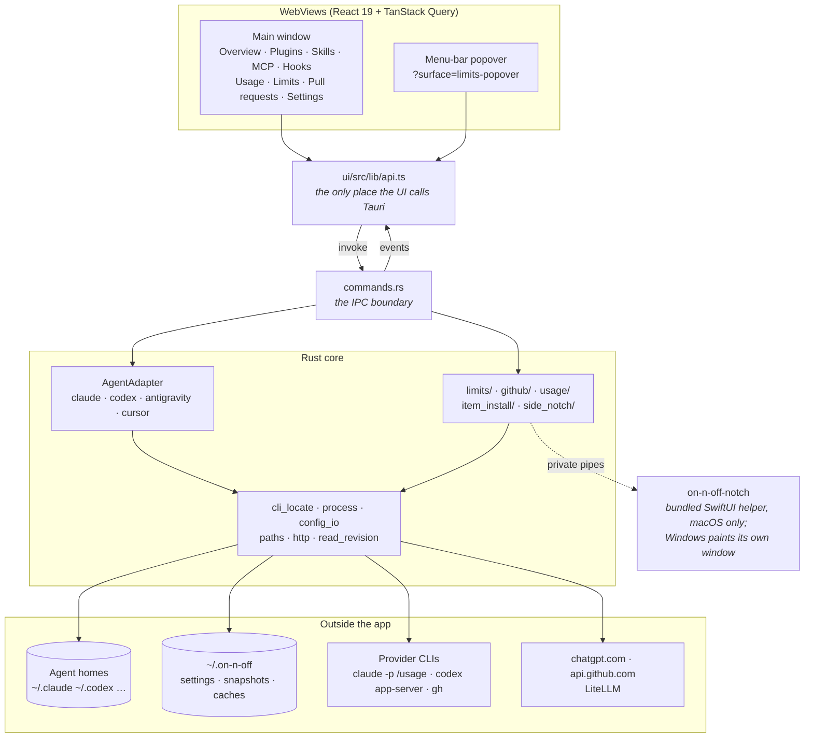
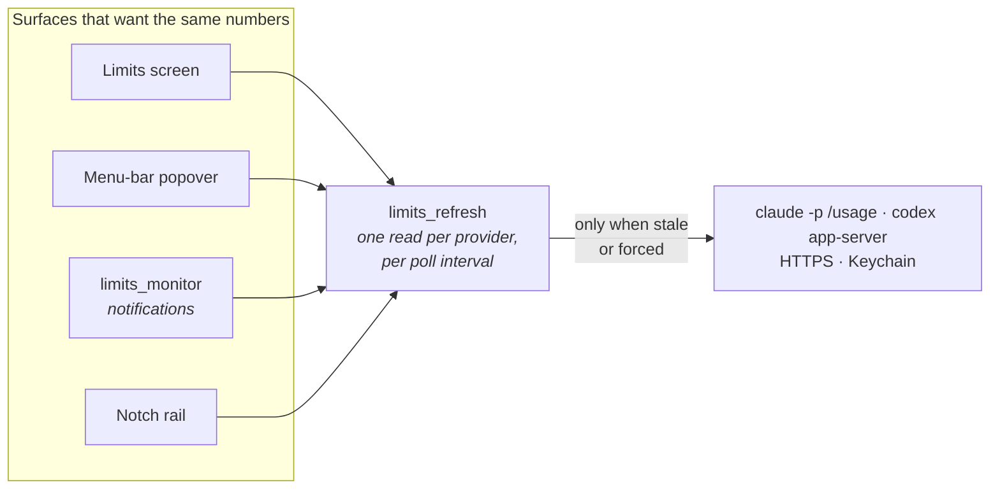
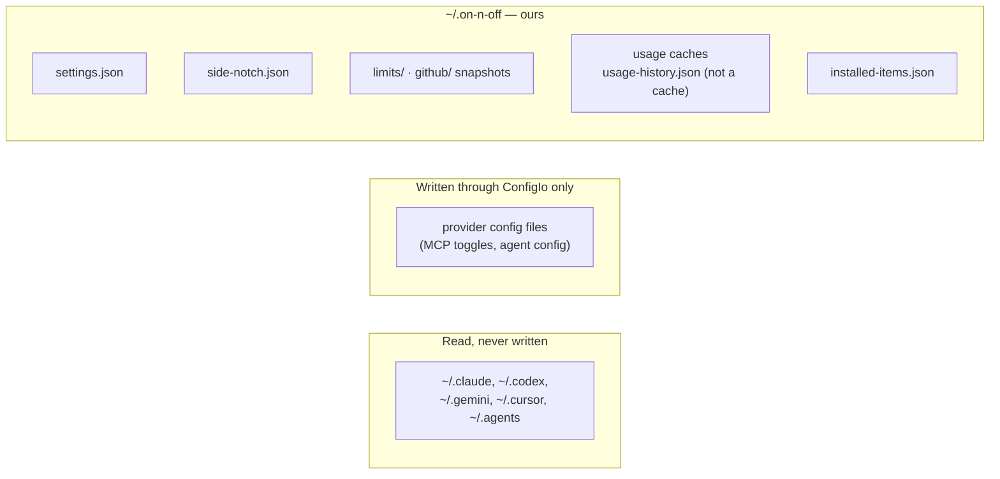

# Architecture

How on-n-off is put together, for orientation.

**This is not a source of truth. The code is.** These notes and diagrams exist so you know where
to look and which pieces talk to which; when they disagree with `src-tauri/` or `ui/`, the code is
right and this file is stale. Fix it in passing or leave it — never "fix" the code to match a
diagram here.

Repository safety and workflow rules live in [AGENTS.md](../../AGENTS.md).
Build commands, testing, visual proof and implementation conventions live in the
[development guide](../development.md).

## What it is

A Tauri 2 desktop app for Windows and macOS (Apple Silicon) that reads what your coding agents —
Claude, Codex, Antigravity, Cursor, Muse — have on disk, and shows it in one place: installed plugins,
skills, MCP servers, the hooks a provider would run (Claude and Codex, listed and never run),
token usage and cost, subscription rate limits, and your GitHub pull requests. It is
overwhelmingly a **reader**; the write boundaries are in [Data safety](../../AGENTS.md#data-safety) and
the [account ownership guide](accounts.md).

## The shape of the process

Two things to hold onto:

- **`commands.rs` is the only door.** The UI reaches Rust through `$lib/api`, which reaches
  `commands.rs`, and nothing else. Feature components never invoke Tauri directly.
- **The notch is not a WebView.** On macOS it is a bundled Swift helper in its own process: Rust
  owns its settings and feeds it snapshots over bounded private pipes, and it draws and reports
  back typed actions. No credentials cross that pipe and it opens no listener. On Windows there is
  no helper — the app paints a layered overlay window itself over in-process channels.

## Reads, and why they are shared

Almost every screen is a view over an expensive read: spawning `claude -p /usage` or
`codex app-server`, unlocking the Keychain, a GraphQL round trip, or a scan of transcript files. Several surfaces want the same read
at the same time, so each such read is cached once per process and shared.

The same pattern holds for pull requests (`github` + `github_monitor` + the notch's PR cell). The
consequence — that a surface holding its own copy has to be told when another one refreshes — is
the subject of [shared-reads.md](shared-reads.md), and it is the part most easily got wrong.

## Feature subsystems

Each is a directory under `src-tauri/src/`. What follows is only enough to know which one you
want; the guides it links and the PROVIDERS.md rows hold the detail, since the source carries no
comments.

| Subsystem | What it does | Notable |
| --- | --- | --- |
| `{claude,codex,antigravity,cursor,muse}.rs` | Provider adapters behind `AgentAdapter` | Every provider difference in behaviour belongs here; each provider's static facts are its row in `provider_catalogue.rs`, and what on-n-off can change for it is the adapter's own capabilities (`capabilities.rs`, below). Layout per provider is in `PROVIDERS.md`. |
| `scanner.rs`, `plugin_meta.rs`, `drift.rs`, `mcp.rs`, `claude_mcp.rs` | Plugins, skills and MCP servers for a provider | Feeds Overview, Plugins, Skills, MCP. `plugin_meta.rs` holds the plugin and marketplace manifest formats; whether a plugin is behind its marketplace is `drift.rs` (Plugin drift, below). `claude_mcp.rs` is Claude's MCP rule in both directions: the servers each view lists and what turns each off there, and the edit a switch makes (PROVIDERS.md, Claude). |
| `usage/` | Token and cost aggregation from transcripts, and the usage kept after they are deleted | Read-only on agent homes. See below. |
| `limits/` + `limits_refresh.rs` | Live subscription rate limits | Provider problems come back as a `status` on the DTO, never an `Err`. See below. |
| `github/` + `github_monitor.rs` | The Pull requests screen and its CI notifications | Not a provider, not behind `AgentAdapter`. See below. |
| `item_install/` | Installing skills/subagents from a GitHub marketplace | The only substantial writer. Atomic placement plus a provenance registry at `~/.on-n-off/installed-items.json`, so upstream changes stay visible after the user edits their copy. |
| `side_notch/` | The notch overlay, macOS and Windows 11 | See [side-notch.md](side-notch.md). |
| `monitor.rs` | Shared polling/notification plumbing | `limits_monitor` and `github_monitor` are both built on it; they poll while the window is hidden. |

### Accounts

The opt-in [account manager](accounts.md) saves protected renewable profiles and explicitly changes
the default native CLI login. Active credentials remain native-owned. Inactive profiles never
refresh in the background. Config, plugins, MCP settings and sessions are preserved.

### Limits

Each provider is read the way that provider intends, and the signed-in login is renewed only by the
provider's own client:

- **Claude** — run Claude Code's own usage report, `claude -p /usage --safe-mode` (with
  `--no-session-persistence --output-format stream-json --verbose`), for the user's own login as
  Claude Code resolves it from `CLAUDE_CONFIG_DIR` and `CLAUDE_SECURESTORAGE_CONFIG_DIR`, but in a
  config dir of on-n-off's own (`~/.on-n-off/claude-usage`), because the report also scans every
  transcript its config dir kept that week (`limits/claude.rs`, `limits/claude_cli.rs`). Claude
  Code reads its own login, renews it when it has to, and asks Anthropic's usage endpoint without a
  model turn; the read opens no Claude credential, and on-n-off sends nothing to Anthropic.
  `--safe-mode` keeps the login but starts none of the user's CLAUDE.md, skills, plugins, hooks,
  MCP servers or custom commands, which every poll would otherwise start; a Claude Code too old to
  know the flag is not run at all, and the card asks for an update. The card is the account the
  user's own `.claude.json` `oauthAccount` names before the read, which must still name it after,
  and its plan comes from that record, not from the copy Claude Code keeps in on-n-off's dir. That
  copy also files Claude Code's usage cache under whichever account first read there, and Claude
  Code answers from that cache for any login, so a read first removes the dir when its copy names
  another account than the user's record, and a read the account changed under removes it after.
  When there is no report, `claude auth status --json`, which reads only what is stored, tells a
  signed-out config dir from a report that could not be had.

  Because the read is Claude Code's, so is the renewal. The access token lives eight hours and
  Claude Code renews it whenever it runs, which each poll does, under its own refresh locks.
  on-n-off holds no Claude token, takes no refresh lock to renew and sends no grant; the one writer
  it keeps in `accounts/claude_store.rs` serves the account switch and the saved accounts' homes.
  Claude Code's report has no saved resets and no subscription status, so a Claude card shows
  neither.
- **Codex** — launch the official `codex app-server` and call `account/read` plus
  `account/rateLimits/read`. Codex owns its own login and refresh; on-n-off reads only
  `account_id` metadata from the app-server's confirmed home. The same read reports banked
  rate-limit resets (`rateLimitResetCredits`). Spending one is the only write Limits makes:
  `account/rateLimitResetCredit/consume`, from an explicit click on the signed-in account's card,
  after checking that the native login is still that account, and never while an account change
  holds the Codex activity lease. The card always asks first, and above 5% of the current limit
  left, or the lower share the account's banked reset alert names (`resetSpendLimit`), or with
  no telling how much is left, it warns before the spend rather than refusing it. An automatic
  spend is held to its alert's share (`ResetSpend::Automatic`, carrying the `SpendShare` only an
  alert gives): it reads the limit again in the same app-server session and refuses above it, or
  when it cannot tell (`SpendShare::allows`). A shared forced read follows every attempt that got
  past that lease, a failed one included, since a request that timed out may still have reached
  Codex; and the card reuses one idempotency key until Codex gives a definite answer, so a retry
  cannot spend a second reset.

  A **banked reset alert** (turned on from a Codex card's menu and listed in Settings) notifies,
  or uses the reset automatically. One module, `reset_alert.rs`, owns the rule end to end and does
  no I/O: the alert as the settings keep it (`ResetAlert`), its defaults and the bounds the
  settings clamp applies (`keep_within_bounds`), how much of the limit is left (the fullest weekly
  or session window), when a reset is worth using, once per weekly cycle, when a waiting spend
  falls due, the share an automatic spend is held to, and the wording of every notification.
  Given a poll's readings, the alerts, the monitor's saved state and the time, `reset_alert::plan`
  returns what to do: the poll's offers, which once the state is saved tell the alerts that only
  notify and schedule the automatic ones (`Offered::commit`), and the waiting spends that fell
  due, each to spend at its alert's share or to keep with the notice that says why.

  It offers the reset when two polls in a row, each a newer reading of the signed-in account in
  the same weekly cycle, find it at the alert's share or below, with its weekly window at least
  the alert's hours from renewing and a banked reset that has not lapsed. It offers once per weekly
  cycle, which a spent reset starts anew. A cycle is the weekly window's reset time, and two within
  two seconds of each other are the same cycle: Codex reports that time to the second, the same
  window's time can differ by a second or two from one response to the next, and a remembered
  window can spell the same instant differently, all of which an exact match took for a new week.
  The tolerance is `ResetInstant::same_cycle_as` (`limits/window.rs`), the one the Codex sessions
  merge matches a window by and the limits monitor compares by, and the saved cycle stays the
  string the reading carried; one that does not read as a time is another cycle. The alert never asks whether usage
  dropped: a cycle is its reset instant alone, since an account can be low again in the next one. An automatic alert's offer is a notification that the reset will be used in ten minutes. When that
  time comes the reset is used only if a fresh read still finds the signed-in account low in the
  same cycle; a read that fails, or could not ask Codex at all (no `codex` found), leaves it
  waiting, while one that finds nobody signed in, or an API-key login, keeps the reset as no longer
  needed. The rule tells them apart by the typed failure of the signed-in read (`ReadFailure`),
  which the shared cache serves with the cards it read (`limits_refresh::read_served`, one `Served`
  per provider) and the monitor hands the rule (`codex_now`), since the card alone reads signed out
  either way; and one found more than fifteen minutes late,
  as after sleep, is kept. A spend that fails is not tried again.

  `limits_monitor` is the loop that does the I/O around the rule (`poll_once`, over a small `Io`
  trait its tests fake). It polls while any alert is on, reading only the providers that bank
  resets (`WITH_BANKED_RESETS`, Codex) when limit notifications are off (`watched_providers`) and
  reading that provider (`BANKED_RESETS_PROVIDER`) afresh when a spend is due. It saves
  its state, in its own file, before it tells anyone or schedules anything, and rolls the state
  back when the save fails, so the offer is made again. It spends through the same
  `limits_refresh::consume_codex_reset_credit` a click uses and says what came of it either way.
  Until then the account's card shows the waiting spend with a Cancel (`pending_reset_spends`,
  `cancel_reset_spend`, announced as the `limits:reset-spends` shared read), and a reset used by
  hand clears it (`spend_reset_by_hand`). A waiting spend lives in memory only, apart from the
  monitor's saved state, so quitting on-n-off cancels it.

  The UI restates the rule's numbers in `ui/src/lib/appSettings.ts`: the 5% cap, a new alert, the
  form's bounds, the ten-minute delay and an alert's share. `ui/src/lib/resetAlertRule.test.ts`
  checks them against `src-tauri/src/reset_alert/fixtures/rule.json`, which a Rust test keeps
  equal to what the rule does. The card's own "how much is left" (`usageLeft`,
  `limitPresentation.ts`) counts a window past its reset as 0% used, as every surface reads a
  window at an instant (below), because a reading ages on screen; the rule judges live readings
  and does not.

Every quota window is built in one place, `limits/window.rs`. A reader maps its provider's answer
to `QuotaWindow` facts (id, scope, length, used percent, reset instant) and nothing else;
`QuotaWindow::into_dto` decides the kind, the label, the meter's range, the reset's spelling and
`windowSeconds` (the rules are in the Common shape of [PROVIDERS.md](../../PROVIDERS.md)), and
`QuotaWindow::idle` is the unused window a provider leaves out while it has not started (Muse's
five-hour window). What a surface does with a window beyond its kind travels on the window, set by
the reader that understands the payload: its `role` (the side notch's inner ring, Claude's Fable
week) and whether it starts with the first message, which the module reports only while the
window is unused and has no reset. The notch and the card read those fields and never a label or
a provider. A reading's plan is the reader's; its label and the capacity the card order weighs
are `plan::describe`'s (`limits/plan.rs`), worked out where the window rules apply and never filed.
Shared Limits code asks a provider's Limits facts (`AgentId::limits_facts`, provider catalogue
below) rather than naming it: a saved profile's legacy reading (`SnapshotStore::remember`), what a
remembered file changes as it loads (`StoredSnapshot::into_dto`), whether a read asked about credits
spent or the subscription term (`limits/reading.rs`), whether session rollouts are merged
(`limits::read_limits_in`) and whose banked resets the monitor and the alert follow
(`BANKED_RESETS_PROVIDER`, the one provider a compile-time check allows). Claude's banked resets
are no part of a reading: no read returns them, so `limits/desktop_resets.rs` takes what Claude
Desktop last saw from one entry of Desktop's HTTP cache and the served column carries it beside the
card (`desktopResets`), dated and display-only ([PROVIDERS.md](../../PROVIDERS.md), Claude, Banked
resets). The plan's label and
capacity hold by construction: `keep_remembered` drops whatever either reading carried and works
them out again from the plan it kept.

Every window that leaves `limits/` is within 0–100, since no surface can draw a meter outside it:
each draws such a window as unreadable, a dash, and the macOS helper used to refuse the whole
message for one, which blanked the notch. Three clamps share that job, and each governs its own
path:

- `QuotaWindow::into_dto` clamps every window a reader builds, the one the Codex sessions merge
  advances included, so a fresh window is in range before anything else sees it.
- `window::keep_in_range` in `StoredSnapshot::into_dto` is the only clamp on what was read from
  disk: a remembered reading an older version wrote, or a file edited by hand, is clamped as it
  loads, while the file keeps what was written. Removing it would let one old file blank the notch.
- `window::keep_in_range` in `pipeline::finish` is the outer guard on every read, signed-in or
  saved, and clamps the workspace-credit share a read computes.

What a window reads at an instant is decided once, in `limits/window_at.rs`: `WindowAt` (`of` a
window, `of_share` a workspace-credit share, in its `instant` child, which only the Windows notch
and tests compile) given the window and the time. Its reset cycle is decided once: pending until its
reset instant, renewed from it, and without a reset idle when its reader says the window starts with
the first message, else unknown. The flag is set only through `window::unstarted`, so the surfaces
trust it and never check the usage again. Its used now is 0 once renewed, and none when its used
percent is not a number or lies outside 0–100, which every surface draws as a dash and an empty
meter in the unreadable ink, and a screen reader hears as "Usage unavailable". It is reached only at
100% used. The figure behind the percent text is 100 only then, so 99.5% reads "99%"; a sliver under
1% reads "<1%" and counts as 1; otherwise the percent is rounded, a half up. That figure is what the
card's meters tell a screen reader and what the banked reset's confirmation says is left. The meter's level
is the base ink up to 70%, a blend toward the trip red eased by the square root of how far it is
through 70–90%, and the trip red from 90%. The reset note names the reset instant in the local zone,
a window's as a weekday and a 24-hour clock (`Mon 14:00`), a share's as a date (`Dec 1`); a window
without one says "Reset time unavailable" and an idle one says it starts with the first message,
where a share without one says nothing. The card writes the note in full ("resets in 2d 3h · Mon
14:00", "reset 1h ago · Mon 14:00", "Starts with your first message"); both notches drop the
countdown, which their popover's row has no room for, and shorten the idle note ("Resets Mon
14:00", "Reset Mon 14:00", "Starts with first message"). The limits monitor asks the same
module whether a window is reached and how a notification words a percent, so "reset from 99% to
<1% used" reads as the card does.

The module does no I/O and reads no clock: the Windows notch plan is given the time by its window, and
the drawers that redraw between reads ask it again. The card restates the rules in
`ui/src/lib/windowAt.ts`, with the meter inks beside the levels, and the macOS helper in `NotchCore`
(`Quota.cycle`, `WorkspaceCredits`, `meterLevel`), since each redraws on its own clock. All three read the cases in
`limits/window_at/fixtures/window-cases.json`, pinned to one instant and one time zone: the Rust
tests assert every field but the card's wording, `windowAt.test.ts` every field but the notch's,
and `NotchCoreChecks` what the helper draws. A row names each surface's wording (`card`, `notch`), so
a rule or a word changed on one side fails until the others follow.

Reset times are compared only as `ResetInstant`s, parsed from a window's `resetsAt` once. The type
itself compares and orders by the exact instant, so equality a struct derives and any sort stay
exact; the tolerance lives only in `same_cycle_as` (two instants within two seconds are one cycle)
and `later_than` (later beyond that), because Codex reports a window's reset to the second and the
same window's can differ by a second or two from one response to the next. Whether a window's
cycle turned over between two observations is `cycle_turned_over`: its reset instant is later than
the saved one, or the saved one has passed by the new observation's time (an idle window reports
none), and in either case its usage dropped by more than half a point. The limits
monitor's reset notice is that rule; the banked reset alert's cycle is the reset instant alone
(above).

Saved profiles are read beside the signed-in account (`accounts/usage.rs`). A saved Claude account
is read in its home ([accounts.md](accounts.md#homes)) by the same Claude Code report, expecting the
profile's identity (`limits/claude_cli.rs`); a Claude login still in the vault, one the last read
could not move into its home, is never sent. A saved Codex account is read by Codex's reader, which
the accounts adapter dispatches (`Adapter::read_usage`): the backend body app-server itself reads,
`wham/usage`, asked over HTTP with the profile's access token (`limits/codex.rs`), since running
app-server for a saved profile would write its credential to disk. Neither renews a login itself:
Claude Code renews a home's login, a Codex login on-n-off owns renews before its read, and one it
does not own is never renewed. A saved read tells a refused login, one that now signs in as another
account and a rate limit apart (its read outcome, below), and the poll backs off accordingly: a
login refused, or now signing in as another account, waits for a new login, in the vault or in its
home alike, and the profile's login state says so, on the account list and on its Limits column entry
([accounts.md](accounts.md#login-state)); any other failure
waits the Limits failure backoff (`limits_refresh::failure_backoff`, [shared-reads.md](shared-reads.md#the-mechanism)),
or a rate limit's Retry-After when that is longer. Every card a
saved poll produces says so (`saved_profile`), which is how the UI knows a remembered reading from a
saved profile read live.

What a read comes to is decided once, by the **read outcome** module (`limits/outcome.rs`). Every
reader only detects: it hands back the account it knew before reading (`Read::account`, the one
the login on disk names) and either its answer or one failure of a closed set (`ReadFailure`): not
installed, signed out, unsupported (an API-key login, an account type, unfinished billing, an
inactive subscription, a provider with no limits), a refused login, another account, an account
changed during the read, a rate limit with its reset, a request that failed with its cause, an
answer that observed nothing, or unavailable with the source's own reason.
Every message comes from one table, `message`, matched on the read context and the failure and
filled with the provider's facts (display name, CLI, client and vendor, from the provider
catalogue): the signed-in card (`Context::SignedIn`), a saved login (`Context::Saved(Saved::Login)`),
an account home (`Context::Saved(Saved::Home)`) and a login's verification (`Context::Verify`).
Around it, one function per read context gives its caller the rest:
- `signed_in` makes the signed-in card: its status (signed out for not installed and signed out,
  unsupported, otherwise failed), its message, and its account. Every failure after the account is
  known keeps it, so the account's remembered reading stands in on the current card and no second,
  remembered card appears for it; only not installed and signed out, where nobody is signed in,
  name no account, and an answer that observed nothing keeps the account and name that answer
  carried. Beside the card it returns the read's `NativeOutcome`: the typed failure and the login
  the read was made for. The shared cache derives from it whether the read counts toward failure
  backoff (a failed card does) and how long a Retry-After holds the next read, and serves the
  failure with the cards.
- `saved` gives a saved poll its `SavedVerdict`: the message, how long a Retry-After holds the
  next poll, and whether the login is parked until a new one, and as what (`Parked`): refused, for
  a login the provider refused or found signed out, or another account. A login in its home parks
  as one in the vault does. A saved card that failed always reads failed.
- `saved_card` and `first_usage` decide acceptance, a reading with something observed for the
  expected account. They are the only makers of `Accepted`, the type the accounts adapters'
  `read_usage`, an account home's `read_usage` and a sign-in's `first_usage` hand back, so the saved
  poll and the sign-in publish what they get without checking it again.
- `verified` answers a login's verification: verified by an answer for its own account, including
  an inactive or unpaid subscription, and otherwise refused in the table's words.

A read that knows the account but not its name (Codex's, before app-server answers) keeps the name
its remembered reading has (`SnapshotStore::remember`).

Because each CLI stores one login at a time, successful reads are remembered per account (numbers
only, under `~/.on-n-off/limits/`) so an account the user has switched away from stays visible
with its last observation time rather than vanishing. What a later read keeps of that remembered
reading, after it answers and after it fails, is one policy, in `limits/reading.rs`, which a read
applies once, keeping from its account's file as it writes over it (`SnapshotStore::remember`).

Which cards a provider shows is the Limits read's: the shared read serves each provider's **Limits
column** (`limits_refresh::read_column`, built by `limits::column` from the cards it read), one
entry per account. It folds the legacy history a scoped account replaced into that account's entry,
by the one rule Forget also uses (`snapshots::supersedes`), lists each saved profile no read
answered for as an entry of its own (`unread`), and carries beside each entry its saved profile and
its category, from the provider's roster the cache keeps beside the cards; the saved profile of the
account the native read names is the active one. The column is built only when the UI asks for it
(`read_limits`), and the UI types it `LimitsColumnEntry`. Both surfaces render that column
through one card model, `limitColumn({ provider, entries, nativeLogin, now })`
(`ui/src/features/limits/limitCards.ts`), so the popover lists the same accounts, counts and copy as
the screen; only the screen's account manager adds the account list's word on who is signed in
(`nativeLogin`). The Rust consumers (the notch, the monitor) read only the signed-in card and keep
the cards as read (`Served::entries`). [accounts.md](accounts.md#the-limits-column) has what the
column reads and what it leaves out to open no credential.

What a card's reading is worth now, its read standing, is one rule, `ReadStanding::of`
(`limits/standing.rs`), worked out from the card as it leaves the Limits read, after the remember
policy, the saved poll and the archive flags: the Limits column sends each entry with its standing
(`ReadStanding::sent_with`, set as `limits::column` builds `ColumnEntryDto`), and the notch model
asks it of the signed-in card (`NotchProvider::current`). An unread entry stands live, so the card
shows its empty copy as before. No card stores a standing, so no surface can see one that went stale
while the read was still changing the card.

A card is live when its own read answered: the signed-in account's or a saved profile's. It is last
observed when it holds an observation (`Reading::has_observations`: a quota window or a figure) that
no read just gave: the signed-in read is paused (it failed, or reached no account it could read:
signed out, or a login without subscription limits), a saved profile's refresh is
paused, or the card is a remembered account, neither signed in nor polled. It is unavailable when
its read did not answer and it holds nothing. A paused or unavailable standing carries the card's
own message, which the read outcome words for every read that did not answer (`limits/outcome.rs`),
in the error tone for a failed read and muted otherwise; a remembered account carries none. The
standing never words a failure itself. Only defensively, for a card that did not answer yet carries
no message, which no read produces, does it say the outcome's "<Provider> did not answer."
(`outcome::unexplained`), so a surface never draws an empty line in its place. `standing` is
left out of a live entry, so an entry an older version sent reads live. Every surface renders it
without deciding it again: the card and the tray popover (`presentStanding`,
`ui/src/features/limits/limitPresentation.ts`) and both notches (`frame::rail`,
[side-notch.md](side-notch.md#what-each-cell-shows-is-decided-once)). They used to decide it three
ways, and the notch said "Usage unavailable." in grey where the card said "Claude limits are
unavailable." in red, and called a card paused only over windows or a workspace share. Before any
read, all three say "Checking limits…". `limits/standing/fixtures/standing-cases.json` is the one
table: the Rust tests assert each row's standing in the shape the UI reads, the notch frame what the
signed-in card's cell shows, and `readStanding.test.ts`, which checks each standing against the UI's
`ReadStanding` type, what the card shows, so a rule or a word changed on one side fails until the
others follow. The limits monitor, the banked reset alert and the failure backoff still ask a card's
status and whether it is the signed-in account, which is all they need.

On screen, what a card offers is decided in one place: the card action plan
(`ui/src/features/limits/cardActionPlan.ts`), a pure function of the card model, the account list's
state (or none, for a provider without an account manager), the card's own archive and removal in
flight and whether an automatic banked reset is waiting for its account. It returns the ⋯ menu in
order and the footer: the main button (Cancel sign-in, Sign in again, Archive account, Save
account, Sign in or Use account), the Switch anyway confirmation, and the banked reset controls.
Whether a saved login must sign in again is the profile's login state alone, for every provider
(`LimitCard.login`, `ui/src/features/limits/loginState.ts`): ended, refused or another account put
Sign in again in the main button's place, and for a refused login or another account the menu
keeps Use account, since the client that owns the login may still renew it once it is used; a
missing login offers Sign in. The same state gives the card its sign-in tag and, when it asks for
a new sign-in, its message in place of the read's.
Each entry carries what its handler needs, `useCardActions` binds a handler to each and
`LimitCardFrame` draws them. The banked reset controls depend only on the provider's feature and
the card's reading, never on an account manager, and a waiting automatic reset keeps its countdown and Cancel while Switch anyway is
asked on the same card; Use banked reset gives way to that confirmation. Archive account is one
action wherever it shows: in the menu of a card that is not signed in, and also as the footer's
main button once a saved Codex subscription has ended without renewing. Remove account and
Archive account are each one command naming the card's account; Rust works out the saved login
and the history they take along from the column it serves, and announces the change
([accounts.md](accounts.md#remove-account)).

Every action decision reads the card's one signed-in state (`LimitCard.signedIn`). The card model
takes the word of the provider's own read, which leads the column (`LimitCard.leads`: the read's
`currentAccount`), when it names an account; the column marks active only that account's saved
profile, so the profile's `active` never says otherwise and the card model does not read it. The
account is `confirmed` once the account list names it as the native login (`nativeObservationId`)
and is not being read again, `unconfirmed` until then, as after a switch, and `no` otherwise. Save
account, Sign out and Use banked reset wait for `confirmed`. Without an account list the read's word
stands as confirmed; the backend still checks the native login before a spend. A read naming no
account still leads its column but signs no card in, and a saved profile no read answered for
never leads. The plan reads `leads` for two decisions only:
Use banked reset is offered only on the provider's own live read, whose numbers a spend acts on,
and Archive account never takes Use account's place on it.

### Pull requests

One GraphQL search request per refresh reads authored (scoped), review-requested and assigned PRs with
their CI rollups and merge state. Problems come back as a `status` + `hint` on the DTO, backed by the
last snapshot under `~/.on-n-off/github/`. Auth is borrowed from `gh auth token`, memoised per
app run, re-read once on a 401, never persisted.

What the read is worth now, its read standing, is one rule, `PrReadStanding::of`
(`github/standing.rs`), worked out from the read as it leaves (`status`, `hint`, `stale`): live when
the search answered; last observed when it failed and the read shows the last one's lists (from
memory or `prs.json`, even when they hold nothing: no open pull request is something read);
unavailable when it failed with nothing remembered. Its message is the read's hint, in the error
tone for a problem the user must fix (`gh` missing, signed out of `gh`, a rejected token) and the
warning tone for one that passes (a rate limit, GitHub out of reach). Only defensively, for a
failure without a hint, which no read produces, does it say "GitHub did not answer.". The message
is `PrStandingMessage`, a `StandingMessage` toned by `PrMessageTone` (error or warning), where a
Limits card's is toned by `MessageTone` (error or muted), so a Limits card cannot carry the warning
tone. The notch draws either through one `notice_of`, each tone type mapped to its inks once
(`From<_> for Tone`, `frame.rs`).
`read_github_prs` sends the read with its standing (`GithubPrsReplyDto`, the standing left out while
live, as a Limits column entry carries a card's); the Rust consumers keep `GithubPrsDto` and ask the
rule, so no value stores a standing that could disagree with its read. Every surface renders it and
none decides it again: the screen's banner and its "Showing the last read" line (`prBanner` and
`showsLastRead`, `ui/src/features/github/prStanding.ts`; the banner's headline stays the screen's
own words for the status, `statusHeadline`), the notch's pull request cell (`frame::rail`: readable
unless unavailable, the message as its notice in its tone), and the monitor, which observes a read
and starts its failure backoff over only when the read stands live (`answered`,
`github_monitor.rs`). They used to decide it three ways, and the notch inked the hint amber over the
last read's lists and muted over none, where the screen inked a missing or signed-out `gh` and a
rejected token red and a rate limit or GitHub out of reach amber.
`github/standing/fixtures/standing-cases.json` is the one table: every status, alone and over the
last read, and a rate limit over a last read with nothing open, each with the open pull requests the
read holds (`rows`), its standing and what the screen and the notch cell show. The Rust tests assert
each row's standing and that every `GithubStatus` has both rows, the frame and the monitor tests
read it, and `prStanding.test.ts` checks each standing against the UI's `PrReadStanding` type, what
the screen shows, and that `GITHUB_STATUSES`, the UI's copy of `GithubStatus`, names exactly the
table's statuses; the dev mock's replies are checked against it too (`dev/githubFixtures.test.ts`,
which names the scenes that send a remembered read rather than reading that off their standing).
The UI tests read the table once, typed, through `ui/src/features/github/prStandingCases.ts`
(`PR_STANDING_CASES`, and `standingFor(status, stale, hint)` for a reply a test builds). The UI's
`GithubPrs` type leaves out `stale` and `hint`, which the reply still carries, so the type checker
refuses a screen that would decide from them again.

Every request a pull request read makes goes through one connection, the `Github` seam in
`github/connection.rs`: the search, the contribution lookup and commit check (GraphQL) and the
events pages (REST). Its production adapter, `HttpGithub`, alone holds what requests share across
reads (`HttpMemo`, one per app run): the `gh` token and its 401 re-read, the status a failure reads
as (a rejected token, a rate limit, or GitHub out of reach) and the pause. The two ways a pause
starts resume differently (`limited_until` and `low_budget_until`, side by side). A rate-limited
reply pauses its budget until GitHub's reset, or one minute when the reset is unknown or already
passed: GitHub just refused, so something must wait. A search reply reporting fewer than 50 points
left pauses GraphQL until its `resetAt`, one minute when that is unreadable, and not at all when it
is already passed by the local clock: the budget has renewed, so that read's contribution requests
still go out (before the connection, such a reply skipped them for that read). A request made while
its budget is paused is refused without being sent. GitHub budgets REST core and GraphQL apart, so
the events pages have a pause of their own: a rate-limited page (a 403 that carries `Retry-After` or
`x-ratelimit-remaining: 0`, or a 429) pauses only the events read until its reset, while the search
and the contribution lookup carry on. Any other 403 keeps its status, never a rejected token
(`http::get_json_with` with `Forbidden::RateLimitWhenSaid`, as the GraphQL POST classifies it).
Every request, the events pages included, re-reads a rejected token once and forgets one rejected
twice. An events or contribution failure is only a warning on the read; the search's failure is the
read's. `read_prs_in` asks the connection whether reads are paused (`reads_paused`) before it
fetches and keeps its memory window, the snapshot fallback and the shared-read rule that a failure
reports `Unchanged`; a pause serves the remembered read as stale without discarding it. The
contributions read asks too, and makes none of its requests while paused. Tests drive `read_prs_in`
and the contributions read through the in-memory adapter (`FakeGithub`, `github/fixtures.rs`, which
refuses a request while its budget is paused, as `HttpGithub` does), and `HttpGithub` against the
loopback server.

The merge fields — `mergeable` for conflicts, `mergeStateStatus` for ready/blocked/behind,
`mergeQueueEntry`, `autoMergeRequest` — are scalars and single objects on purpose, so the request
costs about 2 rate-limit points. They are interpreted in exactly one place, `github/merge.rs`:
`classify` gives each row its own verdict as `parse` reads it, `KnownAnswers::settle` settles the
merge verdict (`mergeKind`) of every open row once per read, the screen only maps kinds to badges,
and the monitor's `Seen` record takes its unknown-aware facts from `merge::facts`. Snapshots written
before those fields existed load with `Unknown`/`false` defaults.

GitHub can report `UNKNOWN` while recalculating mergeability after the base branch advances, so a
known answer is carried across reads. `KnownAnswers` is the one memory of them: one viewer and, per
revision (PR id, head commit `headRefOid`, target branch, as `Revision::of` reads them), the last
answer the PR's rows settled with (`mergeable` and `mergeStateStatus`). Each successful read calls
`settle` once, after contributed PRs have joined Mine, over every open row
(`GithubPrsData::open_prs`: Mine, Review requested, Assigned) and over the open PRs the
contributions record tracks but does not list (out of scope, or not yet confirmed as yours). A
contributed row is from an earlier read when this read did not look it up again: the connection
paused (a low or spent GraphQL budget), a failed lookup, or a node the lookup could not read
(`Contributed.earlier`).

1. A row GitHub answered in this read (`mergeable` known, or `mergeStateStatus` DIRTY) keeps its
   own verdict. Every such answer, from a listed or an unlisted row, is this read's answer for its
   revision; two rows of one revision that answer differently each keep their own.
2. A revision this read did not answer but that has a row from an earlier read takes the memory's
   last raw answer for it, or, when the memory has none, that row's own earlier answer. An earlier
   answer therefore never shows when a newer one was settled for the revision.
3. Any row without its own answer in this read takes the revision's answer from 1 or 2,
   `mergeable` and `mergeStateStatus` included, so the monitor sees it too and one revision shows
   one verdict.
4. Failing that, an unknown row shows Conflicts when the memory's last answer for its revision is
   a conflict and was kept for the same viewer (compared case-insensitively, once per read). Only
   `mergeKind` is carried; raw unknown mergeability, CI, review, title and other fields still
   refresh. A clean answer is never carried to an unknown row this way.
5. Otherwise it gets its own verdict, which also discards one an older file stored.

The memory is then replaced by this read's settled answers: a conflict wins when rows of one
revision disagree (so after a Review requested row says CONFLICTING and the contribution lookup
says CLEAN in one read, a next read whose lookup fails shows the contribution, and tells the
monitor, the conflict), a carried conflict stays, and anything else is forgotten — a revision every row
left unknown without a known conflict, a new head or target, a missing head id, another viewer, a
merge, or a PR the read no longer sees open. A read without a viewer keeps no answers. Because
unlisted rows count, a contribution's known conflict is still known when an expanded scope starts
listing it. The memory is saved with the snapshot (`knownAnswers` in `prs.json`, ignored by older
versions), so it survives a restart, and a failed read shows the snapshot as it was saved.
`KnownAnswers::recall` takes the saved memory; a `prs.json` saved before the memory existed seeds
it once instead, before the next read rewrites `contributions.json`, with the conflicts its open
rows and the record's open PRs (same viewer only) show. A conflict those files kept while GitHub
said unknown is seeded without a raw answer: it is only ever carried as a Conflicts verdict (rule
4), never copied into a row's `mergeable` or `mergeStateStatus`. The badge and both native rings therefore
keep a known conflict during recalculation and clear it once GitHub confirms it is gone, and a
contributed row whose lookup keeps failing shows the revision's latest answer, not its own older
one.

GitHub's search cannot find a pull request by who wrote its commits, so contributed pull requests
come from your pushes instead (`github/contributions.rs`).

- **Pushes.** At most once a minute the read takes your events from
  `api.github.com/users/<login>/events`, page by page up to the three pages GitHub keeps, and stops
  after the page that reaches the newest event it read before. That whole page still counts,
  because an event can show up late with an older id. Each branch push is remembered for thirty
  days after its latest push, the fifty most recent at most.
- **Lookup.** One more GraphQL request asks for the open pull requests on each remembered branch,
  five at most, and for every pull request already tracked, by node id. Repository and branch
  names travel as variables, never as text in the query. A pull request is tracked when you did not
  open it, its head is the repository and branch you pushed, and that branch is not the
  repository's default branch: a release pull request from the default branch carries everyone's
  merged work, yours included. A branch whose repository is gone, or that is the default branch, is
  dropped, and the push that brought it is remembered so that rereading the same page of events
  does not bring it back; only a newer push to it does.
- **Check.** A tracked pull request is shown once a third request, sent only when its head moved and
  for ten pull requests per read at most, finds among its last hundred commits a non-merge commit
  whose authors include you. Rebased commits keep their authors, so an "Update branch" never counts.
  A yes is final for the pull request, which then stays tracked even after its branch is forgotten.
- **Record.** Tracked pull requests are dropped when closed and fourteen days after they merge. The
  record, `~/.on-n-off/github/contributions.json`, keeps each one's last read as GitHub sent it,
  belongs to one GitHub login and starts over for another.

Found pull requests join `mine`, marked `contributed`, and merged ones join `merged`, both under the
same scope as the search. That is all the monitor, the notch and the screen see: the screen tags
them with their author, and the monitor notifies on them, merges included, exactly as on authored
ones. They come after the authored ones, so the notch, which shows the first 25 rows of Mine, leaves
them out when 25 authored pull requests come first. When the lookup fails, or the connection is
paused (the read has just found fewer than 50 rate-limit points left) and the extra requests are
skipped, the record's last read is shown, so a transient error does not take them out of Mine, the
notch or the monitor's baseline.
The record misses a branch you last pushed before GitHub's three pages of events reach back, a push
to a fork's branch, commits of yours that someone else pushed, and commits of yours older than a
pull request's last hundred.

The monitor notifies on CI, review-decision, conflict and ready-to-merge transitions of the PRs
Mine lists — the scoped first page of fifty authored ones, plus contributed ones. It is opt-in and
polls while the window is hidden.

### Usage

Transcript aggregation, entirely read-only, with caches under `~/.on-n-off/`. Prices come from
LiteLLM's public table (`usage/pricing.rs`), cached for a day. A scan that meets a
priceable-looking model the table lacks lets the next scan re-fetch after an hour, and the Usage
refresh button re-fetches at once. The summary cache key carries the table's fetch time, so a new
table can never serve costs computed from an old one.

A summary counts one usage window (`UsageWindow`, `usage/window.rs`), built once from the
`usage_summary` input by `UsageWindow::of`, the only code that interprets that input's days, zone
and instants. It refuses a `sinceDay` or `untilDay` that is not a `YYYY-MM-DD` calendar day,
`sinceDay` after `untilDay`, and an hourly read without two valid instants at most 24 hours apart;
any resolution but `hour` reads by the day, and a zone it does not know reads as UTC (the summary
still echoes the zone it was asked for). The rest of the read asks the window, never the input:

- **Its span** (`span`), the instants it covers: an hourly read's two instants, or a day read's
  days in its zone, from the first instant of its opening day to the first instant of the day
  after its closing day. At a midnight the clocks skip, a day starts when the clocks land; at one
  they repeat, at the first pass. A day read ignores any `sinceTime`/`untilTime` it carries. The
  span alone decides which instants count, what the source signature hashes and which folded rows
  are read, so a summary served from the cache always covers what a fresh read would count.
- **The earliest transcript mtime worth reading** (`earliest_mtime_ms`): 36 hours before an hourly
  read's opening instant, or before a day read's opening day at UTC midnight. Local midnight is at
  most 14 hours before UTC midnight (UTC+14), so the 36 hours cover every zone with 22 to spare;
  it is the value the summary has always used, kept so the files a read scans, and its
  `scannedFiles`, do not change. This is the window's own allowance; the watermark keeps its own
  36-hour slack in `usage/files/history.rs`.
- **The period an instant counts in** (`period_of`): any instant in its span, on its local day in
  the window's zone, and for an hourly read in the hour it falls in, counted from the window's
  opening instant (`hourStart`), so an hour that crosses a local midnight gives two buckets with
  one `hourStart`. `UsageAggregator` takes the window and the price table, nothing else.
- **Its cache identity** (`cache_identity`): what the summary echoes or counts by (days, zone,
  and an hourly read's instants in milliseconds, so two spellings of an instant share an entry),
  and its group. The summary cache keeps eight entries, and storing one replaces every entry of its
  group: a day window is its own group, and every hourly window shares one, because the Usage
  screen asks for the rolling last 24 hours, minute-aligned, and never asks for an older one again.
  Without the group, each hourly read in a new minute added an entry and pushed the day windows out.

The files Usage keeps under `~/.on-n-off/` have one owner, `UsageFiles` (`usage/files.rs`): the
lock every read and write of them takes, folded usage (`files/history.rs`), the transcript
sources with their source index and scan cache (`files/sources.rs`) and the summary cache
(`files/summary_cache.rs`). The three stores are its private children, so nothing else locks,
opens or writes them, and the watermark, the history's open and the lock never leave it. Holding
the lock is checked when it compiles: `lock()` returns a `Locked`, which nothing else can make,
and opening the sources (which borrow it until they finish), checking that they are unchanged,
reading the history's size and mtime for the summary key, storing a summary, folding the history
and clearing it each take one. A test holds a summary inside its lock and checks that a fold waits
for it. It offers whole
operations: a summary of a window, a fold, a clear and the history's status.

- **A summary** (`UsageFiles::summary`) takes the window, the price table's fetch time, whether
  the read is forced, and the counting, which turns a `WindowCount` into the summary. Under the
  lock it keys the summary cache (the window's cache identity, the table's fetch time and the
  history's size and mtime, read there), and `Sources::open` walks the roots and brings the source
  index up to date, which is enough to answer from the cache before any record is read; the
  history is opened only when that needs the watermark. Otherwise it opens the history,
  `Sources::read` returns the records from the window's earliest mtime, from each transcript's
  cached parse where it still holds, and the lock is released for the counting. The
  `WindowCount` gives the records at or after the watermark, the folded rows in the window's
  span and, for each provider, its transcript directory and the files read there (none when the
  directory does not exist). The summary is stored afterwards, under the lock again, only if the
  count is still current (`WindowCount::is_current`, the one store rule): the read was final
  (every transcript read and resolved), the history read, the source index and the transcripts
  are as they were read, and the history still has the size and mtime it was counted with.
- **A fold** (`UsageFiles::fold`) is the background fold's whole check (see Usage history).
- **A clear** removes the history and its copies under the lock; **the status** reads the history
  without it, since every file is replaced atomically and Settings should not wait behind a scan.

`Sources::finish` saves the scan cache, pruned with the watermark it is given, on every path out
of a read, a summary served from the cache included, so what bringing the index up to date parsed
is never parsed again.

A provider whose read was incomplete is still reported `ok`: the UI has no copy for a `partial`
source (the Overview card prints the bare status in a provider chip, the Usage screen shows none,
and no surface shows its message), and the commonest incomplete read is a live transcript, which
counts what it holds.

What one provider's transcripts look like is its transcript format, one module each under
`usage/transcripts/` (`claude.rs`, `codex.rs`, `muse.rs`): the directories they are in
(`TranscriptDirs`: the one a summary reports, and any more, such as Codex's archive), its markers
(a line is parsed as JSON only if it contains one), the parse of a line with what the format
remembers within one file (Codex carries the session from `session_meta`, the model from
`turn_context` and its fork-copy suppression from line to line, so those are among its markers)
and the key of the copy group a record belongs to. `usage/transcripts.rs` picks the format with
one exhaustive `match` on `UsageProvider` (`format_of`) and does the rest the same way for every
provider: the marker check on each line, the walk for transcript files (`*.jsonl`, and Claude
Code's `*.jsonl.superseded-<ms>` under every root, as before), `read_transcript` (a file's
records, one per copy group within the file, which is what the scan cache keeps) and
`richest_copies`. No other Usage code matches on the provider.

Three reading rules carry the accuracy, each pinned by a test:

- **One record per copy group, its richest copy, before anything is counted.** Claude Code writes
  one line per content block of a message, all under one `message.id` and `requestId`, and the
  early lines carry a partial `output_tokens` (often 1 for a thinking block); a resumed or forked
  session copies messages into other transcripts too. A Codex rollout listed under both roots (a
  rename between the walks, or a stale entry after an incomplete walk) repeats its session's events
  at the same instants. `transcripts::richest_copies` collapses both over every file of the scan,
  so the totals and the session counts follow the copy that is counted. Each format keys its
  copies: Claude by `message.id`:`requestId`, Muse by the line's `id`, Codex by an event's
  session, instant, model and tokens with how many times its file has held that event so far, so
  a rollout's own repeats stay apart and only another file's copy of them collapses. A record
  without a key (no message or request id, no line id, no Codex session) is never a copy, and
  copies collapse only within one provider: a Muse line id that happens to equal a Claude
  `message.id`:`requestId` key is two model calls, not one.
- **Cache writes by lifetime.** A one-hour Claude cache write
  (`usage.cache_creation.ephemeral_1h_input_tokens`) is priced at LiteLLM's
  `cache_creation_input_token_cost_above_1hr`, 2x input when the table omits it; a five-minute
  write at `cache_creation_input_token_cost`.
- **Archived Codex sessions still count.** Codex moves an archived session's rollout to
  `~/.codex/archived_sessions/`, mtime intact; it is scanned as a second Codex root under the one
  Codex source.

A transcript still being written while it is read (a live session) counts what it holds at that
moment instead of dropping out of the total. A read parses a file up to twice and reports whether
its size and mtime held still (`TranscriptRead`, in `usage/files/sources/source_index.rs`):

- A file that held still but no longer matches the inventory counts what it holds now.
- One that kept moving, or went away after a parse, counts the last parse that succeeded.
- One no parse succeeded on counts its last cached parse, if there is one.

None of these parses is cached, and the summary is not stored as final, so the next refresh reads
the file again.

A model the table has no price for is shown as **unpriced**, never as `$0.00`: its tokens count
and its cost is left out of the total, which says how many models it leaves out. Any change to
what a transcript parses to bumps `USAGE_TRANSCRIPT_PARSER_VERSION`, which invalidates every
cache, so what the transcripts still hold is re-read from them; nothing in an agent home is ever
written.

Claude Code sets a replaced transcript aside as `<session>.jsonl.superseded-<ms>` rather than
overwriting it. Those are read too, so a turn a rewrite dropped still counts; the turns both copies
hold collapse to one.

One module reads Usage in the UI: `ui/src/features/usage/usageReads.ts`, modelled on the shared-read
source modules ([shared reads](shared-reads.md#in-the-ui)) but not announced, since no Rust revision
stands behind it. It declares every Usage key (the windows on the `["usage"]` root, and the
folded-usage status beside them), builds the `usage_summary` input and forces a read. Screens pass
its query options to `useQuery` and call its operations; they never write a key:

- `usageWindowQuery(days, onRead?)`: one cache entry per window, `["usage", days]`, which the Usage
  screen's 30 days and the Overview card share. Its read is unforced, computes the window when it
  is made (so a cached Past 24h keeps the hour bounds it was read for), and runs `onRead` as it
  starts: the Overview card's `markStartup("usage-start")`.
- `refreshUsageWindow(client, days)`: the Usage refresh button, one forced read of that entry
  through `readForced` (`ui/src/lib/sharedReads/forcedRead.ts`), tried once; a failure stays on the
  entry, beside the figures it already had. The Overview therefore shows what a 30-day refresh
  read, and the read after a refresh is unforced however the screen was mounted. A force carried in
  a ref and a revision in the key, as before, was left armed by a refresh that a remount answered
  from the cache, and forced the next read unasked. Two consequences of the shared entry and of
  `readForced`, accepted as they are for the Limits and pull request refreshes:
  - A failed 30-day refresh shows its error on the Overview card too, beside the figures it
    already had, until the next unforced read of the window succeeds.
  - After a refresh the entry keeps `readForced`'s options until a screen showing that window
    renders again and puts its own back, so a read the cache starts in between (a focus re-read,
    Clear's invalidation) is tried once, without retries. Restoring them in `readForced` itself is
    a follow-up shared with those refreshes.
- `foldedUsageStatusQuery()` and `clearFoldedUsage(client)`: Settings' Usage history card. Clearing
  puts the status the clear returned in the cache and invalidates every Usage window, so a shown
  window reads again, unforced, and a hidden one when it is next shown. The status key,
  `["usage-history"]`, sits outside the `["usage"]` root, so the focus re-read below never reads it.

The Usage screen and the Overview usage card read when they mount, on the Usage refresh button,
and when the user comes back to the main window with figures older than its stale time
(`createMainWindowQueryClient`, `ui/src/lib/queryClients.ts`). Closing the window only hides it,
and switching to another app leaves it on screen, so a screen left on Usage stays mounted; without
this it kept old figures until another screen was opened and Usage was opened again.
`usageFocusReads.ts`, beside the read module, holds the focus connector `App.tsx` mounts. It imports
only the `["usage"]` key root, from the leaf module `usageKeys.ts`, and never the read module:
Rollup keeps a module in one chunk, so a connector importing `usageReads.ts` would pull the loader
and the usage formatters into the startup bundle. Two signals mean "came back":

- **The webview's `visibilitychange`**, which TanStack's focus manager hears. Every Usage window
  opts in through `usageWindowQuery`; the main window turns this off by default, so only reads
  that opt in (usage, Limits, PRs, accounts) re-read on it. WKWebView fires it when the window is
  hidden and shown again; WebView2 on Windows never reports the window hidden.
- **Tauri's `tauri://focus` for the main window** (`onMainWindowFocused` in `$lib/api`), on both
  platforms, including a return from another app, which fires no `visibilitychange`.
  `<UsageFocusReads />`, mounted once beside `<SharedReads />` in `App.tsx`, answers it by
  re-reading the active `["usage"]` queries that are stale by the main window's stale time, and
  no other read.

Both signals start a read only when the data is stale, and both join a read already in flight
(`cancelRefetch: false`), so a show that fires both scans once. The read is unforced, like a
remount's, so it reuses the scan cache and the summary cache.

#### Usage history

Claude Code deletes transcripts after `cleanupPeriodDays` (30 by default), so a count read only
from transcripts shrinks as they go. `usage/files/history.rs` keeps what they held in
`~/.on-n-off/usage-history.json`. That file is user data, not a cache: once the transcripts are
gone nothing can rebuild it.

- **What is kept.** Records older than a week are folded into rows keyed by 15-minute UTC slot,
  provider, model, whether the provider reported the cost, and whether the request's input passed
  200k tokens. A row holds token totals, record count, summed reported cost and the session ids of
  its slot: numbers, model names and session ids, never conversation content. Every UTC offset in
  use is a multiple of 15 minutes, so a slot never straddles a local midnight or hour, and prices
  are linear per model, so a row reads exactly like its records in any time zone and with any
  newer price table. The 200k flag keeps a later long-context price possible for folded usage.
- **The watermark.** Rows cover every record before `foldedThroughMs`; a read counts a
  transcript's records only from it on, so the copies a resumed session makes of folded messages
  are not counted twice. It moves forward only, to the UTC midnight a week before now, so a fold
  runs at most once a day. A transcript whose records all sit below it (or that was last written
  36 hours before it) leaves the scan cache and is never parsed again, even after an index rebuild.
- **When it folds.** Only in `usage/folding.rs`'s background thread, through `UsageFiles::fold`, 90
  seconds after launch and hourly after that, so usage is kept even if the screen is never opened; a
  Usage read only reads the history. A fold needs every root walked and every transcript that may
  hold a record in range read, now or from its cached parse; a transcript still being written counts
  what it holds, since its records old enough to fold were written days ago. Otherwise it waits for
  the next check. A transcript that cannot be read holds it back until it is a week past the cutoff
  and has failed on two checks in a row: by then it never will read, and waiting longer would let
  the provider delete the rest.
- **Summaries.** The summary cache key carries the history file's size and mtime, so a fold or a
  clear never serves a summary counted with the history before it, and a summary counted while
  the file did not read is not stored. They are read under the usage files' lock, before anything
  is counted, so they describe the history the summary counts: read before the lock, a fold that
  landed in between was counted under the key of the history before it (`history:none` for a
  first fold), which a Clear brought back and served with the usage it forgot. A summary is
  stored only while the history still has the size and mtime it was counted with: one counted
  before a fold would otherwise replace, in its cache group, the summary counted after it.
- **When the file does not read.** It is never written over: the previous good file is kept as
  `.bak` and read in its place, and the unreadable one is copied aside under a new name before
  the new file replaces it. A file a newer on-n-off wrote, or one with no readable backup, is left
  alone; Usage counts transcripts alone until the user clears it. A history is written only once
  it reads back as itself, and a file whose rows are out of slot order or at or past its
  watermark does not read.
- **Limits.** A parser fix reaches only records newer than the watermark. A transcript that shows
  up later holding records older than it (copied from another machine, restored from a backup)
  is not counted. A wall clock far ahead at a fold sets the watermark ahead with it, hiding usage
  recorded after the clock is corrected until real time passes it; Clear recovers. A provider set
  to delete transcripts sooner than about nine days (Claude Code's `cleanupPeriodDays` under 9)
  deletes them before they are old enough to fold. Settings shows
  how far back the history reaches and can clear it; clearing forgets what only the history held
  and counts what the transcripts still hold again.

## App settings

`settings.rs` owns `~/.on-n-off/settings.json`. It reads the file one field at a time, so a
setting it cannot read falls back to its default and leaves the rest, normalises what it read, and
validates and normalises again on save. `load_app_settings` and `save_app_settings` carry the whole
document, and a save replaces the file with it.

In the UI one module owns that document in each window: `AppSettingsProvider` and
`useAppSettings` (`ui/src/lib/useAppSettings.tsx`) over `createAppSettingsDocument`
(`ui/src/lib/appSettingsDocument.ts`). The main window and the menu-bar popover each mount their
own, so they share its code and never its state.

- **Verbatim.** The document is held exactly as Rust returned it, keys the UI has no type for
  included, so a setting added on the Rust side survives the next save from a UI that does not
  know it. The UI never re-normalises; Rust already has.
- **One patch path, in order.** Every caller changes settings with `patch`, a partial document or
  an updater given the latest one. Loads and saves run one at a time in the order asked, and each
  change is applied to the document the save before it returned, so two quick changes both land
  and a load answers with what every change asked before it saved. A change to a list or a map
  (hidden providers, binary paths, GitHub scopes, a reset alert turned off in Settings) is an
  updater, so two quick edits to the same one both land too. Limits' reset-alert form still hands
  over the whole map it rendered.
- **Defaults are a placeholder.** `DEFAULT_APP_SETTINGS` is shown until the first load answers. A
  change made before then waits for it, and one made after a failed load reads the document first
  and fails rather than save the placeholder over the user's file.
- **One failure path.** A failed save resolves `null` for its caller and is reported once to
  `onSaveFailed`, which the session turns into its trip-log note; Limits' reset-alert form says it
  could not save the alert.

The two sides agree on the document's keys through fixtures Rust writes:
`src-tauri/src/settings/fixtures/app-settings.json` (every setting away from its default) and
`app-settings.default.json`, which Rust's tests assert it serialises, and
`ui/src/lib/settingsContract.test.ts` checks against `AppSettings` (at the type level),
`DEFAULT_APP_SETTINGS` and `ResetAlert`. `NotchSettings` has the same key check through
`src-tauri/src/side_notch/model/fixtures/notch-settings.json`. The dev mock saves as Rust does, keeping
only the fixture's keys, so a setting added only in TypeScript snaps back in a `?mock` build too.

## Cross-cutting plumbing

| Module | Why it exists |
| --- | --- |
| `cli_locate.rs` | A GUI app does not inherit a terminal's `PATH`. Builds one merged search list and hands it to spawned CLIs as their `PATH`. |
| `process.rs` | Child-process draining with a hard deadline; stdout and stderr drained concurrently, or a full pipe deadlocks. A cancellable wait also hands its caller each stdout line while the command runs (a sign-in's page). |
| `json_line_session.rs` | A provider CLI kept running and spoken to in line-delimited JSON-RPC: `codex app-server`. See below. |
| `change.rs` | The one path every config change takes, for every provider: one at a time, checked against the caller's view read locally, backed up, made by the adapter's step and answered with that view. See below. |
| `config_io.rs`, `backup.rs` | The protected write a change uses: back up every file it touches, then replace a patched document atomically, validate it and restore it from that backup when it does not parse. |
| `project.rs` | The project view: what a provider's tab shows inside one project, the projects it lists and where a project's items go, built for every provider from what its adapter declares it reads there. See below. |
| `paths.rs` | Agent homes and app data paths. `ON_N_OFF_HOME` redirects them in a running app; a test build has no user home, so tests inject their roots. `paths::equivalent` decides whether two paths name the same directory (a CLI's reported home against the one on-n-off gave it). |
| `read_revision.rs` | Tells every surface when a shared cached read has been replaced; in the UI, `ui/src/lib/sharedReads/` holds one module per source and one listener per window. See [shared-reads.md](shared-reads.md). |
| `http.rs` | Outbound HTTPS, plus the loopback test server the limits, github and drift suites drive. `get_json` and the `post_*` calls classify a reply (`finish`: a rejected token, a rate limit with its reset); `get_text` hands back any status outside 2xx as the raw `HttpError::Status(code)` for its caller to read (plugin drift: a 404 is an answer, anything else a failure). |
| `dto.rs` | The serialized shapes crossing the IPC boundary. Changing one is a compatibility event. |
| `provider_catalogue.rs` | Every provider the app knows and one row of static facts each. Every Rust and UI provider list is drawn from it; the Swift helper's is still kept by hand. See below. |

### Provider catalogue

`AgentId::ALL` lists every provider in tab order, and `AgentId::facts` gives each one row: key,
display name, binary and aliases, its Limits facts if it has a Limits reader (`LimitsFacts`, which
`AgentId::limits_facts` reads as `LimitsFacts::NONE` for a provider without one), which
`UsageProvider` reads its transcripts, and whether it offers saved accounts. The Limits facts are
what shared Limits code and the card model ask about a provider ([PROVIDERS.md](../../PROVIDERS.md),
Common shape). The row is one exhaustive `match`, so a new
provider does not compile without one; nothing in Rust makes a list name every variant, so a test
walks the variants serde declares and requires each in `ALL` once. `UsageProvider`, the providers
Usage reads, lives beside it, and its own variants are checked against the rows the same way.
`RAIL_ORDER`, the side notch's order, is a literal of `ALL`'s length that a compile-time check
holds to naming every provider; `WITH_LIMITS`, `WITH_SAVED_ACCOUNTS` and `WITH_BANKED_RESETS` are
compile-time filters in `ALL`'s order. A provider string decoded by hand (scan-cache rows, CLI names) goes through
`UsageProvider::from_key` or `AgentId::from_binary`, and one neither knows is skipped, never taken
for another provider. Settings, folded usage and IPC decode providers through serde, whose
lowercase name a test holds equal to the row's key. Usage keys its buckets by `UsageProvider`
itself, so no provider name is parsed back there.

The catalogue is data. Code that does something different per provider stays an exhaustive
`match` in its own module (the Limits reader and its locks and caches, `accounts::adapter`,
transcript directories, session readers, homes, colours), and an agreement test over `ALL` fails
when a fact and that code disagree.

The notch's provider default has two values, kept as found: `NotchSettings::default()` shows the
providers with a Limits reader (`WITH_LIMITS`: Claude, Codex, Muse), while a stored notch document
with no `providers` field shows every provider in rail order. The UI's `defaultNotchSettings()` is a
test and dev-mock helper, not a placeholder the app shows, and keeps every provider in rail order.

#### In the UI

The UI knows the catalogue through a fixture Rust writes:
`src-tauri/src/provider_catalogue/fixtures/providers.json` holds the tab order, the rail order, the
notch default, the providers with Limits and with saved accounts as maps keyed by provider
(`withLimits`, `withSavedAccounts`), each Limits provider's card features (`limitsFeatures`: the
sign-in deadline, subscription term, banked resets and paid reset offer, each the key of the
implementation it turns on or null) and, by key, each row's name, binary and aliases, Limits reader,
Usage provider and saved accounts. A Rust test builds that document from `AgentId::ALL`, `facts()`,
`RAIL_ORDER`, `WITH_LIMITS`, `WITH_SAVED_ACCOUNTS` and `NotchSettings::default()` and asserts the
file equals it. `ui/src/lib/providers.ts` imports the
file at build time and is the one place the UI learns a provider fact: `PROVIDER_IDS` (tabs),
`RAIL_ORDER`, `LIMITS_PROVIDERS`, `ACCOUNT_PROVIDERS`, `USAGE_PROVIDERS`, `LIMITS_FEATURE_ROWS`
(which `LIMITS_FEATURES` in `ui/src/features/limits/limitFeatures.ts` types, and
`limitFeatures.test.ts` holds to the fixture and to the implementations the card model has), `providerLabel`,
`providerBinary`, `providerNames`, `providerRecord` and the guards `isAgentId`, `hasLimits` and
`hasSavedAccounts`. Every screen's provider list, the Limits columns, the Add account menu, the
remembered tab, the mock's agent list and the Usage and Overview sentences that name the providers
whose transcripts were looked for come from these. The Hooks screen's "Claude and Codex only" is
still written out, because which providers read hooks is `capabilities.readsHooks` on `AgentInfo`, an adapter's
capability (below).

The providers are keyed by their key in the fixture, so `tsc` can compare its keys with the
`AgentId` union (`ui/src/lib/providersContract.test.ts`); orders are arrays, because JSON object
order is not something either side's equality checks. JSON booleans reach `tsc` as `boolean`, so the
narrow unions come from keys too: `LimitsProvider` is `keyof` the fixture's `withLimits` and
`AccountProvider` of its `withSavedAccounts`, and `hasLimits` and `hasSavedAccounts` look a provider
up in the same maps. A provider that gains or loses Limits in Rust changes those unions, so every
record keyed by one (the Limits shared-read table, the dev mock's limits state) stops compiling
until it agrees. Facts Rust does not own are
`Record<AgentId, …>` tables in the same module, so a provider without a row does not compile: its
bar, icon and chart colours, and the display paths Agent Config and the scope bar print
(`providerPaths`). What on-n-off can change for a provider is not one of them: it is the adapter's
capabilities, carried on `AgentInfo` (Capabilities, below). The icons themselves stay in `ProviderIcon.tsx`, an
exhaustive table too, because their SVG paths belong in the screens' chunks and the module is in
the initial bundle. The display paths are the UI's description of where each provider keeps
things; they are not resolved, so a Muse home moved by `XDG_*`, or Muse's Windows folders, still
print as the macOS defaults; the install sheet's preview prints the adapter's own item roots
(`itemRoots`, below), which are resolved. The notch helper (`ProviderId` in
`NotchCore/Models.swift`) keeps its own list; `PROVIDERS.md` names it under "When adding a provider".

### Capabilities

What on-n-off can change for a provider is declared once, by the adapter that changes it:
`AgentAdapter::capabilities` in each adapter file, beside the step that makes each change, as a
`Capabilities` (`capabilities.rs`). Each change (switching a plugin, a skill or an MCP server,
install, uninstall, update) is performed by the provider's CLI (`cli`), by on-n-off patching a file
(`file`) or refused (`refused`, with the reason the method answers and a screen shows); each comes
with `how`, the short text Agent Config prints. Beside them: the install source kinds the install
refuses, each with its reason (`refusedSources`: a git marketplace, a folder, `name@marketplace` or
`npx skills add`, parsed and classified once by `install_source.rs`), the plugin sources an
uninstall reaches (`uninstallFrom`, all when absent), the switches the all-projects view refuses,
each with its reason (`refusedGlobally`, keyed by `Switch`: Claude's MCP switch, since Claude Code
switches a server off one project at a time), and whether it reads hooks. Every adapter
writes every field, so a new one does not compile until each adapter states it. Where an adapter
puts skills and subagents is not declared beside them: it is its `global_item_roots`, the code
that places them, and for a project the `items` of its project facts (Project view, below).

The declaration also decides which rows can be switched: every view of a provider
(`AgentAdapter::list_scope`, which drift reads and the change path checks against) ends with
`Capabilities::restrict`, so a plugin, skill or MCP server row is never `togglable` while that
kind's switch is refused in that view (`Capabilities::refuses(kind, project)`: refused, or refused
in the all-projects view when no project is chosen). An adapter marks only what keeps a single row
from being switched: an Antigravity plugin outside its CLI's folder, a Claude plugin's skill, a
Claude local-scope server and Claude's servers in a project Claude Code has not recorded
(`claude_mcp`), a disabled Muse plugin's skill; every row a project brings is marked by the project
view. Cursor's rows, Muse's MCP servers and Antigravity's skills set nothing of their own.

The change path (Config changes, below) refuses a change the declaration refuses, with the declared
reason, before it reads anything (a switch the all-projects view refuses, when the caller views all
projects, too), and takes every install source through `Capabilities::admit`,
which refuses a declared kind before anything runs, so a provider that does not make a change only
declares it refused. An adapter whose step makes no step for a change it declares (`step` answers
`None`) is answered with that declared change's refusal, "… is not implemented yet";
`every_provider_checks_backs_up_and_answers_through_one_change_path` (`change/tests.rs`) makes every
declared change of every provider on a seeded home, so it fails then. `AgentInfo::of` (`capabilities.rs`) builds the whole `AgentInfo` an
adapter is listed with, through `AgentInfo::describe` from the declaration, whether the CLI was
found (`cli_locate::provider_cli_found`) and the adapter's item roots; it is no trait method. It
carries the declaration whole as `capabilities`, the item roots as `itemRoots`
(`ItemPlaces::of`, beside `ItemRoots` in `adapter.rs`: the global ones shown from `~` when under the
home, the project ones as the adapter declares them, relative to the project), and derives the
older flags from the declaration for older readers: `installGit` and `installFolder` (install ready
and the kind accepted), `pluginToggle` (the plugin switch ready) and `readsHooks`. A `cli` change
is ready only when the CLI was found, a `file` change always, a `refused` one never.

`capabilities/tests.rs` holds the agreement over `AgentId::ALL` in scratch homes
(`adapter::scratch_adapter`): no declared change, asked through the change path, answers a declared
refusal (in an empty home most stop at their missing target; the change path's table above is what
reaches each step), and every refused change and refused source kind answers exactly its declared
reason and leaves the home as it was: each provider's home is seeded with the files its changes
back up or patch, and every path and its bytes are compared, so a refusal that backs up first
fails. An accepted `npx skills add` source is only checked
through `admit`: running it would start the real `npx`, which writes to the user's own home. The
same file writes the fixture `src-tauri/src/capabilities/fixtures/agents.json` (each provider's
declaration, the flags it derives with its CLI found and missing, and its item roots against a `~`
home for every provider but Muse, whose roots differ by OS), from which the dev mock and UI tests
build `AgentInfo` (`ui/src/dev/agentFixtures.ts`, which supplies Muse's macOS item roots itself), and
`ui/src/lib/capabilities.test.ts` holds the UI's gates to the flags Rust derives, for every provider
with its CLI found and missing.

In the UI every gate reads `capabilities` and `itemRoots` through `ui/src/lib/capabilities.ts`,
never the older flags or a provider match: the INSTALL button (`canInstall`: some source kind it
`installsFrom`, install ready and the kind accepted), the install sheet's folder picker
(`installsFrom(agent, "folder")`) and its refusals, which show a refused source kind's reason in
place of submitting it (`sourceRefusal`; adding a GitHub repository as a marketplace is the git
marketplace kind, while copying its skills is not a source kind and stays offered), the plugin
switch on Plugins and Overview (`canSwitchPlugins`), Update on Plugins and Overview (`canUpdate`),
Uninstall (`canUninstallPlugin`), Agent Config's install, plugin and MCP rows, the MCP screen's
notice (`mcpNotice`, which also shows the all-projects view's refusal while no project is chosen), the Hooks screen and its rail count (`capabilities.readsHooks`), whether
subagents can be picked for a scope (`takesSubagents`) and whether Skills lists installed ones
(`holdsSubagents`), both from the item roots, and the install sheet's preview (`previewPath`, in the
order the providers were chosen, `chosenAgents`). `overlayAgents` (`ui/src/lib/session.ts`) keeps
every field Rust sends; until `list_agents` answers, or when it fails, every provider offers nothing
(`NOTHING_OFFERED`).

### Config changes

Every config change (switching a plugin, a skill or an MCP server; installing, uninstalling or
updating a plugin) takes one path, `Changes::make` (`change.rs`), whichever provider and command
asks. The six change commands keep their names and their answer, an `AgentTabDto`, and take an
optional `projectPath`: the scope the caller is viewing. In order:

1. One change at a time per provider: `Changes`, one in `AppState`, holds a lock per provider.
2. A change the adapter's capabilities refuse answers the declared reason before anything is read,
   and so does a switch they refuse in the all-projects view when the caller has no project
   (`Capabilities::refuses`; the project is `adapter::chosen(projectPath)`, a blank path being none).
   An MCP switch's step is handed that project (`Checked::Mcp`).
3. The target is checked against the caller's view, read locally (`list_scope`, the adapter's own
   scan, which never reads the network): the plugin, skill or MCP server must be in it and
   switchable (`togglable`), an uninstall must reach the plugin's source (`Capabilities::uninstalls`, for every provider), and
   an install's source passes `Capabilities::admit`. "plugin not found: …" and "… is not
   togglable: …" are its answers, so a row a project brings into its view is never switched.
4. The adapter's step (`AgentAdapter::step`), handed its own copy of the row it acts on: argv run
   through its CLI (an install or an update with the install deadline, any other change with the
   default one), `npx skills add`, or a JSON or TOML document edit (`Step::json`, `Step::toml`),
   with the files the change touches; or none, for a change the adapter does not make, which is
   answered with the declared change's refusal. It is the only part that differs per provider, one
   method in each adapter file.
5. Every file the step touches is backed up (`ConfigIo::back_up`); a backup that fails refuses the
   change. A document edit's own file is always among them, and its write (`ConfigIo::patch`)
   refuses a file the change did not back up, replaces the file atomically, checks that it parses
   and restores it from that backup when it does not. A provider CLI's own writes are backed up, never rolled back.
6. The answer is the caller's view read again, locally (`drift::read` with `Reach::Local`: its
   upstream versions come from the marketplace copies on disk), so a change reads no network. The
   UI stores it as the tab (`mutate`, `masterCut` and `install` in `SessionProvider.tsx`), keeping the
   upstream version and out-of-sync badge it already showed for every plugin whose installed
   version the change left alone (`keepShownPluginMetadata`, `ui/src/lib/session.ts`), so they do
   not flash; a plugin the change moved to another version shows the answer's own, read from the
   marketplace copy the update just refreshed. A remote enrichment of the tab that was already on
   its way when the answer came is laid only over the plugins whose installed version it still
   matches (`enrichTab` checks the provider's answer count, which storing an answer moves on, and
   then merges through `keepShownPluginMetadata`), so it cannot lay the versions read before the
   change over the answer while every plugin the change left alone still gets its upstream; the
   load generation is left alone, so a project list still loading is kept.

`change/tests.rs` is one table over every provider in scratch homes, with a fake step: a made change
backs up its files before the step runs and answers the local view of the caller's scope, read after
the step; an unknown or unswitchable target, a declared refusal and a failed backup are refused
without writing anything; and no change reads the network (`drift::with_fetch_text` panics, on
fixtures whose `Reach::Remote` view would fetch). Which files each provider's changes touch is in
PROVIDERS.md.

### Plugin drift

Whether a plugin is behind its marketplace is answered once, by `drift.rs`, for every provider and
every read of a view: `drift::read(adapter, view, reach)`.

- The adapter lists its view from disk (`list_scope`: its `list_tab` and the project view), each
  plugin with its installed version (`drift::installed`), and declares where its marketplaces are
  (`AgentAdapter::marketplaces`): a marketplace checkout on disk with the repository it came from
  (`Marketplace::checkout`), or the versions the provider recorded (`Marketplace::listing`, Muse's
  snapshots). Neither knows whether GitHub is read; what each provider declares is in PROVIDERS.md.
- `read` answers each plugin's `upstream` and `outOfSync`, looking it up by marketplace and name.
  An upstream is answered only when it and the installed version are both release versions
  (trimmed, not empty, not `unknown`, not a commit SHA), so a plugin recorded at a commit shows no
  upstream; `outOfSync` is whether the two differ, a leading `v` and case aside. The screens restate
  none of it: the version note (`pluginVersionNote`), the Outdated filter and Overview's drift rows
  read `outOfSync` and `upstream` as answered. How far it reaches is the caller's `Reach`: `Local` reads only the copies on disk; `Remote` also
  asks GitHub (each marketplace's file on its default branch, and the manifest of a plugin pinned
  to a commit with no version of its own) through the memo; `Forced` asks GitHub again for every
  answer it needs, once per read.
- The memo (`drift::Memo`, one in `AppState`) keeps each GitHub answer by URL, with when it came,
  for an hour (`REMEMBERED_FOR`). An answer is the file or GitHub's 404 for it (`http::get_text`);
  a request that fails any other way (no network, a timeout, another status) is no answer, is not
  kept, and the next read asks again, so an app started offline shows upstreams once it is online.
  A read accepts anything that landed since it started and, unless `Forced`, anything younger than
  the hour, so a later tab load, scope change or provider reading the same marketplace repository
  reuses it. Two
  reads that overlap before the first answer lands each ask (nothing waits on a request in flight).
  Until this module, every enriched read fetched the marketplace files again and a plugin
  manifest's answer, failures included, was kept for the life of the process.
- The commands choose the reach: `list_local_plugins` reads `Local` (a screen's first paint; every
  config change answers the same view), `list_plugins` reads `Remote` and `refresh` reads `Forced`.
  Each command runs one synchronous `AppState` method that fixes its reach (`local_plugins`,
  `remote_plugins`, `forced_plugins`) on a clone of the state in a blocking worker, so a test calls
  the same method on its own thread, where `drift::with_fetch_text` applies.
  The UI paints a provider from `list_local_plugins`, then reads `list_plugins` and merges only its
  plugin versions and badges into what it shows (`enrichTab` in `SessionProvider.tsx`,
  `mergeEnrichedPluginMetadata`), so a tab load or a scope change asks GitHub at most once an hour.
  Each load carries its mode (`LoadMode`): `local` (a first paint, a tab switch, a scope change:
  `list_local_plugins` then `list_plugins`), `forced` (`list_local_plugins` then `refresh`) or
  `probe` (`refresh` alone, after the CLIs are looked up again). The Refresh button loads the open
  provider as `probe` and every other visible provider as `forced`, so Refresh always reads GitHub
  again; a load asked for while another is running supersedes it and waits as the strongest mode
  asked (probe, then forced, then local), the superseded load's own included, except that a
  superseded probe counts as forced: its CLI lookup already ran, so a scope change asked during
  the open tab's Refresh still paints from disk first and still reads GitHub again. A forced load
  whose local read fails leaves nothing behind.

`drift/tests/providers.rs` pins every provider's answers in scratch homes, from disk and with a
fake GitHub (`drift::with_fetch_text`); `drift/tests/memo.rs` pins the hour, the forced read, the
remembered 404, the failure asked again and the answer two providers share, on a test clock
(`Memo::on`) that moves forward on every reading, and the exact hour on one that does not.
`commands/tests.rs` pins each command's reach on an `AppState` built from scratch adapters: a local
read never asks GitHub, two scans ask once through the shared memo, and a refresh after a scan asks
again.

### Project view

What a provider shows inside one project is built once, by `project.rs`, for every provider, from
what the adapter declares it reads there: `AgentAdapter::projects` answers a `Projects`, built
without reading anything, in the shape of the marketplaces drift reads.

- `items`: where on-n-off installs a project's skills (and Claude's subagents), relative to the
  project (`ItemRoots`). `AgentAdapter::item_roots` places a project install under the project
  path (`ItemRoots::under`), and `AgentInfo.itemRoots.project` shows the relative form as it is.
  Its skills dir is also the first one read.
- `more_skills`, read after it in order, and `skill_files`, how those dirs are read
  (`scanner::SkillFiles`: `Folders` holds `<name>/SKILL.md`, `FoldersAndMarkdown`, Antigravity's,
  also loose `*.md` files).
- `plugins`: workspace plugin folders and the adapter's own reader for its plugin layout
  (`PluginFolders { dirs, read }`). Antigravity alone declares them, handing its `plugin.json`
  folder reader, so `project.rs` reads them without knowing whose layout it is; every other
  provider declares none.
- `mcp`: where the project's MCP servers come from, in reading order (`McpSource`): a file and
  its format (`McpSource::File`, built with `McpSource::at` or `McpSource::mcp_json`;
  `mcp::McpFormat`: Claude's JSON, Codex's TOML `mcp_servers`, Antigravity's JSON), or the
  project's entry in Claude's `.claude.json` (`McpSource::ClaudeEntry`, the entry Claude Code keys
  the folder by: its repository's main checkout, found from the files alone, `claude_mcp::claude_key`),
  which Claude's rule reads (`claude_mcp::in_project`): it drops the all-projects view's local-scope rows, adds the servers
  the entry keeps, and decides every server of the view by the entry's `disabledMcpServers` (and
  whether the user's ones can be switched there by whether the project is recorded). Claude
  declares it after `.mcp.json`, so its list covers the `.mcp.json` servers too.
- `record`: where the provider records the projects it knows (`ProjectRecord`), only to list them:
  Claude's `.claude.json` (its `projects` keys) or Codex's `config.toml` (its `[projects]` keys).
  The path is the one the adapter was built with, so `ClaudeAdapter::at` reads a scratch home's.

`Projects::view` turns the provider's own listing into the project view (`list_scope` with a
project path), adding workspace plugins first, then skills, then MCP servers. Every row a project
brings is never `togglable`; its skills and servers carry `origin: "project"`, and its skills,
servers and workspace plugins have ids prefixed `project:`, except a workspace plugin's own skills,
which keep their path ids and name the plugin by its unprefixed id (a follow-up in PROVIDERS.md). A
skill whose name the listing already shows, a plugin's skills included, or one an earlier dir gave,
is left out, and the first server of an id wins. Each MCP source is read with the rows the view
already holds and the servers read before it, so Claude's entry can settle all of them (above).
`Projects::inspect` counts a project's skills and servers for its `ProjectDto` (`inspect_project`),
expanding a leading `~` against the user's home; `Projects::list` inspects every recorded project,
one per folder, sorted by label (`list_projects`). Both commands reach the adapter through the app
state.

`project/tests/views.rs` pins every provider's global and project view row by row, the counts and
the projects Codex lists, in scratch homes; `project/tests/mod.rs` holds the shared mechanics and
Claude's entry, read through the injected `.claude.json`; `claude_mcp/tests/views.rs` pins
Claude's rule per view: what each row kind reads, which can be switched, and what a switch writes. Every provider declares the project's
`.mcp.json`, read as Claude's format; whether the others read that file is an open question in
PROVIDERS.md.

### JSON-line sessions

Codex's app-server is spoken to through one module, `json_line_session.rs`, which owns the
conversation, so the reader keeps only what is its own: the command, its arguments and
environment, the method names and answer types, the checks on what it is told, and the
normalisation into a reading. A reader describes its CLI as a `Peer`: the name every message
starts with ("Codex app-server") and what to say when the CLI exits before it answers
`initialize`. Lines carry no `"jsonrpc"` member, as Codex expects.

- **One deadline and one line limit per session**, 30 seconds and 1 MiB, so a CLI that stops
  answering or writes an unbounded line fails the read rather than hanging it or filling memory.
  Its stderr is drained to nowhere from spawn and never reaches a message, since a provider's
  diagnostics may be sensitive.
- **Every session opens with its handshake.** `Session::run` sends request 1 (`initialize` with
  on-n-off's `clientInfo`), hands the answer to the reader's check, sends the `initialized`
  notification, and only then gives the reader a `Conversation`, the one thing that can send a
  request. The reader numbers its own requests from 2, so a Codex spend by hand still sends its
  consume as request 4 though it skips the limit read. A request waits for the answer with its id
  and skips everything else the CLI says.
- **An early exit is an old CLI.** A pipe that closes during `initialize`, from a CLI that then
  exits unsuccessfully, is a CLI without the subcommand, and the card asks for an update. That
  includes a request written after the CLI is gone: each line is encoded first and written whole,
  so a broken pipe reads as closed rather than as a failure to encode. Every other failure keeps
  its own message, and a failure the reader decided on (`Failure::new`: a different home, an
  account that changed mid-read, a spend refused) is shown as the reader wrote it.
- **Ending a session** closes stdin and waits for the child to exit until the deadline. A child
  still running then is killed and its drainers are left behind, so a descendant still holding a
  pipe cannot hold the read. A session dropped without ending kills its child too.

Tests drive a reader through `json_line_session::Script`, which replays scripted answers and
records what was sent and received, and the real child through `cli_stub.rs` stubs. A stub that
answers waits for the request line first (`CliStub::awaits_line`) instead of sleeping, so a slow
host cannot let it exit before the request is written and turn the failure under test into a
broken pipe.

## Where the state lives

Snapshots under `~/.on-n-off/` exist so a signed-out account or an offline launch still shows the
last trustworthy numbers rather than an empty screen. They are numbers and metadata — never
credentials.

## Glossary

The words are defined in [`CONTEXT.md`](../../CONTEXT.md). This table says where each one lives in
the code today; a change that moves one updates its row.

| Term | Where it lives |
| --- | --- |
| Config change | `Changes::make` (`change.rs`), which every change command in `commands.rs` takes, with each adapter's `AgentAdapter::step` (its argv, document edit or `npx skills add`, and the files it touches); the backup and the protected document write are `ConfigIo` (`config_io.rs`); the UI stores the answer (`mutate` in `ui/src/features/session/SessionProvider.tsx`, through `keepShownPluginMetadata`) |
| Plugin drift | `drift::read` (`drift.rs`) with the caller's `Reach` and the one `drift::Memo` in `AppState`, from each adapter's `AgentAdapter::marketplaces` (`Marketplace`) and the installed version it lists (`drift::installed`); chosen by `list_local_plugins`, `list_plugins` and `refresh` through `AppState::local_plugins`, `remote_plugins` and `forced_plugins` (`commands.rs`) and by the change path's answer (`change.rs`); shown by `ItemList` and Overview's drift rows (`driftRows`, `ui/src/lib/catalog.ts`), merged into the shown tab by `mergeEnrichedPluginMetadata` and kept through a change by `keepShownPluginMetadata` (`ui/src/lib/session.ts`) |
| Project view | `Projects` (`project.rs`), declared by each adapter's `AgentAdapter::projects` with `ItemRoots`, `scanner::SkillFiles`, `PluginFolders`, `McpSource` with `mcp::McpFormat` (and Claude's entry, read by `claude_mcp::in_project`) and `ProjectRecord`; laid over a listing by `Projects::view` in `AgentAdapter::list_scope`, counted by `Projects::inspect` and listed by `Projects::list` for the `inspect_project` and `list_projects` commands (`commands.rs`); a project's item roots by `AgentAdapter::item_roots` and shown by `ItemPlaces::of` (`adapter.rs`) |
| Capabilities | `Capabilities` and `Change` (`capabilities.rs`), declared by each adapter's `AgentAdapter::capabilities`; restricts which rows can be switched (`Capabilities::restrict`, in every `list_scope`, with the all-projects view's refusals, `refusedGlobally`); carried on `AgentInfo` (`capabilities`, with `itemRoots` from `ItemPlaces::of` in `adapter.rs`, and the derived flags) by `AgentInfo::of`; install source kinds are `SourceKind` (`install_source.rs`); read in the UI through `ui/src/lib/capabilities.ts`; the fixture both sides check is `capabilities/fixtures/agents.json` |
| Provider catalogue | `AgentId::ALL` and `AgentId::facts` (`provider_catalogue.rs`), with each Limits provider's `LimitsFacts` (`AgentId::limits_facts`), the lists kept there (`RAIL_ORDER`, `WITH_LIMITS`, `WITH_SAVED_ACCOUNTS`, `WITH_BANKED_RESETS` and its one `BANKED_RESETS_PROVIDER`), the lookups `AgentId::from_key` and `AgentId::from_binary`, and `UsageProvider` with `UsageProvider::all` and `UsageProvider::from_key`; written for the UI as `provider_catalogue/fixtures/providers.json`, which `ui/src/lib/providers.ts` derives every UI provider list and fact from; the Swift list is outside it |
| Quota window | `LimitWindowDto` (`dto/limits.rs`), built only by `QuotaWindow::into_dto` (`limits/window.rs`) from the facts each reader maps, its `role` and `starts_on_first_message` among them |
| Window at an instant | `WindowAt` (`limits/window_at.rs`, with `reached` and `used_text` for the limits monitor), used by the Windows notch plan (`side_notch/plan.rs`, `plan/popover.rs`) and `NotchProvider::inner_at` (`side_notch/model.rs`); restated by `windowAt` and `shareAt` (`ui/src/lib/windowAt.ts`) and `Quota` (`NotchCore/Models.swift`), all checked against `limits/window_at/fixtures/window-cases.json` |
| Reset instant | `ResetInstant` (`limits/window.rs`, re-exported by `limits` with `cycle_turned_over` and `Observation`), parsed from a window's `resetsAt`; one cycle by `same_cycle_as`, later by `later_than`; compared by the limits monitor (`cycle_turned_over`), the banked reset alert (`reset_alert.rs`) and the Codex sessions merge (`limits/codex_sessions.rs`) |
| Reading | `Reading` (`dto/limits.rs`), flattened into `ProviderLimitsDto` and the snapshot file; built by `limits/pipeline.rs` |
| Read standing | `ReadStanding` and `LastObserved` (`dto/limits.rs`), decided by `ReadStanding::of` (`limits/standing.rs`) from the card as it leaves: sent on each Limits column entry (`ColumnEntryDto.standing`, by `ReadStanding::sent_with` as `limits::column` builds it) and asked by `NotchProvider::current` (`side_notch/model.rs`); rendered by `presentStanding` (`ui/src/features/limits/limitPresentation.ts`) for the card and the tray popover and by `frame::rail` (`side_notch/model/frame.rs`) for both notches; the cases all three check are `limits/standing/fixtures/standing-cases.json`, with the checking text (`CHECKING_LIMITS` in the UI) |
| Read standing (pull requests) | `PrReadStanding` with its `PrStandingMessage` (`StandingMessage<PrMessageTone>`, `dto.rs`), decided by `PrReadStanding::of` (`github/standing.rs`) from the read as it leaves: sent by `read_github_prs` as `GithubPrsReplyDto.standing` and asked by the monitor (`answered`, `github_monitor.rs`); rendered by `prBanner` and `showsLastRead` (`ui/src/features/github/prStanding.ts`) for the screen and by `frame::rail` (`side_notch/model/frame.rs`) for both notches; the cases all three check are `github/standing/fixtures/standing-cases.json`, parsed for the UI tests by `ui/src/features/github/prStandingCases.ts` |
| Headline window | a card's weekly window, first in the order `pipeline::kind_rank` gives every card (`limits/pipeline.rs`); chosen as `headlineWindow` (`ui/src/features/limits/limitPresentation.ts`) by the card model both Limits surfaces render (`limitCards.ts`), whose card action plan hands how long it has until it resets by itself (`resetsIn`) to the Use banked reset dialog (`ResetControls`, `cardActionPlan.ts`), and as `NotchProvider::headline_window_id` for both notches (`side_notch/model.rs`), which the Windows notch plan resolves with `NotchProvider::headline` (`cell::cell`, `side_notch/plan/cell.rs`) and the helper with `Reading.headline` |
| Figure | the optional fields `Reading::has_figures` lists, plus `subscription` and `reset_offer` |
| Account details | `plan` on `Reading`, with the `plan_label` and `plan_capacity` `plan::describe` works out from it (`limits/plan.rs`); a `subscriptionStatus` in a snapshot an older version wrote is ignored when it loads |
| Remembered reading | `SnapshotStore` (`limits/snapshots.rs`); a read keeps from it once, as it writes over it (`SnapshotStore::remember`), by the remember policy, `Reading::keeping` (`limits/reading.rs`); a card shows one as remembered when its read standing says so (`LastObserved::Remembered`, `limits/standing.rs`), and an archived one is listed apart |
| Limits column | `ColumnEntryDto` (`dto/limits.rs`), each entry with its read standing, built by `limits::column` (`limits/column.rs`) from the cards a read gives, the provider's `Roster` (`accounts/roster.rs`, owned by the Limits cache and written by the saved refresh and `limits_refresh::roster_changed`) and the sign-in ends the account list read; the active profile is the one the native read names; served by `limits_refresh::read_column` as the `read_limits` command; legacy history folded by `snapshots::supersedes`; rendered by `limitColumn` (`ui/src/features/limits/limitCards.ts`) on the Limits screen and the popover |
| Archived account | `archived.json` beside the snapshots, owned by `SnapshotStore` (`limits/snapshots/archive.rs`); a provider read (`limits_refresh::read_provider`) unarchives its signed-in account, then flags the cards through `limits::mark_archived`, and profiles are flagged by `accounts::list` and in the Limits roster, which archive and unarchive reread and the Limits column flags an unread saved profile by; set by `limits_refresh::set_account_archived` (the `set_limits_account_archived` command), which archives the card's account with the legacy history its column entry folded in, or by `set_limits_archived` for the ids it is given, both through `limits_refresh/account_actions.rs`; skipped by saved polls (`accounts/usage.rs`), and cleared by Remove account (`remove_limits_account`), Forget and the explicit re-adds; split from the other cards by `limitColumn` (`ui/src/features/limits/limitCards.ts`) into `ArchivedAccounts` |
| Signed-in state | `signedIn` on `LimitCard` (`ui/src/features/limits/limitCards.ts`), tested by `isSignedIn`, from the read that leads the column (`currentAccount`, the one entry whose `profile` the column marks `active`) naming an account, confirmed against the account list's `nativeObservationId` (`nativeLogin` on the account controller, `ui/src/features/accounts/AccountManager.tsx`); read by the card action plan and the active dot |
| Card action plan | `cardActionPlan` (`ui/src/features/limits/cardActionPlan.ts`), from the card's `signedIn` and `leads`; bound to handlers by `useCardActions` (`cardActions.tsx`) and drawn by `LimitCardFrame`; a card not read yet offers only `checkNowEntry`, drawn by `PendingCardFrame` |
| Banked reset alert | `ResetAlert` in `AppSettings.reset_alerts`, by account id; the rule (its bounds, offers once a weekly cycle, waiting spends and the share a spend is held to) is `reset_alert.rs`, whose `plan` `limits_monitor.rs` performs; edited by `ResetAlertForm` (`ui/src/features/limits/resetAlerts.tsx`) and listed by `ResetAlertsCard` (`ui/src/features/settings/Settings.tsx`); the numbers the UI restates (`ui/src/lib/appSettings.ts`, `resetSpendLimit` among them) are checked against `src-tauri/src/reset_alert/fixtures/rule.json` |
| Read outcome | `limits/outcome.rs`: `ReadFailure` and `Read`, which every reader returns; the wording table `message` (with `Context` and `Saved`); the per-context mappings `signed_in` (with `NativeOutcome`), `saved` (`SavedVerdict`), `saved_card` and `first_usage` (the only makers of `Accepted`) and `verified`; the wording facts are `LimitsFacts` in the provider catalogue |
| Failure backoff | `limits_refresh::failure_backoff`, asked with each read's own failure count and interval by the shared cache for the native read (`cache_is_fresh`, with the Retry-After floor its `NativeOutcome` gives, held only while the native login is the one it was read for), by a saved profile's poll (`hold_back` in `accounts/usage.rs`, with the Retry-After floor) and by the Codex backend figures' per-account memo (`PerAccount::read_backed_off`, `limits/backend_memo.rs`), which asks with the failures before its latest one, so it starts one doubling behind |
| Native store | as the account switch uses it, `ClaudeNative` (`accounts/claude.rs`) and `CodexNative` (`accounts/codex.rs`), each resolved through its provider's `Adapter` (`accounts/mod.rs`); where the login lives, how it is read and written and any locks around it are `accounts/claude_store.rs` (Claude Code's dirs, Keychain item, credentials file and locks) and `accounts/codex_store.rs` (the file, keyring or auto backend Codex's config selects); `accounts/muse_store.rs` reads Muse Code's device login for its Limits read only |
| Saved profile | `Profile` in the vault's `Database` (`accounts/store.rs`); listed and changed through `Accounts` (`accounts/mod.rs`), and listed for the Limits column in the provider's `Roster` (`accounts/roster.rs`, whose `Roster::of` the account list shares); its usage is polled in `accounts/usage.rs` by one path (`poll`, which attempts, holds and parks a login by its `Generation`) over where the login is kept (`Kept`): in the vault, through the provider's Limits reader (`Adapter::read_usage`: `read_saved_codex` in `limits/codex.rs`, `read_saved_muse`), or in its home (`Home::read_usage`: Claude Code's own report, `read_usage` in `limits/claude_cli.rs`, or Muse's key-mint read); the date its home's sign-in ends is `sign_in_end`, and its card carries `saved_profile` |
| Login state | `LoginState` (`accounts/login_state.rs`), on each listed profile as `loginState` (`ProfileDto`, `accounts::list`), from where the login is kept (`usage::kept`), its `Deadline` (the native store's, a vault login's view, or a home's recorded `SignInEnd`), and, for a profile not signed in (`Standing`), what the saved poll parked (`usage::parked`, kept in memory with the poll's holds by each login's `Generation`, a home's being its `Home::login_stamp`, which reads no secret; `accounts/usage.rs`); the Limits column carries the same state on each entry's profile, stated when it is served (`Roster::in_column`, `accounts/roster.rs`), signed in for the served current card's account, the signed-in login dated only by the ends the account list last handed over and a saved one by those or its recorded `SignInEnd`, and its parked verdict looked up in memory for the login the roster listed (`usage::parked_for`, by `LoginKey`: the vault login's fingerprint or the home, with no stamp), never opening a login; read by the card model as `LimitCard.login` and presented by `signInPresentation` (`ui/src/features/limits/loginState.ts`); the account list reads itself again when an `ending` date passes (`untilSignInEnds`, `ui/src/lib/sharedReads/accounts.ts`) and hands its ends to the column (`Notify::listed`) |
| Account change | `Store::change` (`accounts/store.rs`) with `ChangeKind::Account` (save, remove, use, sign out, in `accounts/mod.rs`), `ChangeKind::SignIn` (a sign-in's publication, `accounts/login.rs`) or `ChangeKind::Recovery` |
| Merge verdict | `mergeKind` on `GithubPrDto` (`dto.rs`): a row's own verdict from `merge::classify` as `github/parse.rs` reads it, settled for every open row once per read by `KnownAnswers::settle` (`github/merge.rs`) from `read_prs_in`'s `fetch` (`github/mod.rs`); mapped to badges by `mergeBadge` (`ui/src/lib/githubFormat.ts`) and the notch's `badges` and `PrAttention` (`side_notch/model/frame.rs`); the monitor's facts from `merge::facts` (`github_monitor.rs`) |
| Known answer | `KnownAnswers` (`github/merge.rs`): one viewer and its `Known` answers per `Revision`; kept in the memo (`ReadMemoState`) and saved with the snapshot as `knownAnswers` (`github/snapshot.rs`); recalled, or seeded once from files saved before it, by `KnownAnswers::recall`, which `remembered_answers` (`github/mod.rs`) feeds from disk |
| Pull request context | `in_organization` on `GithubPrDto` (`dto.rs`), read from `isInOrganization` (`github/parse.rs`); named `PrContext::of` for both notches (`side_notch/model.rs`), decided once as each row's `tag` by the notch model, which also names the viewer's own personal repository without its owner (`pr_row` and `repo_label`, `side_notch/model/frame.rs`) and drawn by the helper's `PullRequestRow` (`PopoverView.swift`) and laid out for the Windows painter by `popover::contents` (`side_notch/plan/popover.rs`) |
| Rail cell | `CellData` (`side_notch/model/frame.rs`), decided for both notches by `frame::rail`; a checking cell has no `reading`; drawn by the helper from `Cell` (`NotchCore/Models.swift`, `NotchRailView` and `PopoverView.swift`) and planned for the Windows painter by `cell::cell` and `popover::contents` (`side_notch/plan/cell.rs`, `plan/popover.rs`), which name it by `CellId` (NotchCore's `RailCell`) |
| Notch plan | `Plan` (`side_notch/plan.rs`), worked out by `plan::plan` from the displays, the `RailData` `frame::rail` decided (its settings among it), the `Hover` state and the clock; each cell's arcs, glyph and figure by `cell::cell` (`plan/cell.rs`); the popover's contents by `popover::contents` with its `Stack`s (`plan/popover.rs`); text measured through `TextMetrics` (`plan/text.rs`), by `DirectWrite` (`side_notch/win_paint/text.rs`) or, in tests, `FixedAdvance`; drawn by `win_paint::render`; kept as the plan on screen and asked what is under the pointer (`Plan::hit`) and whether it moved (`Plan::moved_from`) by `Presenter` (`side_notch/presenter.rs`), which `win_window.rs` drives; every coordinate pinned by `plan/fixtures/plans.json` |
| Transcript format | one module per provider under `usage/transcripts/`, chosen by `format_of` in `usage/transcripts.rs`, the only module that reaches them (`transcript_dirs`, `read_transcript`, `richest_copies`) |
| Transcript source | `Sources` (`usage/files/sources.rs`), which owns the source index (`usage/files/sources/source_index.rs`) and the scan cache (`usage/files/sources/scan_cache.rs`), opened, read and finished only by `UsageFiles` (`usage/files.rs`) |
| Usage window | `UsageWindow` (`usage/window.rs`), built by `UsageWindow::of` from `UsageSummaryInput`; asked by `UsageFiles::summary` (`usage/files.rs`) for its span, earliest transcript mtime and cache identity (keyed by `summary_key`, `usage/files/summary_cache.rs`), and by `UsageAggregator` (`usage/aggregate.rs`) for each instant's `Period` |
| Watermark | `Watermark` (`usage/files/history.rs`), which never leaves `UsageFiles` (`usage/files.rs`) |
| Folded usage | `HistoryStore` (`usage/files/history.rs`), opened only by `UsageFiles` (`usage/files.rs`), which folds it (`UsageFiles::fold`, on the schedule of `usage/folding.rs`), clears it and reports its status; counted as `FoldedRow`s; its status read and cleared in the UI through `foldedUsageStatusQuery` and `clearFoldedUsage` (`ui/src/features/usage/usageReads.ts`) |
