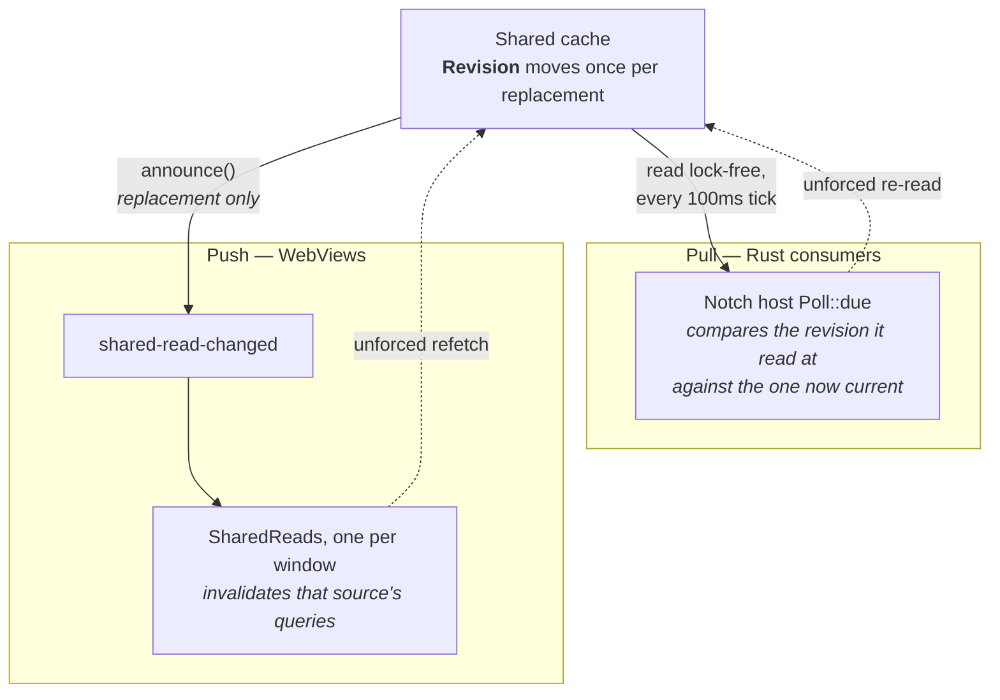
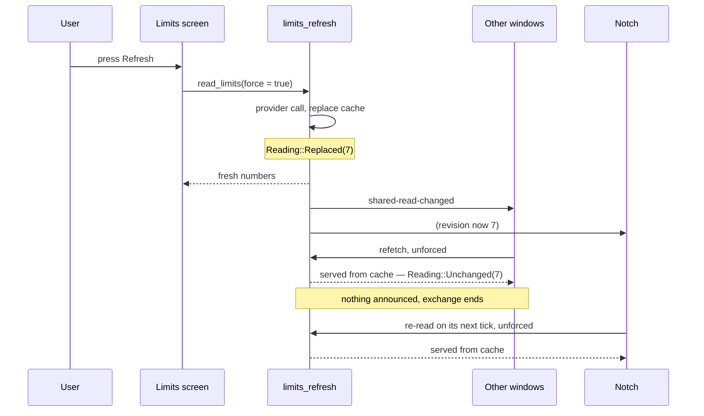

# Shared cached reads

**Orientation, not a source of truth.** `src-tauri/src/read_revision.rs` and its tests are
authoritative.

## The problem

An expensive read — spawning `claude -p /usage` or `codex app-server`, unlocking the Keychain, a
GitHub GraphQL round trip — is made once per process and shared by every surface that wants it. But those surfaces also
each keep their **own copy** of the answer: the notch keeps one per cell so it can draw while a
read is in flight, and each WebView keeps a TanStack Query cache. A copy cannot tell a cache it
has already seen from one another surface has just replaced.

Left there, pressing Refresh on the Limits screen replaced the shared cache immediately while the
notch went on showing the old observation for up to `limitsPollMinutes` — five minutes by default,
thirty at the slowest setting. The same gap ran the other way: a monitor read that found fresher
numbers left both screens on their last answer.

## The mechanism

Limits consumers check the shared cache at least every five minutes while polling is enabled
(`limits_refresh::check_interval`; the WebViews restate it as `LIMITS_CHECK_MINUTES`, which
`ui/src/features/limits/limitsCadence.test.ts` holds to `src-tauri/src/limits_refresh/fixtures/cadence.json`,
a fixture a Rust test keeps equal to `check_interval`). The poll setting is 5, 10, 15 or 30
minutes, so that check is every five minutes today.
The cache keeps separate deadlines for the native account and saved profiles. Only a successful
active account reading whose fullest quota window is at least 90% and below 100% used shortens
its next read to five minutes (or the configured interval, if shorter). At 100%, or below 90%
after a reset, that account returns to the configured interval. Saved profiles keep their own
configured cadence. Extra native reads retain saved cards and announce the replacement as usual.

A read that fails waits the Limits **failure backoff** before it is made again
(`limits_refresh::failure_backoff`): its interval doubled for each failure in a row, at most
sixteen intervals and never more than an hour; a success starts the count over. Each read keeps
its own count and passes its own interval: a provider's native read (the cache's freshness,
`cache_is_fresh`) and each saved profile's poll (`accounts/usage.rs`) count the failure they just
had, so the first one waits two intervals, and both wait out a rate limit's Retry-After when that
is longer. Which failures count, and how long a Retry-After holds the read, is the read outcome's
(`limits/outcome.rs`, [Limits](README.md#limits)): a failed card counts, while signed out, not
installed and unsupported wait the ordinary interval, since reading again cannot help until the user
acts.
Each Codex backend figure, per account (`limits/backend_memo.rs`), counts only the failures before
its latest one, as it was specified when it was added: it waits one interval after its first
failure in a row, half what the other reads wait at each later step, until both reach sixteen
intervals or the hour. So a failing native read never delays the other provider, and a failing
figure never delays the usage read it rides on. A forced read bypasses the native
backoff but not the native read's Retry-After, nor a saved profile's backoff after a failure, nor a
backend figure's. The native Retry-After holds only the login it was answered for: while it holds,
the cache asks the provider's reader which account the native login names now
(`limits::native_login`: the account `.claude.json` names for Claude, the login metadata's account
for Codex, and for Muse only the email `auth.json` records (`muse_store::login_email`), so the
lookup never asks the Keychain; a test per provider holds it to the account a read records),
and a login changed outside on-n-off, such as `muse login` in a terminal, is read at once. The
cache keeps the native read's state apart from the saved accounts' (`NativeState`): a native read
replaces it whole, and a saved-accounts refresh leaves it as it was.

The Limits read serves its column ([Limits](README.md#limits)), built from the cards the cache
holds, the provider's roster of saved profiles and categories, and the sign-in ends the account
list read. The roster and the sign-in ends each sit in the cache under a small lock of their own,
never under the read lock that spans CLI and network reads, so nothing that writes them waits on a
read in flight. The roster has two writers: the saved refresh, from the vault it already loaded
(and only when it loaded one; a saved refresh that could not keeps the previous roster, as does one
a reread overtook), and `limits_refresh::roster_changed`, which every vault writer outside an
in-app account change asks for (`Notify::roster`: automatic remembering, unlock, a category edit or
forget, archive and unarchive) and which rereads the vault with the session's key alone
(`Store::open_unlocked`). The sign-in ends have one, the account list
(`limits_refresh::sign_in_deadlines_listed`). Each bumps the revision and announces only when what
it holds changed, and the reads that answer the announcement are served from the cache.

Two directions, because the Rust consumers can poll a counter and the WebViews cannot. The
notch's Rust consumer is its host (`side_notch/host.rs`), on macOS and on Windows alike: one poll
per provider and one for pull requests, each due as soon as the shared cache's revision is newer
than the one its last read reported, without waiting for its interval.

The `Revision` sits *outside* the mutex guarding the cache, because a read holds that mutex for
the whole of its provider call and asking "is there anything newer?" must never block behind one.

## The two rules

Both are load-bearing. Breaking either turns this into a loop.

**1. Announce a replacement, never a read.**

A read reports a `Reading` — `Replaced(revision)` or `Unchanged(revision)` — and only `Replaced`
is announced. The read a consumer makes in answer is served the value already there, reports
`Unchanged`, and announces nothing. That is what ends the exchange.

**2. Answer an announcement unforced.**

`force` bypasses the cache and belongs to a person pressing refresh. A forced answer would call
the provider, replace the read, and announce again — without end. Every UI source's answer
(`ui/src/lib/sharedReads/announcements.test.tsx`), the forced read's own function after it has run
(`ui/src/lib/sharedReads/forcedRead.test.tsx`) and the notch's poll are tested for this.

## The asymmetry worth knowing

The two caches behave differently on failure, and it is deliberate:

- **`limits_refresh` remembers a failed read** and can serve it, so a failure is a replacement and
  is announced. Everyone converges on the same error message, and the follow-up reads are served
  from the cache rather than hammering a provider that is down.
- **`github` discards its remembered result** on failure, so a failure reports `Unchanged`.
  Announcing it would send the Pull requests screen, the CI monitor and the notch straight back to
  `api.github.com` for the request the reader was just told it could not make.

A new shared read must decide which of those it is before it decides whether to announce.

## In the UI

Each source is one module under `ui/src/lib/sharedReads/`: `limits.ts` (the three
`limits:<provider>` sources), `githubPrs.ts`, `resetSpends.ts` and `accounts.ts`. A source module
is the only place that knows its query keys and its reads through `$lib/api`. Screens pass its
query options to `useQuery` (`limitsQuery`, `githubPrsQuery`, `pendingResetSpendsQuery`,
`accountListQuery`, `accountPreferenceQuery`, `codexSubscriptionQuery`)
and call its operations (`refreshLimits`, `refetchStaleLimits`, `rereadLimits`, `updateLimits`,
`refreshGithubPrs`, `rereadPendingResetSpends`, `rereadAccountListsAndPreference`,
`accountChanged`, `cachedAccountList`, `setCategoryLocally`); they never
write a key. Each module also exports its source's entry for the
announcement table, the keys an announcement of it invalidates, and `announcements.ts` builds the
table from those entries alone. A key changed in one place is therefore changed in both. The
modules import no React and no query observer: the table and the shell's Refresh are in the
initial bundle, and TanStack's observer stays in the screens' chunks.

- **One listener per window.** `<SharedReads />` sits inside the main window's and the popover's
  `QueryClientProvider`, and nothing else listens for `shared-read-changed`. It only invalidates:
  a query a screen shows reads again once, through its own unforced query function, however many
  surfaces show it, and one no screen shows is marked stale, so the next screen to show it reads
  it again rather than drawing the copy from before the announcement until its stale time passes.
- **One forced read.** `readForced` (`sharedReads/forcedRead.ts`) waits out a read of the key
  already in flight, so a refresh asked during it is not answered by it, then fetches once with
  `force = true` through a query function that disarms itself after its first call. TanStack
  keeps the last function it fetched with for the query's later refetches, an announcement's
  included; disarmed, that function reads unforced. The forced fetch passes `staleTime: 0`, or the
  main window's 30-second default would answer it from the cache. A screen showing the query puts
  its own unforced function back when it next renders, which can hide one that never disarmed, so
  `forcedRead.test.tsx` also checks the disarm with no screen showing the read, on each window's
  own query client (`ui/src/lib/queryClients.ts`). The shell's Refresh and the popover's are
  `refreshLimits`, every limits source forced; the Pull requests screen's is `refreshGithubPrs`.
  A forced read is tried once and not retried.
- **Accounts has no forced read.** Its announcement covers two key families, the account lists
  with the remembering preference (`["accounts", …]`) and the Codex subscription dates
  (`["subscription", "codex", …]`). An account change in the window (`accountChanged`) re-reads
  both and that provider's limits; the shell's Refresh and the remembering toggle re-read the
  lists and the preference, not the subscription dates (`rereadAccountListsAndPreference`).
- **Limits poll the cache at least every five minutes** (`limitsRefreshMs`): the shared cache, not
  the screen, decides which accounts are due, including an active account close to its limit.

Rust and the UI agree on the wire through `src-tauri/src/read_revision/fixtures/shared-reads.json`:
the event name and, by source, the exact payload `announce` sends. `read_revision/tests.rs`
asserts Rust writes exactly that for every `Source`, and `ui/src/lib/sharedReadsContract.test.ts`
asserts that `SharedReadSource`, `SharedReadChanged` and the announcement table have exactly the
fixture's sources (at the type level, so `bun run check` fails) and that `onSharedReadChanged`
listens to its event. A new source is a `Source` variant, its fixture entry, a `SharedReadSource`
member and its module's table entry; the tests fail until all four agree.
