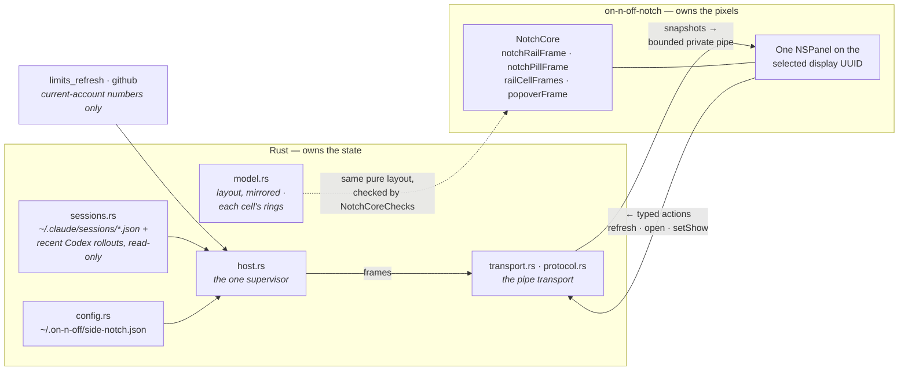

# The side notch

**Orientation, not a source of truth.** `src-tauri/src/side_notch/` and
`src-tauri/macos/SideNotch/` are authoritative.

An opt-in overlay that keeps quota rings and pull requests visible without the app window being
open. It is the only part of the product that is not a WebView. It exists twice: on macOS as a
bundled helper executable, on Windows 11 as a window the app paints itself. Rust owns the settings
and the data on both, and both draw the same rail and popovers from the same layout maths.

## One host, two transports

`host.rs` is the only supervisor, on both platforms. It owns the settings snapshot the notch is
drawn for, a poll per provider and one each for sessions and pull requests, the actions both
notches report (refresh, open Limits or Pull requests, show on hover), the status it emits as
`side-notch-changed`, and the one projection of what it read into the rail frame (`RailData`): the
selected providers that have been read, in rail order, with their sessions, then the pull request
cell when it is on and has been read, each list keeping at most 25 rows and only those on
github.com, each row with its context. The frame and that projection are `host/frame.rs`; the
Tauri side, the supervisor thread and the app the host reads through (`Production`, which opens
windows and emits through the `AppHandle`), is `host/app.rs`. The host keeps no interval of its
own: it asks `Production` for the limits check interval and the pull request interval at every
check. Both come from the settings once, are then held in memory (`settings::remembered_seconds`
over `limits_refresh::POLL_SECONDS` and `github::POLL_SECONDS`), and are replaced when settings
are saved.

What differs between the platforms is how a frame reaches the pixels and how actions come back.
That is the `Transport` the host is given, and it is the only thing that differs:

- **macOS, `transport.rs` (`Pipe`).** Starts the helper, sends each frame as one protocol-6 line
  (`protocol::encode`) and waits for its ack before sending the next. A helper that fails to start,
  exits or acks nothing for 10 s is started again after a wait of 1 s, doubling to 30 s; new
  settings try again at once, and an ack after 30 s up, or turning the notch off, sets the wait back
  to 1 s. Its time is the host's, passed in on every call, so its tests run on a clock of their own.
- **Windows, `win_transport.rs` (`Overlay`).** Starts the window thread, hands it each frame over a
  channel, pings it every tick to notice it died, and confirms each frame the window took, which
  clears the error a lost window left. It carries out the two actions only it has, opening a pull
  request and copying a review request, and gives the host their result to show.

Both report a screen change, which makes the host re-read the displays and the limits: the helper
when macOS says the screens changed, the Windows window when its screen poll reads other displays
than the last time.

Things that are easy to get wrong:

- **A platform difference goes in its transport, never in a second loop.** There used to be one
  loop per platform, and they drifted: the Windows one never learned the
  [shared-read revisions](shared-reads.md), so a refresh on the Limits screen reached the Windows
  notch only on its next interval, and it redrew after every Limits read whether or not it changed.
- **A read redraws only when it changed what the frame shows.** Otherwise a frame goes out on the
  30 s heartbeat, and after an action or new settings.
- **What only one transport reports is gated to its platform** (and to test builds): a wait before
  retrying on macOS, an action the transport carried out on Windows.
- **The host's rules are tested on every OS** through a fake transport and a fake `App`
  (`host/tests/`), the seam that stands for the reads, the settings store and the windows it opens.
  `host/tests/wire.rs` pins the exact bytes the helper receives; `transport/tests.rs` the pipe's
  acks, waits and frame numbers; `host/app/tests.rs` that `Production` follows the shared reads'
  own revisions and intervals; `win_transport/tests.rs`, on Windows only, the overlay.

## On macOS



What each provider cell shows is decided once, in `model.rs` (`NotchProvider::current`), from the
current account's card, and both notches only draw it:

- **The windows**, in the card's order: weekly, then session, then per model. The popover lists
  them so, as the Limits screen does. Codex's hidden buckets never arrive: the limits reader drops
  them (see the Codex row of `PROVIDERS.md`).
- **The headline window**, by id: the weekly window. The cell's outer ring and figure show it
  whatever the card's status, as its Limits card does: an account whose refresh is paused keeps
  its last reading, which the macOS cell's label and both popovers call last observed. An account
  without a weekly window shows a dash, never its session.
- **The inner ring**: Claude's Fable weekly window, by id, or a Codex business member's
  workspace-credit share, chosen the same way. The share's meter is the
  limits reader's `used_percent`; its amounts are worded once in `model.rs`
  (`workspace_share_wording`) for both notches, and each draws it as a window so it renews at its
  reset.

Each pull request row's context is decided the same way, by `PrContext::of` from GitHub's
`isInOrganization`: work for an organization's repository, personal for a user's. Both popovers
draw it as a WORK or PERSONAL tag before the repository, a stripe down the row's leading edge and a
copy icon in the same ink, so a review request is not pasted into the wrong channel. A row read
before GitHub reported its owner draws none of them.

The macOS helper receives these over the pipe (`headlineWindowId`, `innerRing`, each row's
`context`; protocol version 6) and refuses a message naming a window it did not send; the Windows
painter gets them in memory.
What depends on the clock stays with each, since they redraw between reads: a window's percent now
and its reset note.

Things that are easy to get wrong:

- **Rust owns settings and data; the helper owns drawing.** The settings card stays in
  `ui/src/features/notch/`. The helper reports typed actions and never edits configuration
  directly, and never picks a window: the host names the headline and inner-ring windows.
- **The display is chosen explicitly, by UUID.** A disconnected or mirrored selection hides the
  notch rather than falling back to another screen — silently moving it is worse than not showing.
- **The rail's geometry exists twice on purpose**, in `NotchCore` (Swift, `Models.swift`) and
  `side_notch/model.rs` (Rust), so Rust can reason about it without calling into AppKit. They
  mirror each other function for function: `railLayout` is `rail_metrics`, `RailLayout.length` is
  `RailMetrics::length`, `notchRailFrame` is `layout`, `railCellFrames` is `rail_cell_frames`,
  `notchPillFrame` is `pill_frame`, and `selectedDisplay` and `pixelAligned` keep their names.
  Both round every measurement to the display's pixel grid before adding them up, so a rail is
  exactly as long as its cells, their spacing and two ears, and lands on whole device pixels.
  The helper draws from the Swift copy. Rust's copy decides whether the rail has room (`save` and
  the host's reads) and is what the Windows painter draws its silhouette, cells, cap and pill
  from. A change to `model.rs` alone therefore moves the Windows notch and the macOS room check,
  never the macOS helper. The expected numbers live once, in
  `macos/SideNotch/Tests/NotchCoreTests/rail-cases.json`, which `NotchCoreChecks` and
  `model/tests/rail.rs` both read: each case is a list of displays (the one named `main` is
  selected), a size, an edge and a cell count, and the rail and pill it gets in device pixels, or
  `null` where the rail hides; the metrics rows give every measurement of a right-edge rail. To
  change a measurement, edit both files and the fixture. A change on one side only fails that
  side's check.
  Popovers are not in `model.rs`: the Windows painter places them with its own copy of
  `popoverFrame` (`popover_frame`) and lays out what is in them itself.
- **Nothing sensitive crosses the pipe** — current-account numbers, session rows, PR rows. No
  credentials, no network listener. PR rows open in the browser and copy a link to the pasteboard;
  the helper never writes to GitHub.
- **The notch is Liquid Glass from macOS 26.** `NotchRailView` fills the rail's silhouette and
  `PopoverView.swift` draws each popover's card and tail as one outline, both through
  `notchSurface` in `NotchView.swift`. On macOS 26 both are glass with a translucent layer of their
  ink over it, which keeps the figures and muted text readable on
  a bright desktop; earlier systems fill them with solid ink. The settings card's Style choice
  (`popoverStyle`, glass by default) asks for solid ink on macOS 26 as well, for the rail and the
  popovers together. The card offers it only when the snapshot's `liquidGlass` reports macOS 26 or
  later. The Windows painter draws its own solid rail and card and ignores the choice.
- **Renders show the layout, not the glass.** Offscreen there is nothing behind the notch for the
  glass to sample, so `--render` draws the rail and popovers in solid ink. It also writes
  `rail-styled.png` and `popover-claude-styled.png` in the fixture's own style.
  `scripts/check-native-notch.mjs` fails if the rail's screen edge is not rail ink, if the hovered
  cap changes nothing, if a rendered card is not solid popover ink or lacks its 1 pt border, if its
  tail is missing, off its cell's centre or the wrong width, if a popover is not the same card on
  every edge plus one tail, and, on macOS 26 or later, if a styled render is solid ink. The fixture
  keeps popovers clear of the display's edges so the tail sits mid-popover. Judge the glass from a
  `screencapture -R` of the rail and popovers on screen. Computer-use screenshots never show the
  helper.

Built by `native_build.rs` on macOS only and bundled through `tauri.macos.conf.json`. Native
checks run without an Xcode XCTest dependency:

```sh
xcrun swift run --package-path src-tauri/macos/SideNotch NotchCoreChecks
bun scripts/check-native-notch.mjs   # after a Rust build
```

## On Windows

There is no helper and no second executable. `win_window.rs` owns one transparent, always-on-top,
non-activating `tao` window per selected display and presents it with `UpdateLayeredWindow`;
`win_paint.rs` draws the rail (from `model.rs`'s metrics and frames), the marks and the popovers
into a tiny-skia pixmap; `win_displays.rs` enumerates monitors; and `win_transport.rs` is the
host's Windows transport, in-process channels where macOS has pipes. The display is chosen by
device name rather than UUID, and the same rule holds — a disconnected or mirrored selection
hides the notch. Windows 11 is the floor (`CurrentBuildNumber` >= 22000); the settings card says
so on older builds.

`OS.md` carries the Windows behaviours that decide whether this works at all — the bare `WS_POPUP`
style, per-pixel-alpha hit testing, the pointer poll that stands in for the `CursorMoved` events
tao never sends, pixel alignment on fractional display scaling, and the screen poll that puts the
notch back on top when Windows stacks it below an ordinary window. Read it before changing
`win_window.rs`.

**Typography is measured, not eyeballed.** The overlay sits next to the app's own window, so any
mismatch in face, weight or antialiasing reads instantly as the wrong font. `win_paint/text.rs`
therefore re-treads the path the WebView takes rather than forming its own opinion: the face
DirectWrite hands the WebView for a weight (Segoe UI ships no 500, and DirectWrite steps a 500
request *up* onto semibold, so the app's `font-medium` renders semibold on both sides), the
ClearType 3x1 texture collapsed by sRGB luminance the way Skia does for a grayscale alpha mask, and
the sRGB display exponent applied to that linear coverage before blending. Marks beside a title
centre on the cap band, which is where SF Pro's line box lands and where Segoe UI's does not.

`win_paint::visual::specimen` renders every size and weight on one sheet so it can be checked
against the real thing: rebuild the same rows as HTML and render them with `msedge --headless`,
once plain and once with `--disable-lcd-text`, which brackets what the WebView does. Advance widths
and ink centroids should match outright, total ink to a few per cent. Measure alpha-weighted — a
premultiplied PNG read as RGB reports every partial pixel as solid and will tell you the text is
far harder than it is.
