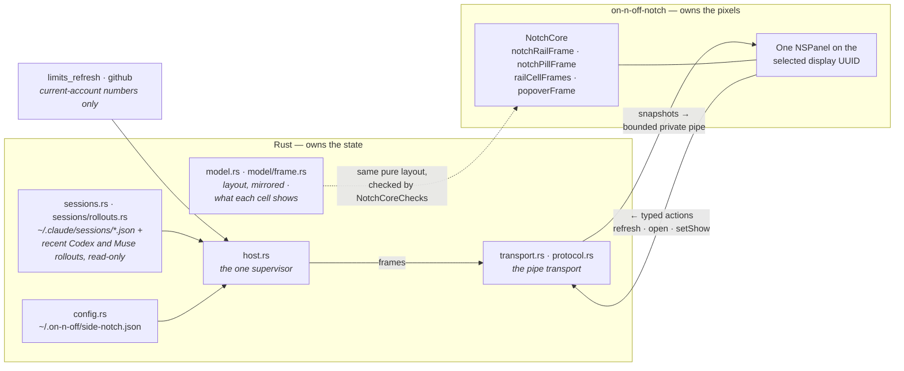

# The side notch

**Orientation, not a source of truth.** `src-tauri/src/side_notch/` and
`src-tauri/macos/SideNotch/` are authoritative.

An opt-in overlay that keeps quota rings and pull requests visible without the app window being
open. It is the only part of the product that is not a WebView. It exists twice: on macOS as a
bundled helper executable, on Windows 11 as a window the app paints itself. Rust owns the settings
and the data on both, and both draw the same rail and popovers from the same layout maths.

## One host, two transports

`host.rs` is the only supervisor, on both platforms. It owns the settings snapshot the notch is
drawn for, a poll per provider and one each for sessions and pull requests, the actions both
notches report (refresh, open Limits or Pull requests, show on hover), the status it emits as
`side-notch-changed`, and the rail frame (`RailData`) it hands its transport. It does not decide
what the frame holds: it gives the notch model what its polls last read (`frame::rail`, below) and
sends what comes back. The
Tauri side, the supervisor thread and the app the host reads through (`Production`, which opens
windows and emits through the `AppHandle`), is `host/app.rs`. The host keeps no interval of its
own: it asks `Production` for the limits check interval and the pull request interval at every
check. Both come from the settings once, are then held in memory (`settings::remembered_seconds`
over `limits_refresh::POLL_SECONDS` and `github::POLL_SECONDS`), and are replaced when settings
are saved.

What differs between the platforms is how a frame reaches the pixels and how actions come back.
That is the `Transport` the host is given, and it is the only thing that differs:

- **macOS, `transport.rs` (`Pipe`).** Starts the helper, sends each frame as one protocol-7 line
  (`protocol::encode`) and waits for its ack before sending the next. A helper that fails to start,
  exits or acks nothing for 10 s is started again after a wait of 1 s, doubling to 30 s; new
  settings try again at once, and an ack after 30 s up, or turning the notch off, sets the wait back
  to 1 s. Its time is the host's, passed in on every call, so its tests run on a clock of their own.
- **Windows, `win_transport.rs` (`Overlay`).** Starts the window thread, hands it each frame over a
  channel, pings it every tick to notice it died, and confirms each frame the window took, which
  clears the error a lost window left. It carries out the two actions only it has, opening a pull
  request and copying a review request, and gives the host their result to show.

Both report a screen change, which makes the host re-read the displays and the limits: the helper
when macOS says the screens changed, the Windows window when its screen poll reads other displays
than the last time.

Things that are easy to get wrong:

- **A platform difference goes in its transport, never in a second loop.** There used to be one
  loop per platform, and they drifted: the Windows one never learned the
  [shared-read revisions](shared-reads.md), so a refresh on the Limits screen reached the Windows
  notch only on its next interval, and it redrew after every Limits read whether or not it changed.
- **A read redraws only when it changed what the frame shows.** Otherwise a frame goes out on the
  30 s heartbeat, and after an action or new settings.
- **What only one transport reports is gated to its platform** (and to test builds): a wait before
  retrying on macOS, an action the transport carried out on Windows.
- **The host's rules are tested on every OS** through a fake transport and a fake `App`
  (`host/tests/`), the seam that stands for the reads, the settings store and the windows it opens.
  `host/tests/wire.rs` pins the exact bytes the helper receives (the golden messages, under
  [Protocol 7](#protocol-7)); `model/frame/tests.rs` what each cell shows; `transport/tests.rs`
  the pipe's acks, waits and frame numbers; `host/app/tests.rs` that `Production` follows the
  shared reads' own revisions and intervals; `win_transport/tests.rs`, on Windows only, the
  overlay.

## What each cell shows is decided once

`side_notch/model/frame.rs` (`frame::rail`) decides the whole frame, for both notches: which cells
the rail has, in what order, and everything each one says that does not depend on the clock. The
macOS helper and the Windows painter only draw it. They used to decide much of it twice, and
disagreed: the Windows ring drew a pull request that sat in two lists twice, and the Windows rail
drew only the cells that had been read into the first slots of a rail sized for all of them.

- **The cells.** One per selected provider, in rail order (`RAIL_ORDER`), then the pull request
  cell when it is on. A provider without a current-account reading, not read yet or read without
  one, keeps its slot as a checking cell: no reading, a dash, and "Checking limits…" in its
  popover, the words the Limits screen and the tray popover use before their first read. The pull request cell is checking until its first read ("Checking pull requests…").
  The rail is as long as the frame's cells on both notches: the Windows painter and the helper
  size it from the cells they were sent, and `save` and the host's reads from
  `frame::cell_count`, which counts the same slots `frame::rail` fills. The helper decodes no
  provider list or pull request settings at all.
- **A provider cell**: its reading (from `NotchProvider::current`, below: meter data only, the
  windows and what the rings name), its sessions, and what its card's read standing says
  (`ReadStanding::of`, which `NotchProvider::current` asks of the signed-in card and keeps to
  itself; [why](README.md#limits)). A live card says nothing above its windows, even without any. A
  card last observed shows an amber paused line, whatever it still holds: "Refresh paused. Last
  observed values below." over windows or a workspace share, and "Refresh paused." when it holds
  only figures the notch does not draw, such as a credit balance, rather than pointing at values
  that are not there. Above it, the standing's message is its notice. An unavailable card shows
  the standing's message alone: the card's own, in the read outcome's words. A message's tone is the card's: a failed read's message is red (`error`), any other
  muted. The notch used to decide this itself: "Usage unavailable." where the card said "Claude
  limits are unavailable.", always muted where the card is red, and paused only over windows or a
  share. The read's status, message and standing never reach the drawers: the notice and the
  paused line are what they say.
- **The pull request cell**: what the read's standing says (`PrReadStanding::of`, which the frame
  asks of the read; [why](README.md#pull-requests)): readable unless it is unavailable, its message
  as the notice when it is not live, in the message's tone whether or not the last read's lists
  still show: red for a problem the user must fix (no `gh`, signed out of it, a rejected login),
  amber for one that passes (a rate limit, GitHub out of reach), as the Pull requests screen inks
  its banner. The notch used to ink it amber over the last read's lists and muted over none, so a
  signed-out `gh` read grey on the notch and red on the screen. Then, only when readable, the lists
  in their own order with their titles, at most 25 rows each and only rows on github.com. The ring
  has one segment per pull request across the lists, at most 24, a passing pull request with merge
  conflicts marked as such, and its figure (`label`) is the count of distinct pull requests once the
  read is readable, a dash until then. The attention counts the macOS cell speaks (conflicts,
  failing CI, changes requested, ready to merge) count each pull request once too.

- **Each row's badges** (Draft, Approved, Changes requested, Conflicts, Queued, Auto-merge, Ready to
  merge, Behind base, Blocked) and **its tag**, each a label and a tone. A tone names an ink, never
  a colour: muted, green, red, amber, work, personal; each drawer keeps its own inks for them.

What each provider cell's reading holds is decided in `model.rs` (`NotchProvider::current`), from
the current account's card:

- **The windows**, in the card's order: weekly, then session, then per model. The popover lists
  them so, as the Limits screen does. Codex's hidden buckets never arrive: the limits reader drops
  them (see the Codex row of `PROVIDERS.md`).
- **The headline window**, by id: the weekly window. The cell's outer ring and figure show it
  whatever the card's status, as its Limits card does: an account whose refresh is paused keeps
  its last reading, which the macOS cell's label and both popovers call last observed. An account
  without a weekly window shows a dash, never its session.
- **The inner ring**: the window its reader gave the inner-ring role (`role: "innerRing"`,
  Claude's Fable week), by id, or else a Codex business member's workspace-credit share, chosen the
  same way. The model asks the role, never the provider or the label. The helper is told the ring
  by id, and each window its message carries is a `NativeWindow` (`protocol.rs`) borrowing only the
  fields the helper reads: the seven protocol 7 has always sent, and the first-message flag when it
  is set, from which both notches word an idle window as the card does. No later window field, the
  role among them, reaches the helper by accident. The share's meter is the
  limits reader's `used_percent`; its amounts are worded once in `model.rs`
  (`workspace_share_wording`) for both notches, and each draws it as a window so it renews at its
  reset.

Each pull request row's context is decided the same way, by `PrContext::of` from GitHub's
`isInOrganization`: work for an organization's repository, personal for a user's. It reaches the
drawers as the row's tag (Work or Personal, in the work or personal tone). Neither popover draws the
tag's label, which pushed the pull request's number out of the repository line: the tone inks a
stripe down the row's leading edge and the copy icon, blue for work and a soft lavender for
personal, so a review request is not pasted into the wrong channel, and the label names the row for
VoiceOver. A row read before GitHub reported its owner has no tag and draws neither. The model also
names the viewer's own personal repository without its owner (`dotfiles`, not `octocat/dotfiles`),
by `repo_label`; another user's personal repository and the viewer's fork of an organization's keep
the owner.

What stays with each drawer is what depends on the clock, since they redraw between reads (a
window's percent now, its reset note, a session's age, the percent under a provider's ring), and
what is only style: provider names and marks, the inks of each tone, list titles and tags set in
capitals, the CI dot's colour, "Nothing open." and "N of M". The rules for what a window reads at
an instant are still one, `limits/window_at.rs`, which the Windows plan asks with the clock its
window passes in and NotchCore restates; both, and the card, read the cases in
`limits/window_at/fixtures/window-cases.json` ([why](README.md#limits)). The review request copied from a row is
still worded by each drawer. What VoiceOver says for a rail cell is built in NotchCore
(`ProviderCell.spoken`, `PullRequestCell.spoken`, pinned by NotchCoreChecks) from the decided
fields alone: a cell not read yet is "updating", one without a headline says its notice, a ring
whose meter is unreadable says "usage unavailable", as its popover row does, and the paused line adds
"refresh paused, last observed" after the headline's figure, or "refresh paused" before the notice
of a cell without a headline.

A drawer never decides what a cell says. A new badge, notice or rule goes in `model/frame.rs` and
reaches both notches as data; a drawer only maps it to pixels. The helper draws the cells in the
order it receives them, so rail order lives in `RAIL_ORDER` alone.

## Live sessions

A provider cell's sessions come from `sessions::read` (`sessions.rs`), which the host calls every
ten seconds for each selected provider, off the supervisor thread. It is read-only and lists at
most twelve sessions, the most recently active first; one exhaustive match picks each provider's
reader, and each provider's facts are its Live sessions row in [PROVIDERS.md](../../PROVIDERS.md).
Claude Code writes a file per running process that names its state, read by its own reader, which
lists a row only while its pid is alive. Codex and Muse name no live state: each writes its
transcripts into dated dirs (`sessions/YYYY/MM/DD`), and one reader, `sessions/rollouts.rs`, lists
both from there. A provider is a small description beside it (`CODEX`, `MUSE`): its layout and its
turn markers. A layout is either a rollout file a session, whose first line names its id, workspace
and place (Codex), or a folder a session, named by its id, with the head keys that name its
workspace and the registry of live sessions its host keeps (Muse); a folder session's place is
always Terminal. The markers say which events start and end a turn and where a line names its
kind. Each setting belongs to one layout, so a description cannot pair a registry with rollout
files. The reader owns the rest, once for both:

- **The walk.** The day dirs of yesterday, today and tomorrow by the UTC date. Both providers date
  a session's dir by the local date it started on (observed 2026-11 for both, on a machine at UTC−3:
  a session started at 22:20 local sits in that local day's dir, whose UTC date was the next), and
  every zone's local today is one of those three UTC dates. Reading only the UTC today and
  yesterday missed, east of UTC, every session started after local midnight until UTC midnight; west
  of UTC tomorrow's dir never exists, so reading it costs one failed directory open. A session is a
  candidate when its transcript was written in the last hour, or when the registry names it; only
  the 48 most recently written candidates are read (each its first line or head, then its tail), so
  a day of hundreds of rollouts costs at most 48 transcripts a read. A folder id is kept from the
  newest day that holds it, and hidden folders are skipped.
- **The name.** The registry's name and project when it has them; otherwise the project is the
  workspace's folder name (Home without one) and the name `<project>-<last two id characters>`.
- **The turn.** The last start or end event in the transcript's final 128 KiB decides a `Turn`:
  open, closed, or unmarked when the tail has neither. An open turn written in the last 15 minutes
  is working, and so is an unmarked one written in the last two, since a long answer can push the
  turn's start out of the tail while it is still being written; anything else is idle.
- **Last active.** The later of the transcript's and the registration's modification times; the
  turn's age is the transcript's alone.

`limits/codex_sessions.rs` reads the same Codex rollouts for a different purpose, a remembered
window's newer observations, with a walk of its own: nine days back from the UTC today, in name
order, every `token_count` event in a 256 KiB tail. The two share only the dated path, so they
share no code. That walk still starts at the UTC today, so east of UTC it leaves out the newest
local day's rollouts until UTC midnight.

## On macOS



### Protocol 7

The helper receives the frame as one line: `version` 7, `sequence`, `snapshot` (the
settings and displays), `cells` in rail order and `actionError`. Each cell has a `kind`:

- `provider`: `provider`, `reading` (absent while checking: `windows`, each with
  `startsOnFirstMessage` only when it is set, `headlineWindowId`, `innerRing`, `workspaceCredits`),
  `notice`, `paused` (each a `text` and a `tone`, absent when there is none) and `sessions`.
- `pullRequests`: `label`, `reading` (absent while checking: `readable`, `count`, `segments` of `ci`
  and `passingWithConflicts`, `attention`, `lists` of `id`, `title`, `total` and `items`, each row
  with its `repo` as the drawers show it, its `badges` and optional `tag`, each a `label` and a
  `tone`) and `notice`.

The snapshot's settings still carry the provider list and the pull request settings, for the app;
the helper reads only `enabled`, `displayId`, `edge`, `size`, `show` and `popoverStyle`.

The helper refuses another version, a message naming a window it did not send, two cells with the
same id, more than 24 segments or 25 rows a list, and a row off github.com. A window or workspace
share whose used percent is outside 0–100 or not a number (`null` on the wire) is not refused: it
draws as unreadable, a dash and an empty meter, and the rest of the notch as usual. It used to
refuse the whole message, and one bad meter blanked the notch. It skips a cell whose
provider it does not know rather than refusing the whole message, and its rail is one cell shorter
for it: the helper ships inside the bundle, so this only matters between builds, but one unknown
provider used to blank the notch. An unknown tone draws muted; an unknown CI state draws as no
checks.

Two messages are the contract both sides check:
`macos/SideNotch/Tests/NotchCoreTests/host-message.json`. `host/tests/wire.rs` drives the host
through its first frame, where every cell is checking, and a frame after every read (a read
provider, a paused one, one with no current account, a stale pull request read with a pull request
in two lists and a passing one in conflict), and asserts that the encoder's bytes are that file's,
key for key; `NotchCoreChecks` decodes the same file and asserts every decided field. A field
renamed or dropped on one side fails that side's check. To change the protocol, change the encoder
and the Swift models, regenerate the file from the encoder, and update both assertions.

Things that are easy to get wrong:

- **Rust owns settings and data; the helper owns drawing.** The settings card stays in
  `ui/src/features/notch/`. The helper reports typed actions and never edits configuration
  directly, and never picks a window: the host names the headline and inner-ring windows.
- **The display is chosen explicitly, by UUID.** A disconnected or mirrored selection hides the
  notch rather than falling back to another screen — silently moving it is worse than not showing.
- **The rail's geometry exists twice on purpose**, in `NotchCore` (Swift, `Models.swift`) and
  `side_notch/model.rs` (Rust), so Rust can reason about it without calling into AppKit. They
  mirror each other function for function: `railLayout` is `rail_metrics`, `RailLayout.length` is
  `RailMetrics::length`, `notchRailFrame` is `layout`, `railCellFrames` is `rail_cell_frames`,
  `notchPillFrame` is `pill_frame`, and `selectedDisplay` and `pixelAligned` keep their names. The
  frames take the rail's cell count rather than counting the settings' providers.
  Both round every measurement to the display's pixel grid before adding them up, so a rail is
  exactly as long as its cells, their spacing and two ears, and lands on whole device pixels.
  The helper draws from the Swift copy. Rust's copy decides whether the rail has room (`save` and
  the host's reads) and is what the Windows plan places the rail, its cells, the cap and the pill
  from. A change to `model.rs` alone therefore moves the Windows notch and the macOS room check,
  never the macOS helper. The expected numbers live once, in
  `macos/SideNotch/Tests/NotchCoreTests/rail-cases.json`, which `NotchCoreChecks` and
  `model/tests/rail.rs` both read: each case is a list of displays (the one named `main` is
  selected), a size, an edge and a cell count, and the rail and pill it gets in device pixels, or
  `null` where the rail hides; the metrics rows give every measurement of a right-edge rail and
  the first two cells on the right and top edges. To change a measurement, edit both files and
  the fixture. A change on one side only fails that side's check.
  Popovers are not in `model.rs`: the Windows plan places them with its own copy of
  `popoverFrame` (`popover_frame`) and lays out what is in them itself
  ([the Windows plan](#the-windows-plan)).
- **Nothing sensitive crosses the pipe** — current-account numbers, session rows, PR rows. No
  credentials, no network listener. PR rows open in the browser and copy a link to the pasteboard;
  the helper never writes to GitHub.
- **The notch is Liquid Glass from macOS 26.** `NotchRailView` fills the rail's silhouette and
  `PopoverView.swift` draws each popover's card and tail as one outline, both through
  `notchSurface` in `NotchView.swift`. On macOS 26 both are glass with a translucent layer of their
  ink over it, which keeps the figures and muted text readable on
  a bright desktop; earlier systems fill them with solid ink. The settings card's Style choice
  (`popoverStyle`, glass by default) asks for solid ink on macOS 26 as well, for the rail and the
  popovers together. The card offers it only when the snapshot's `liquidGlass` reports macOS 26 or
  later. The Windows painter draws its own solid rail and card and ignores the choice.
- **Renders show the layout, not the glass.** Offscreen there is nothing behind the notch for the
  glass to sample, so `--render` draws the rail and popovers in solid ink. It also writes
  `rail-styled.png` and `popover-claude-styled.png` in the fixture's own style.
  `scripts/check-native-notch.mjs` fails if the rail's screen edge is not rail ink, if the hovered
  cap changes nothing, if a rendered card is not solid popover ink or lacks its 1 pt border, if its
  tail is missing, off its cell's centre or the wrong width, if a popover is not the same card on
  every edge plus one tail, and, on macOS 26 or later, if a styled render is solid ink. The fixture
  keeps popovers clear of the display's edges so the tail sits mid-popover. Judge the glass from a
  `screencapture -R` of the rail and popovers on screen. Computer-use screenshots never show the
  helper.

Built by `native_build.rs` on macOS only and bundled through `tauri.macos.conf.json`. Native
checks run without an Xcode XCTest dependency:

```sh
xcrun swift run --package-path src-tauri/macos/SideNotch NotchCoreChecks
bun scripts/check-native-notch.mjs   # after a Rust build
```

## On Windows

There is no helper and no second executable. `win_window.rs` owns one transparent, always-on-top,
non-activating Win32 window per selected display, on its own window class and message loop rather
than a second tao event loop (`OS.md` says why), and presents it with `UpdateLayeredWindow`;
`presenter.rs` holds what that window shows and how it answers the pointer
([the presenter](#what-the-window-asks-the-plan)); `plan.rs` works out where everything the window
draws and answers clicks for sits ([the plan](#the-windows-plan)); `win_paint.rs` draws a plan, the
rail, the marks and the popovers, into a tiny-skia pixmap; `win_displays.rs` enumerates monitors;
and `win_transport.rs` is the host's Windows transport, in-process channels where macOS has pipes.
The display is chosen by device name rather than UUID, and the same rule holds — a disconnected or
mirrored selection hides the notch. Windows 11 is the floor (`CurrentBuildNumber` >= 22000); the
settings card says so on older builds.

`OS.md` carries the Windows behaviours that decide whether this works at all — why the notch runs
no tao event loop, the bare `WS_POPUP` style, per-pixel-alpha hit testing, the pointer poll that
the window's own mouse messages cannot replace, pixel alignment on fractional display scaling, and
the screen poll that puts the notch back on top when Windows stacks it below an ordinary window.
Read it before changing `win_window.rs`.

### The Windows plan

`side_notch/plan.rs` turns the displays, the frame `model/frame.rs` decided (its settings among
it), the hover state and the clock into a `Plan`: the window, the rail, each cell, the cap, the pill
(the collapsed strip shown on hover), and the open popover's frame, card, tail and every item and
hit zone in it. The rail and its cells come from `model.rs`'s metrics and frames, the popover's
frame from `popover_frame`, what each cell draws from `cell::cell` (`plan/cell.rs`), and what is in
the popover from `popover::contents` (`plan/popover.rs`), the one place that reads a cell's data to
lay a popover out, which composes it in sections (a provider's quota blocks and session rows, a pull
request list and its rows, the footer) at one `Scale` (the size and the display's pixel grid).

The plan works out where everything the painter draws sits and how far it reaches; the painter maps
those to pixels and keeps only what is style: the rail, card and track inks it fills with, the
card's 1 px border, the strokes of the marks and of a CI dot without checks, the conflict band's
gradient, and two shapes drawn inside a planned rect, the silhouette's curves inside the rail and
the pill's capsule 1 px inside the strip. A cell (`CellPlan`) carries its identity (`CellId`,
NotchCore's `RailCell`), its rect, its arcs, its glyph's box and its figure, a `Text` like any
popover run, with its rect. A quota bar carries how far it fills (its share of the width, never
less than its height, so a nearly empty meter is still a round cap), and a CI dot its ink and
whether it is a ring (no checks) or a disc. Each `Arc` names its
centre, radius, stroke, start and end in degrees (0 at three o'clock, clockwise), ink and caps: the
track, the headline's meter from twelve o'clock, the inner ring's track and meter 6 pt inside it,
or one segment a pull request with 9° between segments, a passing one in conflict banded
(`ArcInk::Conflict`). The figure is 17 pt at the chosen size, centred under the ring and nudged
2 pt right when it shows a headline, as the helper's is. The cap carries its pin's box, the popover
its card's corner radius and its tail's base and apex. The tail is 8 pt long and 7 pt either side
of its apex, the corners 12 pt, and the nudge 2 pt, each scaled by the size and put on the
display's pixel grid (`Scale::value`), the helper's `metrics.value`. The painter used to work these
out itself and disagreed: it drew the tail 8 and 7 times the size off the pixel grid, while the plan
reserved the aligned length for it, the corners at 12 pt whatever the size, and the nudge at 2
device pixels, a single point on a 2x display.

### What the window asks the plan

`presenter.rs` (`Presenter`) is the window's state, compiled like the plan for Windows and for
tests on every OS: the frame and displays it was last sent, whether a full-screen app hides it, the
hover and pin state, and the plan it presented. `win_window.rs` is the Win32 shell around it: it
hands the presenter the frame, the displays, the pointer and the clicks, and draws the plan
`present` returns. Everything the pointer does is answered from that presented plan, the one on
screen: `Plan::hit` names what is under a point, the cap, a cell by its identity, or a popover zone
(open a row, copy its review request, or the footer, which names its page: Limits or Pull
requests), and the pointer's device pixels are read at the scale that plan was drawn at. Whether
the rail is open to the pointer and which show mode the cap asks for come from it too: the cap's
pin on screen, not settings that arrived after it was drawn. Hover and pin hold a cell's identity,
not its slot. The window used to plan afresh for every pointer sample and click, from whatever data
had arrived since it drew, so a click could land on a row that was not on screen yet, and it decided
the footer's page by looking its slot up in the frame.

A pinned popover follows the pointer onto another cell and stays put while the pointer is anywhere
else, its own popover and the rail between cells among it, as the helper's does
(`PanelController.pollPointer` re-pins only when the pointer is over a cell). The window used to
unpin it as soon as the pointer left the cell for anything opaque that is not a cell, so moving onto
the popover to click a row could close it first.

A presented plan that moved from the one before it closes the popover and drops the hover state
(`Plan::moved_from`): its rail sits elsewhere on screen, its cells are other cells, or the cap pins
another show mode. A notch shown again after being hidden, by a full-screen app or by being
switched off, also starts with nothing open. The helper's rule is close but not the same: it drops
its state when a frame names another display, edge, size, show mode or set of cells, and not when
the selected display itself changes, so a display change that moves the rail (another resolution,
say) keeps a macOS popover open where the Windows one closes. The window used to compare a list of settings fields instead, so
a change of pull request lists closed an open pull request popover and a display change that moved
the rail kept it open somewhere else.

### What ties the plan to Windows

The plan is compiled for Windows and for tests on every OS (`cfg(any(target_os = "windows", test))`,
as `RailMetrics::cell` is), so its tests run on a Mac. What ties it to Windows is text: the popover
wraps, ellipsizes and places runs by their measured width. It measures through one seam,
`TextMetrics` (`plan/text.rs`): a run's advance and the middle of its cap band, at a device-pixel
size and a `TextWeight`. The window passes `DirectWrite` (`win_paint/text.rs`), the faces and
advances the painter draws with, so what the plan measured is what is drawn; tests pass
`FixedAdvance`, a fixed advance a character for each weight, heavier wider, rounded to whole pixels
as DirectWrite rounds a run. `plan/tests/` plans with `FixedAdvance` on every OS (`chrome.rs` names
the cell, cap and tail rules), `presenter/tests.rs` drives the presenter the same way, and
`win_paint/tests/` renders plans made with `DirectWrite`, on Windows only, from the same fixtures.

The popover's spacing is a set of stacks (`Stack`, `plan/popover.rs`), each declaring the spacing
between its items, as `PopoverView.swift` declares the helper's: the card (10 pt, inside 12 pt of
padding), each quota block (5), the session list (8) and each session (2), each pull request list
(6) and each row (2), and, across, a row's repository and badges (6). A nested stack writes through
its parent's position, so there is nothing to hand back when it ends, and it knows its parent's
spacing: a group's `last` item is followed by the parent's spacing, as a SwiftUI stack's last child
is followed by its parent's. The session list, whose last item belongs to a session, ends with
`close`, which trades its own spacing after that item for the card's. A stack adds an item's extent
and the gap after it in one step, as the popover always added them, so no rect moved when the
spacing became stacks. `plan/fixtures/plans.json` pins every rect, arc, point and radius of ten
plans, every edge, size and display scale among them, to the bit, and `plan/tests/spacing.rs` names
the spacing rules; a change
to either moves the Windows notch's pixels. When it is meant, the golden test's failure prints the
file's new contents.

Where the Windows popover departs from the helper's stacks, the gap is written at that item:

| Where | Windows | Helper |
| --- | --- | --- |
| After a provider's notice | 0 | 10 |
| After the paused line | 4 | 10 |
| After a pull request notice | 4 | 10 |
| After a pull request list | 6 + 8 | 10 |
| After an action error, before the footer | 0 | 10 |
| The sessions divider | no height of its own | its line |
| Repository to first badge, badge to badge | 8, 6 | 5, 5 |

The header mark, the footer arrow and the CI dot are also placed on the cap band of the standard
size's text (`cap_middle` is asked at 13, 10.5 and 10 points, unscaled) while the text is drawn at
the chosen size, so at compact and large they sit slightly off it. On the top edge the card starts
at the popover's top rather than below its tail (`placed.y + tail_space` adds the reserve only the
left and right edges have), so the tail points up over the rail's bottom and the tail's length
reserved under the card goes unused; the helper pads the top by the tail. The cap's pin is 12 pt at
every size and sits 0.62 of the cap from its top-left corner on every edge, where the helper's is
the size's 12 pt and mirrored toward the screen edge on the left and top edges; the figure is
17 pt times the size off the pixel grid, where the helper's font is `metrics.value(17)`; and the
popover has no maximum height, where the helper's is 560 pt.

**Typography is measured, not eyeballed.** The overlay sits next to the app's own window, so any
mismatch in face, weight or antialiasing reads instantly as the wrong font. `win_paint/text.rs`
therefore re-treads the path the WebView takes rather than forming its own opinion: the face
DirectWrite hands the WebView for a weight (Segoe UI ships no 500, and DirectWrite steps a 500
request *up* onto semibold, so the app's `font-medium` renders semibold on both sides), the
ClearType 3x1 texture collapsed by sRGB luminance the way Skia does for a grayscale alpha mask, and
the sRGB display exponent applied to that linear coverage before blending. Marks beside a title
centre on the cap band, which is where SF Pro's line box lands and where Segoe UI's does not.

`win_paint::visual::specimen` renders every size and weight on one sheet so it can be checked
against the real thing: rebuild the same rows as HTML and render them with `msedge --headless`,
once plain and once with `--disable-lcd-text`, which brackets what the WebView does. Advance widths
and ink centroids should match outright, total ink to a few per cent. Measure alpha-weighted — a
premultiplied PNG read as RGB reports every partial pixel as solid and will tell you the text is
far harder than it is.
